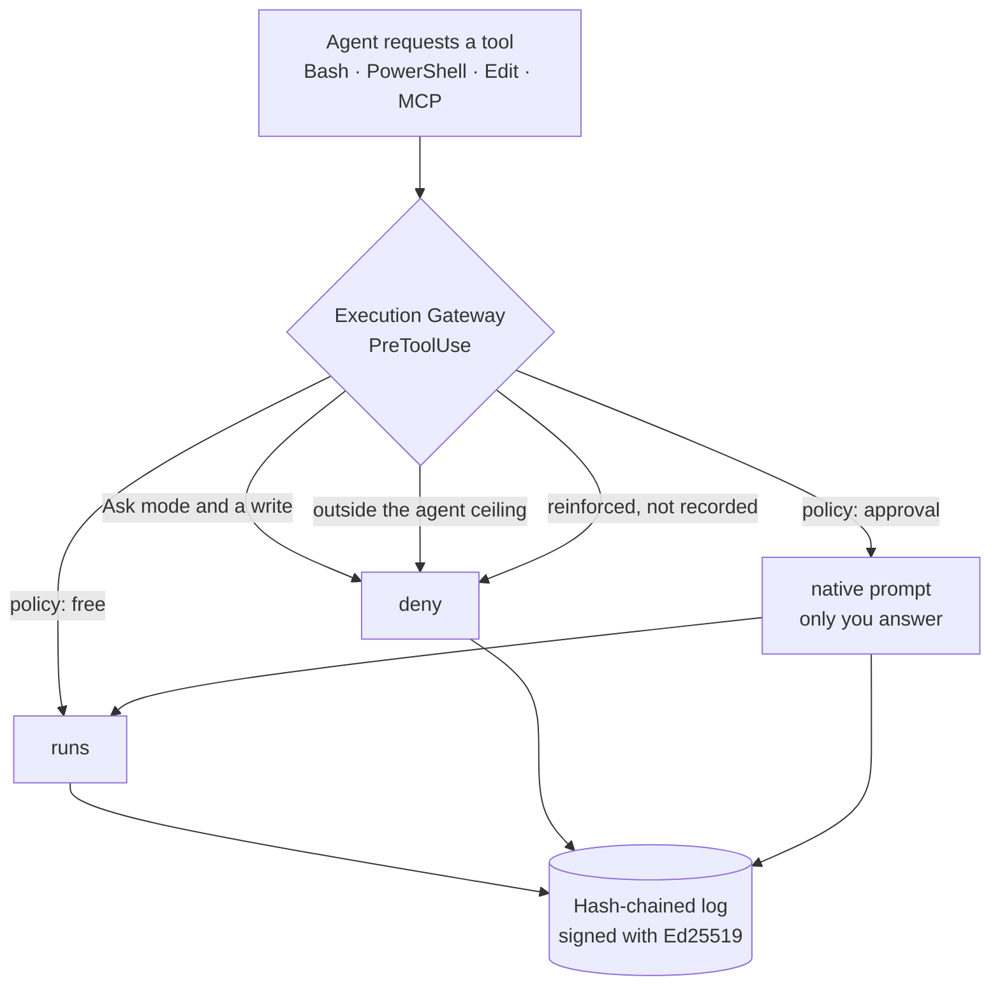
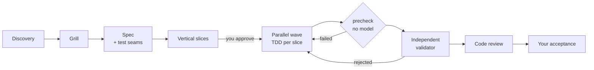

<p align="center"></p>

<p align="center"><b>English</b> · <a href="README.pt-BR.md">Português</a></p>

AISEF is a Claude Code plugin that turns a plain-language request into a specified feature: broken into vertical slices, implemented test-first by agents running in parallel, validated by a different agent and accepted by you. Every tool call goes through a policy enforced in code, and every step lands in a signed, tamper-evident log.

| 148 | 919 | 19 | ~0.2 s |
|---|---|---|---|
| consistency rules in `aisef-check` | automated checks, CI on Linux and Windows | recorded architecture decisions ([ADRs](docs/adr/README.md), Portuguese) | per tool call on Windows ([measured](tools/bench_hooks.py)) |

<p align="center"></p>
<p align="center"><sub>The live panel on demo data: who is running, who is waiting and why, which subagent each agent spawned, and the lanes over time.</sub></p>

## What's new

- **0.12.0, the team, best practices and architecture (port of everything-claude-code ideas).**
  - **66 agents from one catalog**, grouped by kind: executors, evaluators (code, architecture, database, security, tests, silent failures, types, comments and 16 language reviewers), fixers (simplifier, dead-code cleaner, performance and 13 build resolvers) and advisors (planner, architect, spec miner, explorer, docs lookup). Language agents are switched on only when their stack is detected. The `frontend` agent is unchanged.
  - **Architecture detection.** `aisef_project.py detect` finds the stack and the style (Clean, hexagonal, DDD, CQRS, MVC, modular monolith, microservices...), checks the dependency rule from imports and recommends improvements. Adopting a style is your decision and becomes an ADR.
  - **Best practices** (common, per architecture with "when not to use", per language) installed into `.claude/rules/aisef/`.
  - **Reviewers chosen in code**, all must approve before the validator, with a double review on high risk. Plus `verify-loop`, no `--no-verify`, and lint configs that agents cannot loosen.
- **0.10.0, panel v3.** The **execution map** is now the main view: one column per wave, every slice with its state, time and last action, and subagents attached to the agent that spawned them. A new hook records **who spawned whom**; when it cannot be sure, the link says "inferred".
  - Click a slice for its drawer. Click an agent or subagent for its own drawer: what it was asked, who spawned it, model, time and latest actions.
  - **Parallel lanes** mark rejections, gateway denials and decision requests at the exact moment.
  - The dependency graph is drawn natively and highlights the **critical path**.
  - Global search (`Ctrl K`), keyboard shortcuts, filters that survive a reload, light and dark with AA contrast checked, and a self-test in headless Chrome.
- **0.9.3, Ask researches the web.** `/aisef:ask` reads primary sources, cites URLs and picks the model by question: Haiku to find something in the project, Sonnet for research (the default), Opus only on request.

Full history in the [CHANGELOG](CHANGELOG.md) (Portuguese).

## One feature, two ways

Request: *"password reset by email; the link is valid for 30 minutes and can be used only once"*.

| With a bare prompt | With AISEF |
|---|---|
| The agent starts writing code right away. | AISEF states the phase: "We are in Specify. Next: Grill → Spec → Slices." |
| Table, endpoint and screen all at once; no test before the code. | **Grill:** three questions, one at a time, each with a recommendation (link lifetime? response for unknown emails? reusable link?). Nothing is invented. |
| It decides on its own that "the link lasts 24 h" and that "the response differs when the email does not exist". Neither was asked for, and the second leaks who has an account. | **Spec** with the test seams you confirmed (`POST /auth/reset`, `POST /auth/reset/confirm`). |
| It runs a command against the local database "to check the table". Nothing stops it, nothing records it. | Three **vertical slices**; you approve the plan. One call dispatches the wave: two slices in parallel to the `implementer`. |
| "Done, all tests pass": the tests were written after the code. | The agent tries `psql` and gets **deny** (a database from a session is treated as production). It is logged. |
| `git push` goes along, because the agent assumed you wanted it. | The `tdd_evidence` shows the test **failing before it passed**, and the check verifies the order. A different model validates. Code review, your acceptance, and `git push` goes through the native prompt that only you can answer. |

On the left, the work is fast and opaque. On the right, every decision was yours, every requirement has a test and evidence, and six months from now the panel and the log show exactly what happened.

## How it works

Skills tell the model what to do. The **gateway** decides what it **may** do.



The work follows Matt Pocock's method (grill → spec → tickets → TDD), with end-to-end traceability:



| Layer | What it does |
|---|---|
| **Process (SDD + TDD)** | Discovery, grill, spec, vertical slices, parallel test-first execution, independent validation, code review and your acceptance. Each requirement points to its slice, criterion, test and evidence (RTM). |
| **Enforcement** | A `PreToolUse` gateway applies the policy to Bash, PowerShell, file tools, WebFetch and MCP. Each Git operation needs its own approval, secrets ask, databases and deploys are denied, and each subagent is capped by its Agent Contract. |
| **Evidence** | Every operation and every blocked attempt goes to a hash-chained log signed with Ed25519. The signed head is kept outside the repository. |
| **Cost** | Model and effort are routed per task by risk and complexity, from Haiku to Opus; each failed attempt moves one level up. |
| **Learning** | Lessons drawn from errors already on record (rejections, blocks), which only apply after your approval and lose confidence when they stop helping. |

## The panel

<p align="center"></p>

Eight screens on an icon rail. Each one is derived from the contracts and the signed log, and none is a source of truth:

| Screen | What you see |
|---|---|
| **Now** | What runs and what waits, the execution map, decisions waiting for you with the command to copy, the next step, the parallel lanes and the slice table with TDD cycles |
| **Agent map** | The map and lanes full width, plus the tree of who spawned whom |
| **Features and slices** | Each feature's stage, its slices, the native dependency graph with the critical path and the delivered execution reports |
| **Traceability** | Requirement → slice → criterion → evidence, with a "gaps only" filter |
| **Governance** | Pending decisions, past decisions, architecture choices with discarded options, and risks |
| **History** | The hash-chained log, each event with its block and signature |
| **Engineering** | Architecture and data diagrams, endpoints, threats and migrations from the blueprint |
| **Agent team** | Who works on what, subagents in flight, approved lessons and dispatches per model |

A broken log puts a red banner on top and hides every approve command. Run it live with `build_panel.py --serve` (it refreshes every 3 s without losing scroll, filters or the open drawer) or as a static page.

## Where AISEF sits among the alternatives

Based on each project's README and official docs as of 2026-11-18. "Instruction" means the process relies on the model obeying; "enforced" means code prevents it.

| | Specs | Enforcement | TDD | Parallelism | Traceability | Audit | Cost by risk |
|---|---|---|---|---|---|---|---|
| **AISEF** | ● spec + slices | ● gateway, per-agent ceiling | ● red→green checked | ● waves + per-wave validation | ● requirement→evidence | ● hash + Ed25519 | ● L0–L6 |
| Spec Kit (150k★) | ● | ◐ extension hooks | – | – | ◐ | – | – |
| Superpowers (321k★) | ◐ | ◐ instruction + bootstrap | ● | ● | – | – | ◐ |
| BMAD (55k★) | ● | – instruction | ◐ | ◐ | ◐ IDs with source | – | – |
| OpenSpec (75k★) | ● | – instruction | – | – | ◐ | – | – |
| Kiro (AWS) | ● | ● hooks | ◐ | ● waves | – | – | – |
| Matt Pocock (327k★) | ● | – instruction | ● | ● | ◐ blocking edges | – | – |
| everything-claude-code (306k★) | ◐ | ● Node hooks | ● | ◐ | – | ◐ scanning | ◐ |
| Plain Claude Code | – | ● permissions and hooks | – | ● | – | – | ◐ manual |

● covers · ◐ partly · – not described

### Seven gaps nobody covers well, and AISEF's answer

| Gap | How AISEF covers it | Limit |
|---|---|---|
| Governance at tool-call time | The gateway decides allow, ask or deny on every call, with a per-agent ceiling | It reads commands by pattern: it reduces risk, it does not isolate. Pair it with `/sandbox` |
| Tamper-evident log | Each event carries the previous hash and an Ed25519 signature; the head lives outside the repo | It does not protect against someone holding your machine's private key |
| Requirement to evidence | The RTM links requirement → slice → criterion → test → evidence, and the check flags gaps | The quick maintenance path has lighter traceability |
| Validation with separate privileges | The validator only reads Git, never validates its own work and runs at an equal or higher level, preferably on another model | A large wave on one validator should be split |
| Model chosen by risk | A Haiku → Opus ladder driven by risk, sensitive resources, complexity and attempts | Claude Code environment variables can override it; the router warns |
| One place for decisions | Each decision is a request with impact, diff, rollback and risk; a reinforced approval covers the exact command, once | If you approve without reading, no technical layer stops it |
| Memory reviewed before it becomes a rule | Lessons from recorded errors, approved by you, with confidence computed in code | Without your review at milestones nothing is learned, by design |

### Adding up instead of competing

AISEF is the **spine** (governance, traceability, decisions and reviewed learning). The **muscle** comes from ready-made skills maintained by their authors:
- **Matt Pocock:** `grilling`, `domain-modeling`, `tdd` (preloaded in the `implementer` agent) and `code-review`.
- **Design:** UI/UX Pro Max, Taste and Impeccable, working inside a design authority you approve.
- **Code graphs:** codebase-memory-mcp (code) and Graphify (docs and decisions).

## Install

Requirements:
- Claude Code;
- Python 3.10+ with `pip install jsonschema cryptography`;
- on Windows, Git Bash (Claude Code already uses it for hooks).

```
/plugin marketplace add NowItMakesSense/aisef
/plugin install aisef@aisef
```

If the Python with `cryptography` is not the first one on your PATH, set `AISEF_PYTHON` to it (this also makes the hooks faster). To update an older install: `/plugin marketplace update aisef`, then `/plugin update aisef@aisef`.

## Start in 5 minutes

1. In a project folder, say **"start AISEF in this project"**. On an existing codebase, AISEF investigates before proposing anything.
2. Approve the agents and the native second-layer rules when asked.
3. Describe what you want. AISEF tells you which phase you are in and walks you through Grill → Spec → Slices up to the plan you approve.
4. Watch it live: `aisef-panel` opens the panel with the execution map, who spawned whom, the decisions waiting for you and the parallel lanes.
5. Just a question? `/aisef:ask <question>` answers without changing anything: it reads the project and, when the question calls for it, researches the web with cited sources, choosing the model by the question. `/aisef:modo ask` keeps the whole session read-only until `/aisef:modo exec`. See [how it compares to Cursor's Ask](docs/guide/ask-mode.md) (Portuguese).

To explore without spending tokens, follow the [walkthrough with the demo project](docs/guide/walkthrough.md) (Portuguese).

## What's inside

| Component | Role |
|---|---|
| Skills | `aisef` (orchestrator), `aisef-init`, `aisef-discovery`, `aisef-tooling`, `aisef-design`, `aisef-feature`, `aisef-approve`, `aisef-check`, `aisef-panel`, `ask`, `modo` |
| Agents | 66 roles from one catalog (`core/agents/catalog.v0.1.json`): executors (`implementer`, `backend`, `frontend`...), evaluators, fixers, advisors and the `validator`; stack-specific ones switch on with detection. Each has a permission ceiling |
| Hooks | gateway (`PreToolUse`), audit (`PostToolUse`), doctor (`SessionStart`), subagent events and who spawned whom (`PreToolUse` Agent), Ask-mode reminder |
| Core | JSON Schemas, permission and model policies, consistency checker, signed log, brief generators, batch dispatch, context packs, reviewed learning, live panel, stack and architecture detection, best practices, reviewer routing and verify-loop |

## Documentation

Start at [docs/README.md](docs/README.md) (Portuguese) for:
- concepts and the workflow;
- the policy, command and hook references;
- the generated list of check rules;
- the [architecture decisions](docs/adr/README.md);
- the [roadmap](docs/roadmap.md).

## Development

```
python -m venv .venv && .venv/Scripts/pip install -r requirements-dev.txt   # Windows
python run_tests.py
claude plugin validate plugins/aisef
claude plugin eval plugins/aisef --tag trigger --no-publish
```

The repository uses Graphify on itself (code, docs, ADRs and skills; structural pass only, nothing leaves the machine). Rebuild the graph after changing code or docs; `graphify-out/` is not versioned:

```
GRAPHIFY_BACKEND=none python -m graphify update .
python -m graphify query "how does the gateway decide on git push"
```

## License

MIT
