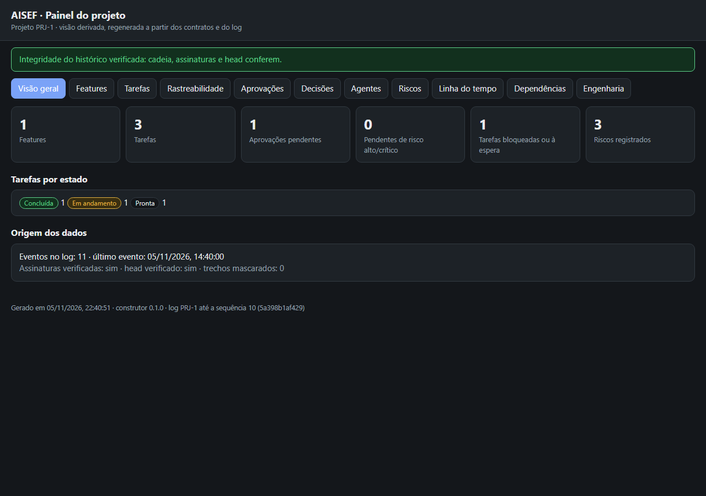

<p align="center"></p>

# AISEF

**English** · [Português](README.pt-BR.md)

AI-assisted software engineering with **autonomy in execution, rigor in validation and human control over the decisions that matter.** AISEF is a Claude Code plugin you install once and use in any project, new or existing. It combines a spec-driven workflow with governance that is **enforced, not just requested**: a permission gateway on every tool call, a tamper-evident signed audit log, and approvals that only you can give.



## Why AISEF

Most agent workflows either give you **process without enforcement** (skills that ask the model to behave) or **guardrails without process** (a hook that blocks a few commands). AISEF does both:

- **Process:** discovery, then Feature Contract, then Engineering Blueprint, then task contracts, then execution. Every task is validated by a different agent, and the feature closes with your acceptance. Requirements are traceable end to end (RTM), and more than 60 cross-document consistency rules are checked.
- **Enforcement:** a `PreToolUse` gateway applies the permission policy:
  - Each git operation needs its own approval (commit ≠ push ≠ merge).
  - Secret files ask for approval; databases and deploys are denied.
  - Each subagent is capped by its Agent Contract (the validator, for example, can only read git).
  - Destructive operations go up one approval level.
- **Evidence:** every operation and every blocked attempt goes to an append-only, hash-chained log signed with Ed25519. The signed head and periodic anchors are kept outside the repository, so rewriting or truncating the log is detected.

## Install

Requirements:

- Claude Code.
- Python 3.10+ with `pip install jsonschema cryptography`.
- On Windows, Git Bash (Claude Code already uses it for hooks).

In Claude Code:

```
/plugin marketplace add NowItMakesSense/aisef
/plugin install aisef@aisef
```

If the Python that has `cryptography` is not the first one on your PATH, set `AISEF_PYTHON` to it. Doing so also makes the hooks faster.

A `SessionStart` doctor tells you if something is missing, and stays silent otherwise.

## Use

1. In a project folder, say "start AISEF in this project". On an existing codebase, AISEF investigates before proposing anything.
2. Approve the agents and the native second-layer permission rules when asked.
3. Ask for work in plain language:
   - **Feature:** the model writes a ~20-line brief, and `aisef_new.py` expands it into valid contracts, tasks, RTM and a plan-approval request. You approve the plan, execution runs inside the approved scope, and the feature closes only with your acceptance.
   - **Small change** (typo, trivial fix, non-breaking dependency patch): goes through a quick maintenance path, with no blueprint and no extra approvals.
4. See everything in the panel (`aisef-panel`): features, tasks, traceability, approvals, decisions, risks, timeline, dependencies, and an engineering page with architecture and ER diagrams. It works offline.

A step-by-step walkthrough with the demo project is in [docs/walkthrough.md](docs/walkthrough.md) (Portuguese).

## What's inside

| Component | Role |
|---|---|
| Skills | `aisef` (orchestrator), `aisef-init`, `aisef-discovery`, `aisef-feature`, `aisef-approve`, `aisef-check`, `aisef-panel` |
| Agents | `backend`, `frontend`, `database`, `qa`, `security`, `devops`, `domain`, `validator`, each capped by an Agent Contract |
| Hooks | gateway (`PreToolUse`), audit (`PostToolUse`), doctor (`SessionStart`) |
| Core | 9 JSON Schemas, permission policy, `check_project.py`, signed audit chain, generators, panel |
| `AGENTS.md` template | the same rules as guidance for Codex, Cursor, Gemini and other tools |

## Honest limits

- **The gateway is not a security boundary.** It classifies commands by patterns and reduces risk. Pair it with the Claude Code sandbox (`/sandbox`) and the native permission rules it installs.
- **Approval relies on you.** It uses Claude Code's native permission prompt, which the model cannot answer, but nothing stops you from approving without reading. That is why the riskiest operations require a recorded reinforced approval *before* the prompt appears.
- **Hook latency.** Each tool call costs about 0.2–0.3 s on Windows, measured, mostly process startup.
- **Outside Claude Code there is no enforcement.** `AGENTS.md` is guidance only.

## Development

```
python -m venv .venv && .venv/Scripts/pip install jsonschema cryptography   # Windows
python run_tests.py                                  # 10 suites
claude plugin validate plugins/aisef
claude plugin eval plugins/aisef --tag trigger --scaffold --no-publish   # skill evals
```

Further reading:

- [docs/decisions.md](docs/decisions.md): every decision.
- [docs/pending.md](docs/pending.md): what is still open.
- [docs/aisef-context.md](docs/aisef-context.md): the original vision.

## License

MIT
