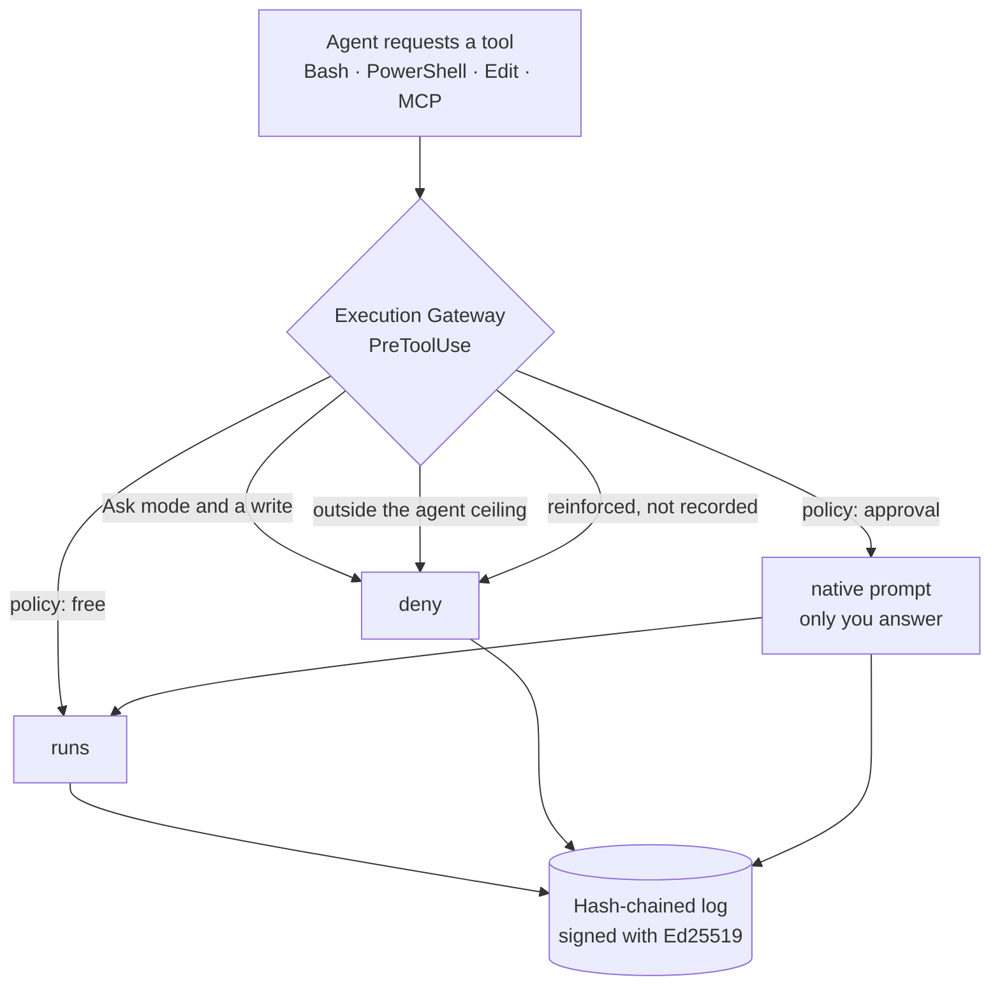
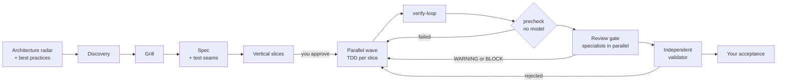

<p align="center"></p>

<p align="center"><b>English</b> · <a href="README.pt-BR.md">Português</a> · <a href="README.zh-CN.md">简体中文</a></p>

<h3 align="center">The evidence trail for AI-assisted engineering. Rules enforced in code, every step in a signed log, every requirement traced to its proof, and a package your auditor can verify on their own.</h3>

AISEF is a Claude Code plugin for teams that must show what the AI did, not just ship faster. A plain-language request becomes a specified feature: triaged in code, split into vertical slices, built test-first by agents in parallel, reviewed by specialists, validated by a different agent and accepted by you. Every tool call goes through a policy enforced in code, and every step lands in a signed, tamper-evident log that CI can verify on each pull request.

| **168** | **2,500+** | **168** | **66** | **~0.2 s** |
|---|---|---|---|---|
| consistency rules in `aisef-check` | automated checks, CI on Linux and Windows | gateway cases, 65 of them bypass attempts, all blocked ([limits](#what-the-gateway-does-not-guarantee)) | specialist agents (15 active on a new Python project) | gateway cost per tool call on Windows ([measured](tools/bench_hooks.py)) |

<p align="center"></p>
<p align="center"><sub>The live panel on demo data: who is running, who is waiting and why, which subagent each agent spawned, and the lanes over time.</sub></p>

## What only AISEF covers

| Need | What AISEF gives you |
|---|---|
| **Rules that hold** | An Execution Gateway decides allow, ask or deny on every tool call, in code. It reads commands token by token (`bash -c`, `eval`, `$(...)`, inline code), keeps the signing key out of reach, and caps each agent with its own permission ceiling. |
| **A log nobody can quietly edit** | Each event is hash-chained and signed with Ed25519; the head lives outside the repository. In a team, each person writes to their own stream with their own key, so merges never conflict and every approval carries the signature of whoever gave it. |
| **Every requirement traced to its proof** | Requirement → slice → acceptance criterion → test → evidence, checked by 168 rules. `aisef_sysgraph.py` answers "what does this requirement touch?" without a model. |
| **Proof on every pull request** | The `aisef-verify` GitHub Action fails the PR if the log was tampered with, if the log shrank since the base branch, if `aisef-check` finds an error, or if the PR touches a task nobody validated. |
| **Evidence your auditor can verify** | `aisef_evidence.py` packs a feature (contracts, reports, approvals, signed events, public keys) with a controls table for SOC 2 CC8.1 and ISO/IEC 27001:2022 A.8.32 and A.5.3. The package verifies itself, without the project. |
| **Observability you already use** | `aisef_otel.py` exports each feature as OpenTelemetry traces (OTLP/JSON) with the GenAI conventions: one span per agent attempt, one per tool call. |

AISEF is for teams in regulated settings and for anyone who has to show how an AI-made change was authorized, tested and approved. If you only want the fastest possible agent, plain Claude Code is cheaper; the "Measured" section below has the numbers.

## The toolbox

Everything below ships in one plugin, runs locally with the Python standard library, and works on Windows, macOS and Linux.

| | Tool | What it gives you | How you reach it |
|---|---|---|---|
| 🧭 | **Triage in code** | Picks the path for each change (quick, lean or full) from sensitive paths, change kinds, size and risk. The lean path is one TDD slice with no blueprint. Profiles (solo, team, regulated) set the defaults. You can move up a path, never down. | `aisef_triage.py` |
| 👥 | **Agent team** | 66 specialists: executors, reviewers, fixers and advisors, each with a signed permission ceiling. A new project starts with the core team plus your stack; the rest join on request. | automatic delegation, `aisef:<agent>` |
| 🧭 | **Architecture radar** | It finds your stack and your style (Clean, hexagonal, DDD, CQRS, modular monolith, microservices, MVC, vertical slices…). It checks the dependency rule and module boundaries from your imports, then recommends improvements. | `aisef_project.py detect` |
| 📚 | **Best-practice library** | 33 rules: common ones (Clean Code, SOLID, testing, security, Git), one per architecture style with a "when not to use it" section, and one per language. | `aisef_setup.py --apply` (during init) |
| 🔍 | **Review gate** | Reviewers are picked in code for each task: general, language, database, security, architecture and tests. All of them must approve before the validator runs. High-risk tasks get two independent reviews. | automatic in every wave |
| ✅ | **verify-loop** | Build → types → lint → tests → secrets in the diff → diff summary, ending in PASS or FAIL, with evidence saved for the task. | `aisef_project.py verify-loop` |
| 🛡️ | **Execution Gateway** | Every tool call gets allow, ask or deny, enforced in code. Each Git operation needs its own approval. No `--no-verify`. Databases and deploys are denied. Agents cannot loosen lint configs. | always on (hook) |
| 🧾 | **Signed audit log** | Lifecycle, decisions, shell commands and every blocked or questioned call go into a hash-chained log signed with Ed25519; file edits go to a hash-chained telemetry. One stream per person in a team. | `aisef-check`, `aisef_streams.py` |
| ✔️ | **CI verification** | The `aisef-verify` Action checks the log, the consistency rules and the tasks touched by each pull request, with a job summary. | `.github/actions/aisef-verify` |
| 📦 | **Evidence package** | A self-verifying package per feature, with SOC 2 and ISO 27001 controls mapped to the evidence. | `aisef_evidence.py build` |
| 🔭 | **OpenTelemetry export** | Features as traces with GenAI attributes, for the observability stack you already run. | `aisef_otel.py export` |
| 🗳️ | **Approval Center** | Each decision shows its impact, diff, rollback and risk. Only you decide, through the native prompt. | `aisef-approve` |
| 📊 | **Live panel** | Execution map, who spawned whom, decisions waiting for you, traceability, parallel lanes. | `aisef-panel` |
| 💸 | **Model router and budget** | Haiku → Sonnet → Opus, chosen by risk and complexity. The continuous loop stops on a feature budget (time, tokens, dispatches), on the same failure twice, and on a stalled agent. | automatic |
| 🌳 | **Worktree per slice** | Slices that touch the same file run side by side, each in its own worktree; the merge goes through the feature scope and a conflict becomes a new attempt. | `parallel.mode = worktree` |
| 🧠 | **Reviewed learning** | Lessons drawn from errors already on record. They apply only after you approve them and lose confidence when they stop helping. | `aisef_learn.py` |
| 🎨 | **Design authority** | One approved typography, palette and component set per project, checked in the code. | `aisef-design` |
| ❓ | **Ask mode** | Answers questions without changing anything, researching the web with cited sources. | `/aisef:ask` |
| 🧪 | **Outcome benchmark** | Hidden tests, AISEF vs. plain Claude Code, with cost and time. | `tools/bench_outcomes.py` |

## Meet the team

Agents load only when they apply. A new project starts with the core team (13 subagents: the builders, the reviewers that run on every task, the validator and three advisors) plus the language and framework agents the radar detects, so a Python project starts with 15 and never pays for the Swift reviewer. The extended team joins when you ask or when the work calls for it.

| Kind | What they do | Agents |
|---|---|---|
| **Builders** (7) | Implement inside the task contract, test-first | `implementer` (whole vertical slices with TDD), `backend`, `frontend`, `database`, `devops`, `doc-updater`, `e2e-runner` |
| **Reviewers** (10) | Report with proof; never touch the code | `code-reviewer`, `architecture-reviewer`, `database-reviewer`, `security`, `qa`, `pr-test-analyzer`, `silent-failure-hunter`, `type-design-analyzer`, `comment-analyzer`, `agent-evaluator` |
| **Language reviewers** (19) | Idioms, security and pitfalls of your stack | Python, Django, FastAPI, TypeScript/JavaScript, React, Vue, Go, Rust, Java (Spring/Quarkus), Kotlin, Swift, C#, F#, C++, PHP/Laravel, Ruby/Rails, Flutter, Godot, plus `a11y-architect` (WCAG 2.2) |
| **Fixers** (16) | Smallest diff that works; never loosen a rule to pass | `code-simplifier`, `refactor-cleaner`, `performance-optimizer`, and 13 build resolvers (TS/JS, Python, Django, Go, Rust, Java, Kotlin, Swift, Dart/Flutter, C++, PyTorch, HarmonyOS, React) |
| **Advisors** (10) | Investigate and propose; you decide | `planner`, `architect`, `code-architect`, `code-explorer`, `spec-miner` (specs out of legacy code), `domain`, `docs-lookup`, `commit-reviewer`, `conversation-analyzer`, `harness-optimizer` |
| **Domain reviewers** (3) | Switched on when the domain shows up | `rag-pipeline-reviewer`, `mle-reviewer`, `healthcare-reviewer` |
| **Validator** (1) | Independent; never validates its own work; read-only Git | `validator` |

Every reviewer follows the same discipline:
- it reports only findings it is more than 80% sure of;
- CRITICAL and HIGH findings need the line, the failure scenario and the reason existing guards miss it;
- zero findings is a valid result.

Every fixer works under one rule: no `any`, no `# noqa`, no skipped tests to make the build pass.

## The architecture radar

```
$ python aisef_project.py detect --project .
Stacks: TypeScript, React, C# / .NET (manager: npm)
Architecture (heuristic, confirm with the user):
  - DDD strategic: confidence 0.89 (folder backend/src/Shop.SharedKernel; file docs/glossary.md)
  - Modular monolith: confidence 0.80 (3 modules in backend/src/Modules/; module with layers: Orders)
  - Clean Architecture / Onion: confidence 0.67 (folder .../Shop.Orders.Domain; folder .../Shop.Orders.Application)
  - Vertical slices: confidence 0.67 (folder frontend/src/features; folder frontend/src/shared)
Module boundaries: 3 module(s), 204 file(s) scanned, 2 cross-module dependencies:
  suggestions -> accounts (application); suggestions -> accounts (domain, VIOLATION)
Recommendations (your decision):
  - REC-DEPENDENCY-RULE: Fix the dependency rule. Suggestions.Infrastructure/EfCatalog.cs:2 imports Shop.Accounts.Domain
Applicable practices: common, lang/typescript, lang/web, lang/csharp, architecture/modular-monolith, architecture/clean-architecture, ...
```

The radar was measured on 10 public reference repositories (Clean Architecture templates, eShop, modular-monolith-with-ddd, domain-driven-hexagon and others). It got 9 of them right, with no false dependency violations.

It never changes anything on its own. You adopt a style through the Approval Center, and from then on the `architecture-reviewer` holds every delivery to it. Each practice says when **not** to use it, so AISEF will not push DDD or CQRS onto a simple CRUD app.

## Measured, not claimed

`tools/bench_outcomes.py` runs the same task three ways. The tests are hidden from the agent and only run after it finishes. Results for `feat-slugify`, Sonnet, 3 repetitions:

| Arm | Hidden tests | Median cost | Median time |
|---|---|---|---|
| Plain Claude Code | 3/3 runs at 7/7 | US$ 0.13 | 26 s |
| AISEF with the review gate | 3/3 runs at 7/7 | US$ 1.49 | 335 s |
| AISEF without reviewers | 3/3 runs at 7/7 | US$ 1.32 | 333 s |

The review gate adds about 13% per slice, which is within run-to-run noise. On a task this small, the full process costs about 11× more than plain Claude Code. What you pay for is the spec, the TDD evidence, independent validation, review and the signed record. Quality gains on larger, real features are being measured next.

Features from 0.13 on are covered by CI, including a test that runs a whole feature cycle through all 48 combinations of profile, path, parallelism, telemetry and per-person log. They have not run in a real project yet. The [maturity table](docs/reference/maturity.md) shows the level of each one, whether it is on by default, and how to turn it back.

## What's new

- **0.16.0, a panel you can trust and another session in the same project.** The panel shows accepted features as accepted, maps agents to the slice they worked on with a per-feature timeline and an overview in cards, and only raises the gateway alarm when it matters. Two Claude Code sessions in the same project now see each other, reserve separate areas, and get warned before editing or committing over the other's work.
- **0.15.5, the remote before the first push.** `next` and the doctor flag a project with no Git repository or no remote, and the init asks whether the project already exists on GitHub before creating one. Adding or changing a remote, and creating a GitHub repository, are now your decision.
- **0.15.4, panel.** A single card in the right column keeps half the map's height instead of stretching to the full height.
- **0.15.3, panel fixes.** The live indicator shows how long the panel has been open, elapsed times keep moving between updates, and on the Now screen the execution map has a fixed height that the decisions and the attention card split evenly.
- **0.15.2, what is proven and what is not.** A maturity table tells real-use features from CI-only ones, with the default and the way back for each. A new test runs a whole feature cycle through all 48 mode combinations. The README numbers are now checked against the code.
- **0.15.1, attention cost and impact in the panel.** The Now screen shows how often you had to stop (approvals and gateway prompts per completed task, first-pass validation, tokens per task), and Traceability gains an "Impact of" filter: type a requirement, task or file and see only the requirements it touches.
- **0.15.0, for teams and auditors.** The `aisef-verify` GitHub Action on every pull request, a self-verifying evidence package per feature with SOC 2 and ISO 27001 controls, OpenTelemetry export with the GenAI conventions, one audit log per person (merges never conflict, approvals signed by whoever gave them), and a roadmap checked against the changelog.
- **0.14.0, the system as a graph, the flow as data, slices in their own worktrees.**
  - no core or hook module is over 500 lines anymore; `aisef_project` keeps the same API, and the check runs a registry of rule groups;
  - `aisef_sysgraph.py` answers impact questions without a model: which tasks, criteria, tests, files and evidence a requirement touches, and why a task exists;
  - the flow (task states, events, phases, gates, profiles) lives in `workflow.v0.1.json`, read by the loop, the guide, the triage and the check;
  - file edits and allowed MCP calls go to a hash-chained telemetry, so the signed log keeps what proves the work;
  - with `parallel.mode = worktree`, slices that share a file run side by side in their own worktrees, merge through the feature scope, and a merge conflict becomes a new attempt. Hooks inside a worktree write to the main `.aisef`;
  - `metrics` reports the attention cost: how many times you had to stop, per finished task.
- **0.13.0, less friction, harder gateway, a loop that knows when to stop.**
  - code triage picks the path (quick, lean or full); the new lean path is one TDD slice with no blueprint, and ceremony profiles (solo, team, regulated) set the defaults;
  - a Python project starts with 15 agents instead of 33, and the init applies agents, native rules, practices and docs in one approval;
  - the gateway reads commands token by token (`bash -c`, `eval`, `$(...)`, inline code), and a 138-command corpus with 48 bypass attempts guards it. It also closed real gaps: a `git -c` force push only asked, and the signing key and head anchor were reachable;
  - Git by risk: commits on `feat/*` are free, and the feature push is covered by the feature scope. MCP tools can be trusted for up to 7 days;
  - the continuous loop stops on budget, on repeated identical failures and on stalled agents. Hooks record task start and end, `check --fix` suggests the fix, and `rebase-req` follows a changed requirement;
  - a native import graph when Graphify is missing, a doctor that finds the right Python, `migrate` and the native sandbox.
- **0.12.1, field-tested fixes.** These came from running 0.12 on a real project:
  - architecture decisions can apply to the whole project, so you can adopt a style before the first feature exists;
  - the radar checks module boundaries and no longer counts skeleton services as microservices;
  - the gateway no longer blocks read-only commands that touch the audit folder (`grep`, `git check-ignore`, `--dry-run`).
- **0.12.0, the team, the radar and the practices.** 56 new agents, organized by kind and switched on by stack. Architecture detection with recommendations. 33 best-practice rules. Reviewers chosen in code, with a gate before validation. `verify-loop`. Lint configs that agents cannot loosen. Ideas ported from [everything-claude-code](https://github.com/affaan-m/everything-claude-code) (MIT, see [notices](THIRD_PARTY_NOTICES.md)).
- **0.11.0, measure.** `metrics` (approvals, rejections, lead time, tokens and cost per task) and the outcome benchmark.
- **0.10.0, panel v3.** The execution map, who spawned whom, parallel lanes, and the dependency graph with the critical path.

Full history in the [CHANGELOG](CHANGELOG.md) (Portuguese).

## One feature, two ways

Request: *"password reset by email; the link is valid for 30 minutes and can be used only once"*.

| With a bare prompt | With AISEF |
|---|---|
| The agent starts writing code right away. | AISEF states the phase: "We are in Specify. Next: Grill → Spec → Slices." |
| Table, endpoint and screen all at once; no test before the code. | **Grill:** three questions, one at a time, each with a recommendation (link lifetime? response for unknown emails? reusable link?). Nothing is invented. |
| It decides on its own that "the link lasts 24 h" and that "the response differs when the email does not exist". Neither was asked for, and the second leaks who has an account. | **Spec** with the test seams you confirmed (`POST /auth/reset`, `POST /auth/reset/confirm`). |
| It runs a command against the local database "to check the table". Nothing stops it, nothing records it. | Three **vertical slices**; you approve the plan. One call dispatches the wave: two slices in parallel to the `implementer`. |
| "Done, all tests pass": the tests were written after the code. | The agent tries `psql` and gets **deny** (a database from a session is treated as production). It is logged. |
| `git push` goes along, because the agent assumed you wanted it. | The `tdd_evidence` shows the test **failing before it passed**, and the check verifies the order. Specialist reviewers approve, then a different model validates. Your acceptance, and `git push` goes through the native prompt that only you can answer. |

On the left, the work is fast and opaque. On the right, every decision was yours, every requirement has a test and evidence, and six months from now the panel and the log show exactly what happened.

## How it works

Skills tell the model what to do. The **gateway** decides what it **may** do.

### What the gateway does not guarantee

The gateway is a hook that runs as your own OS user. It reads each tool call, so it catches what it can read: it does not see what a script written now does when it runs later, and a command it cannot read becomes a question, not an allow. The hard boundary is the OS: turn on Claude Code's native sandbox (Linux, macOS, WSL2) or run the agents in a devcontainer. The `team` and `regulated` profiles write a strict sandbox into the project settings (no `dangerouslyDisableSandbox` escape, no reads of `~/.aisef`), and the doctor warns while it is not in effect. On native Windows the sandbox does not exist: use WSL2 or a devcontainer.



The work follows Matt Pocock's method (grill → spec → tickets → TDD), with end-to-end traceability:



| Layer | What it does |
|---|---|
| **Process (SDD + TDD)** | Architecture radar, discovery, grill, spec, vertical slices, parallel test-first execution, the review gate, independent validation and your acceptance. Each requirement points to its slice, criterion, test and evidence (RTM). |
| **Enforcement** | A `PreToolUse` gateway applies the policy to Bash, PowerShell, file tools, WebFetch and MCP. Each Git operation needs its own approval, secrets ask, databases and deploys are denied, and each subagent is capped by its Agent Contract. |
| **Evidence** | Every operation and every blocked attempt goes to a hash-chained log signed with Ed25519. The signed head is kept outside the repository. |
| **Cost** | Model and effort are routed per task by risk and complexity, from Haiku to Opus; each failed attempt moves one level up. |
| **Learning** | Lessons drawn from errors already on record (rejections, blocks), which only apply after your approval and lose confidence when they stop helping. |

## The panel

<p align="center"></p>

Eight screens on an icon rail. Each one is derived from the contracts and the signed log, and none is a source of truth:

| Screen | What you see |
|---|---|
| **Now** | What runs and what waits, the execution map, decisions waiting for you with the command to copy, the next step, the parallel lanes and the slice table with TDD cycles |
| **Agent map** | The map and lanes full width, plus the tree of who spawned whom |
| **Features and slices** | Each feature's stage, its slices, the native dependency graph with the critical path and the delivered execution reports |
| **Traceability** | Requirement → slice → criterion → evidence, with a "gaps only" filter |
| **Governance** | Pending decisions, past decisions, architecture choices with discarded options, and risks |
| **History** | The hash-chained log, each event with its block and signature |
| **Engineering** | Architecture and data diagrams, endpoints, threats and migrations from the blueprint |
| **Agent team** | Who works on what, subagents in flight, approved lessons and dispatches per model |

A broken log puts a red banner on top and hides every approve command. Run it live with `build_panel.py --serve` (it refreshes every 3 s without losing scroll, filters or the open drawer) or as a static page.

## Where AISEF sits among the alternatives

Based on each project's README and official docs as of 2026-11-18. "Instruction" means the process relies on the model obeying; "enforced" means code prevents it.

| | Specs | Enforcement | TDD | Parallelism | Traceability | Audit | Cost by risk |
|---|---|---|---|---|---|---|---|
| **AISEF** | ● spec + slices | ● gateway, per-agent ceiling | ● red→green checked | ● waves + per-wave validation | ● requirement→evidence | ● hash + Ed25519 | ● L0–L6 |
| Spec Kit (150k★) | ● | ◐ extension hooks | – | – | ◐ | – | – |
| Superpowers (321k★) | ◐ | ◐ instruction + bootstrap | ● | ● | – | – | ◐ |
| BMAD (55k★) | ● | – instruction | ◐ | ◐ | ◐ IDs with source | – | – |
| OpenSpec (75k★) | ● | – instruction | – | – | ◐ | – | – |
| Kiro (AWS) | ● | ● hooks | ◐ | ● waves | – | – | – |
| Matt Pocock (327k★) | ● | – instruction | ● | ● | ◐ blocking edges | – | – |
| everything-claude-code (306k★) | ◐ | ● Node hooks | ● | ◐ | – | ◐ scanning | ◐ |
| Plain Claude Code | – | ● permissions and hooks | – | ● | – | – | ◐ manual |

● covers · ◐ partly · – not described

### Seven gaps nobody covers well, and AISEF's answer

| Gap | How AISEF covers it | Limit |
|---|---|---|
| Governance at tool-call time | The gateway decides allow, ask or deny on every call, with a per-agent ceiling | It reads commands by tokens and patterns: it reduces risk, it does not isolate. Pair it with the native sandbox, which the init turns on where it exists |
| Tamper-evident log | Each event carries the previous hash and an Ed25519 signature; the head lives outside the repo | It does not protect against someone holding your machine's private key |
| Requirement to evidence | The RTM links requirement → slice → criterion → test → evidence, and the check flags gaps | The quick maintenance path has lighter traceability |
| Validation with separate privileges | The validator only reads Git, never validates its own work and runs at an equal or higher level, preferably on another model | A large wave on one validator should be split |
| Model chosen by risk | A Haiku → Opus ladder driven by risk, sensitive resources, complexity and attempts | Claude Code environment variables can override it; the router warns |
| One place for decisions | Each decision is a request with impact, diff, rollback and risk; a reinforced approval covers the exact command, once | If you approve without reading, no technical layer stops it |
| Memory reviewed before it becomes a rule | Lessons from recorded errors, approved by you, with confidence computed in code | Without your review at milestones nothing is learned, by design |

### Adding up instead of competing

AISEF is the **spine** (governance, traceability, decisions and reviewed learning). The **muscle** comes from ready-made skills maintained by their authors:
- **Matt Pocock:** `grilling`, `domain-modeling`, `tdd` (preloaded in the `implementer` agent) and `code-review`.
- **Design:** UI/UX Pro Max, Taste and Impeccable, working inside a design authority you approve.
- **Code graphs:** codebase-memory-mcp (code) and Graphify (docs and decisions).

## Install

Requirements:
- Claude Code;
- Python 3.10+ with `pip install jsonschema cryptography`;
- on Windows, Git Bash (Claude Code already uses it for hooks).

```
/plugin marketplace add NowItMakesSense/aisef
/plugin install aisef@aisef
```

If the Python with `cryptography` is not the first one on your PATH, set `AISEF_PYTHON` to it (this also makes the hooks faster). To update an older install: `/plugin marketplace update aisef`, then `/plugin update aisef@aisef`.

## Start in 5 minutes

1. In a project folder, say **"start AISEF in this project"**. On an existing codebase, AISEF investigates before proposing anything.
2. Approve the agents and the native second-layer rules when asked. On an existing codebase, the **architecture radar** runs and presents your stack, your style and its recommendations. You adopt a style and install the matching **best practices** with one approval each.
3. Describe what you want. AISEF tells you which phase you are in and walks you through Grill → Spec → Slices up to the plan you approve.
4. Watch it live: `aisef-panel` opens the panel with the execution map, who spawned whom, the decisions waiting for you and the parallel lanes.
5. Just a question? `/aisef:ask <question>` answers without changing anything: it reads the project and, when the question calls for it, researches the web with cited sources, choosing the model by the question. `/aisef:modo ask` keeps the whole session read-only until `/aisef:modo exec`. See [how it compares to Cursor's Ask](docs/guide/ask-mode.md) (Portuguese).

To explore without spending tokens, follow the [walkthrough with the demo project](docs/guide/walkthrough.md) (Portuguese).

## What's inside

| Component | Role |
|---|---|
| Skills | `aisef` (orchestrator), `aisef-init`, `aisef-discovery`, `aisef-tooling`, `aisef-design`, `aisef-feature`, `aisef-approve`, `aisef-check`, `aisef-panel`, `ask`, `modo` |
| Agents | 66 roles from one catalog (`core/agents/catalog.v0.1.json`): executors (`implementer`, `backend`, `frontend`...), evaluators, fixers, advisors and the `validator`; stack-specific ones switch on with detection. Each has a permission ceiling |
| Hooks | gateway (`PreToolUse`), audit (`PostToolUse`), doctor (`SessionStart`), subagent events and who spawned whom (`PreToolUse` Agent), Ask-mode reminder |
| Core | JSON Schemas, permission and model policies, consistency checker, signed log, brief generators, batch dispatch, context packs, reviewed learning, live panel, stack and architecture detection, best practices, reviewer routing and verify-loop |

## Documentation

Start at [docs/README.md](docs/README.md) (Portuguese) for:
- concepts and the workflow;
- the policy, command and hook references;
- the generated list of check rules;
- the [architecture decisions](docs/adr/README.md);
- the [roadmap](docs/roadmap.md).

## Development

```
python -m venv .venv && .venv/Scripts/pip install -r requirements-dev.txt   # Windows
python run_tests.py
claude plugin validate plugins/aisef
claude plugin eval plugins/aisef --tag trigger --no-publish
```

The repository uses Graphify on itself (code, docs, ADRs and skills; structural pass only, nothing leaves the machine). Rebuild the graph after changing code or docs; `graphify-out/` is not versioned:

```
GRAPHIFY_BACKEND=none python -m graphify update .
python -m graphify query "how does the gateway decide on git push"
```

## License

MIT
