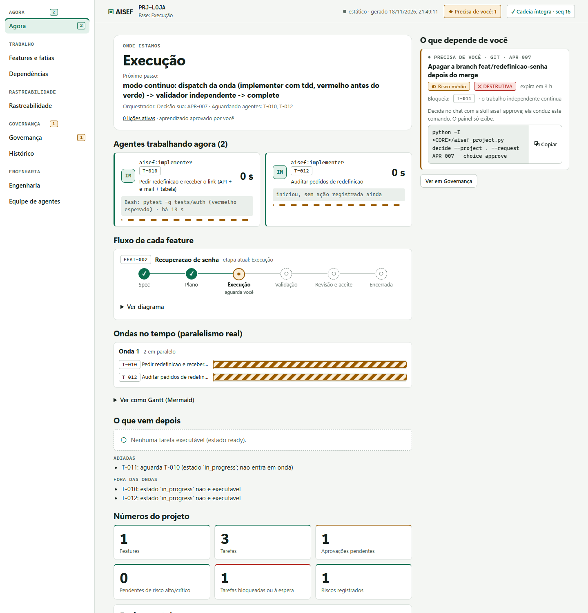
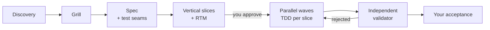

<p align="center"></p>

# AISEF

**English** · [Português](README.pt-BR.md)

**AI-assisted software engineering with autonomy in execution, rigor in validation and human control over the decisions that matter.**

AISEF is a Claude Code plugin you install once and use in any project, new or existing. It turns plain-language requests into specified, agent-executed, independently validated work, under a permission policy that is **enforced on every tool call, not just requested** and a tamper-evident signed audit log.



## Why

Most agent workflows give you either **process without enforcement** (skills that ask the model to behave) or **guardrails without process** (a hook that blocks a few commands). AISEF does both, and keeps the evidence:

| | What you get |
|---|---|
| **Process (SDD + TDD)** | Discovery → Grill → Spec with agreed test seams → vertical slices → parallel execution with red-then-green TDD → independent validation → code review → your acceptance. The red-before-green evidence is checked, not just requested. Requirements are traced end to end (RTM); more than 140 consistency rules are checked. |
| **Enforcement** | A `PreToolUse` gateway applies the permission policy to Bash, PowerShell, file tools, WebFetch and MCP. Each Git operation needs its own approval, secrets ask, databases and deploys are denied, and each subagent is capped by its Agent Contract. |
| **Evidence** | Every operation and every blocked attempt goes to a hash-chained log signed with Ed25519, with the signed head kept outside the repository. |
| **Cost control** | Model and effort are routed per task by risk and complexity, cheapest first; each failed attempt moves one level up. |

## How it flows



Small changes (typo, trivial fix, non-breaking dependency patch) take a quick maintenance path with no blueprint. Once a plan is approved, **continuous mode** keeps going on its own and stops only when it needs you.

## Install

Requirements:
- Claude Code;
- Python 3.10+ with `pip install jsonschema cryptography`;
- on Windows, Git Bash (Claude Code already uses it for hooks).

```
/plugin marketplace add NowItMakesSense/aisef
/plugin install aisef@aisef
```

If the Python with `cryptography` is not the first on your PATH, set `AISEF_PYTHON` to it (this also makes the hooks faster). A `SessionStart` doctor tells you if something is missing and stays silent otherwise.

## Start in 5 minutes

1. In a project folder, say **"start AISEF in this project"**. On an existing codebase, AISEF investigates before proposing anything.
2. Approve the agents and the native second-layer rules when asked.
3. Ask for a feature in plain language. You approve the plan; execution runs inside the approved scope; the feature closes only with your acceptance.
4. Watch it live in the panel (`aisef-panel`): what each agent is doing now, the next step, the flow of each feature and the parallel waves.
5. Just a question? `/aisef:ask <question>` answers in a cheap read-only Haiku subagent; `/aisef:modo ask` keeps the whole session read-only (enforced by the gateway) until `/aisef:modo exec`.

To explore without spending tokens, follow the [walkthrough with the demo project](docs/guide/walkthrough.md) (Portuguese).

## What's inside

| Component | Role |
|---|---|
| Skills | `aisef` (orchestrator), `ask` and `modo` (Ask mode), `aisef-init`, `aisef-discovery`, `aisef-tooling`, `aisef-design` (one design authority per project), `aisef-feature`, `aisef-approve`, `aisef-check`, `aisef-panel` |
| Agents | `implementer` (vertical slices with TDD), `backend`, `frontend`, `database`, `qa`, `security`, `devops`, `domain`, `validator`, each capped by an Agent Contract and generated from one source |
| Hooks | gateway (`PreToolUse`), audit (`PostToolUse`), doctor (`SessionStart`) |
| Core | 9 JSON Schemas, permission and model policies, consistency checker, signed audit chain, brief generators, wave planner, context packs, panel |

## Honest limits

- **The gateway is not a security boundary.** It classifies commands by patterns and reduces risk. Pair it with the Claude Code sandbox (`/sandbox`) and the native rules it installs.
- **Approval relies on you.** The model cannot answer the native permission prompt, but nothing stops you from approving without reading. That is why the riskiest operations need a recorded reinforced approval *before* the prompt appears.
- **Hook latency.** About 0.2–0.3 s per hook on Windows, mostly process startup (`python tools/bench_hooks.py`).
- **Claude Code only.** Elsewhere, `AGENTS.md` is guidance, not enforcement.

## Documentation

Start at [docs/README.md](docs/README.md) for concepts, the workflow, the policy reference, commands, hooks, the generated list of check rules, the [architecture decisions](docs/adr/README.md) and the [roadmap](docs/roadmap.md).

## Development

```
python -m venv .venv && .venv/Scripts/pip install -r requirements-dev.txt   # Windows
python run_tests.py
claude plugin validate plugins/aisef
claude plugin eval plugins/aisef --tag trigger --no-publish
```

## License

MIT
