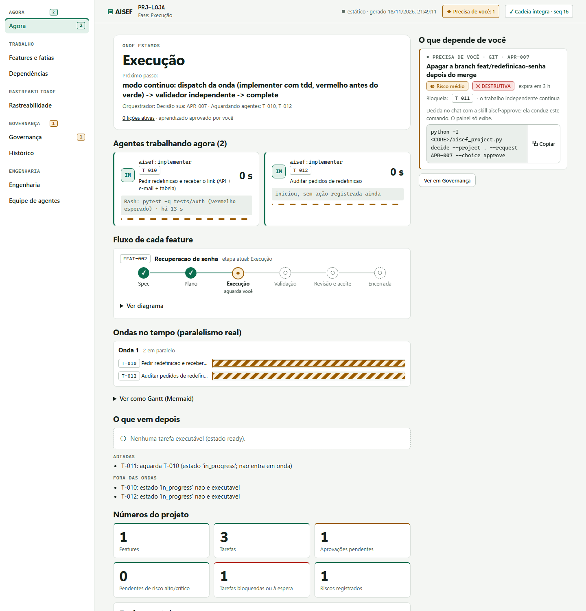
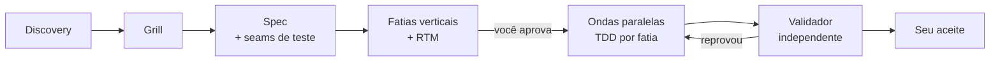

<p align="center"></p>

# AISEF

[English](README.md) · **Português**

**Engenharia de software assistida por IA, com autonomia na execução, rigor na validação e controle humano nas decisões importantes.**

O AISEF é um plugin do Claude Code que você instala uma vez e usa em qualquer projeto, novo ou já iniciado. Ele transforma pedidos em linguagem natural em trabalho especificado, executado por agentes e validado de forma independente. Tudo isso sob uma política de permissões **aplicada em cada chamada de ferramenta, e não apenas pedida ao modelo**, e com um log de auditoria assinado que denuncia adulteração.



## Por quê

A maioria dos workflows com agentes oferece **processo sem aplicação** (skills que pedem ao modelo que se comporte) ou **barreiras sem processo** (um hook que bloqueia alguns comandos). O AISEF faz as duas coisas e guarda a evidência:

| | O que você ganha |
|---|---|
| **Processo (SDD + TDD)** | Discovery → Grill → Spec com seams de teste combinados → fatias verticais → execução paralela com TDD (vermelho antes do verde) → validação independente → code review → o seu aceite. A evidência de vermelho antes do verde é checada, não só pedida. Requisitos rastreados de ponta a ponta (RTM) e mais de 140 regras de consistência checadas. |
| **Aplicação técnica** | Um gateway `PreToolUse` aplica a política a Bash, PowerShell, ferramentas de arquivo, WebFetch e MCP. Cada operação Git pede a própria aprovação, segredos pedem aprovação, banco e deploy são negados e cada subagente fica limitado pelo seu Agent Contract. |
| **Evidência** | Toda operação e toda tentativa bloqueada vão para um log encadeado por hash e assinado com Ed25519, com o head assinado guardado fora do repositório. |
| **Controle de custo** | Modelo e effort escolhidos por tarefa, conforme risco e complexidade, do mais barato para cima; cada tentativa que falha sobe um nível. |

## Como flui



Mudanças pequenas (typo, ajuste trivial, patch de dependência sem quebra) vão por um caminho rápido de manutenção, sem blueprint. Com o plano aprovado, o **modo contínuo** segue sozinho e só para quando precisa de você.

## Instalação

Pré-requisitos:
- Claude Code;
- Python 3.10 ou mais novo, com `pip install jsonschema cryptography`;
- no Windows, o Git Bash (o Claude Code já o usa para rodar os hooks).

```
/plugin marketplace add NowItMakesSense/aisef
/plugin install aisef@aisef
```

Se o Python que tem o `cryptography` não for o primeiro do PATH, defina `AISEF_PYTHON` com o caminho dele. Isso também deixa os hooks mais rápidos. No início de cada sessão, um doctor avisa se falta alguma coisa; quando está tudo certo, ele não diz nada.

## Comece em 5 minutos

1. Na pasta do projeto, peça **"iniciar o AISEF neste projeto"**. Num projeto existente, o AISEF investiga antes de propor qualquer coisa.
2. Quando ele pedir, aprove os agentes e as regras nativas de segunda camada.
3. Peça uma feature em linguagem natural. Você aprova o plano, a execução acontece dentro do escopo aprovado e a feature só fecha com o seu aceite.
4. Acompanhe ao vivo no painel (`aisef-panel`): o que cada agente está fazendo agora, o próximo passo, o fluxo de cada feature e as ondas em paralelo.
5. Só uma dúvida? `/aisef:ask <pergunta>` responde num subagente Haiku só de leitura, barato; `/aisef:modo ask` deixa a sessão inteira só de leitura (aplicado pelo gateway) até `/aisef:modo exec`.

Para explorar sem gastar tokens, siga o [passo a passo com o projeto de demonstração](docs/guide/walkthrough.md).

## O que vem dentro

| Componente | Papel |
|---|---|
| Skills | `aisef` (orquestrador), `ask` e `modo` (modo Ask), `aisef-init`, `aisef-discovery`, `aisef-tooling`, `aisef-design` (uma autoridade de design por projeto), `aisef-feature`, `aisef-approve`, `aisef-check`, `aisef-panel` |
| Agentes | `implementer` (fatias verticais com TDD), `backend`, `frontend`, `database`, `qa`, `security`, `devops`, `domain`, `validator`, cada um limitado pelo seu Agent Contract e gerado de uma fonte única |
| Hooks | gateway (`PreToolUse`), auditoria (`PostToolUse`), doctor (`SessionStart`) |
| Núcleo | 9 JSON Schemas, políticas de permissão e de modelo, verificador de consistência, cadeia de auditoria assinada, geradores por brief, planejador de ondas, pacotes de contexto e painel |

## Limites conhecidos

- **O gateway não é uma fronteira de segurança.** Ele lê os comandos por padrões e reduz o risco. Use junto o sandbox do Claude Code (`/sandbox`) e as regras nativas que o `aisef-init` instala.
- **A aprovação depende de você.** O modelo não consegue responder ao prompt nativo de permissão, mas, se você aprovar sem ler, nenhuma camada técnica impede. Por isso, as operações de maior risco exigem uma aprovação reforçada registrada **antes** do prompt.
- **Latência.** Cerca de 0,2 a 0,3 s por hook no Windows, quase todo gasto abrindo processos (`python tools/bench_hooks.py`).
- **Só no Claude Code.** Em outras ferramentas, o `AGENTS.md` serve apenas como orientação.

## Documentação

Comece por [docs/README.md](docs/README.md). Lá estão:
- os conceitos e o fluxo de trabalho;
- a referência da política, dos comandos e dos hooks;
- a lista gerada das regras do check;
- as [decisões de arquitetura](docs/adr/README.md);
- o [roadmap](docs/roadmap.md).

## Desenvolvimento

```
python -m venv .venv && .venv/Scripts/pip install -r requirements-dev.txt   # Windows
python run_tests.py
claude plugin validate plugins/aisef
claude plugin eval plugins/aisef --tag trigger --no-publish
```

## Licença

MIT
