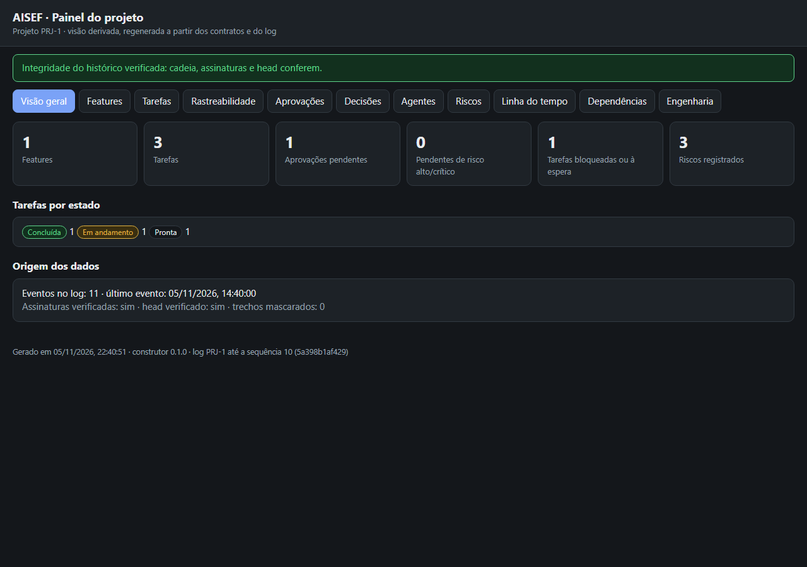

<p align="center"></p>

# AISEF

[English](README.md) · **Português**

Engenharia de software assistida por IA, com **autonomia na execução, rigor na validação e controle humano nas decisões importantes**. O AISEF é um plugin do Claude Code que você instala uma vez e usa em qualquer projeto, novo ou já iniciado. Ele junta um processo orientado por especificação com uma governança que é **aplicada, e não apenas pedida**:

- um gateway de permissões em toda chamada de ferramenta;
- um log de auditoria assinado, à prova de adulteração;
- aprovações que só você pode dar.



## Instalação

Pré-requisitos:

- Claude Code.
- Python 3.10 ou mais novo, com `pip install jsonschema cryptography`.
- No Windows, o Git Bash, que o Claude Code já usa para rodar os hooks.

No Claude Code, rode:

```
/plugin marketplace add NowItMakesSense/aisef
/plugin install aisef@aisef
```

Se o Python que tem o `cryptography` não for o primeiro do PATH, defina `AISEF_PYTHON` com o caminho dele. Isso também deixa os hooks mais rápidos.

No início de cada sessão, um doctor avisa se falta alguma coisa. Quando está tudo certo, ele não diz nada.

## Uso

1. Na pasta do projeto, peça "iniciar o AISEF neste projeto". Num projeto existente, o AISEF investiga o que já existe antes de propor qualquer coisa.
2. Quando ele pedir, aprove os agentes e as regras nativas de segunda camada.
3. Peça o trabalho em linguagem natural:
   - **Feature:** o modelo escreve um brief de umas 20 linhas, e o `aisef_new.py` gera a partir dele os contratos, as tarefas, a RTM e o pedido de aprovação, tudo já validado. Você aprova o plano, a execução acontece dentro do escopo aprovado e a feature só fecha com o seu aceite.
   - **Mudança pequena** (typo, ajuste trivial, patch de dependência que não quebra nada): vai pelo caminho rápido de manutenção, sem blueprint e sem aprovações extras.
4. Acompanhe tudo no painel (`aisef-panel`). Ele funciona sem internet.

O passo a passo completo, usando o projeto de demonstração, está em [docs/walkthrough.md](docs/walkthrough.md).

## Como o gateway decide

- **Git:** status, log e diff são livres. Commit, push, merge e release pedem, cada um, a sua própria aprovação. Force push, reescrita de histórico e apagar branch exigem aprovação reforçada.
- **Arquivos sensíveis:** `.env`, chaves e credenciais pedem aprovação.
- **Banco de dados e deploy:** o ambiente de destino é desconhecido, então ficam bloqueados como se fossem produção.
- **Código ofuscado ou baixado** (`curl | sh`, `base64 -d | bash`, `eval`): pede aprovação.
- **Operações destrutivas:** sobem um nível de aprovação (regra T1).
- **Subagentes:** cada um fica limitado pelo seu Agent Contract. O validador, por exemplo, só lê o Git. Um agente em rascunho fica bloqueado.
- **O próprio AISEF:** o log de auditoria e as chaves não podem ser editados à mão.
- **Registro:** toda tentativa negada ou levada à aprovação também vai para o log.

A política completa está em [`plugins/aisef/core/permission-policy.v0.1.json`](plugins/aisef/core/permission-policy.v0.1.json). As exceções do projeto ficam em `.aisef/policy.local.json` e só podem deixar a política mais restritiva.

## Limites conhecidos

- **O gateway não é uma fronteira de segurança.** Ele lê os comandos por padrões e reduz o risco. Use junto o sandbox do Claude Code (`/sandbox`) e as regras nativas que o `aisef-init` instala.
- **A aprovação depende de você.** Ela acontece no prompt nativo de permissão, que o modelo não consegue responder sozinho. Mas, se você aprovar sem ler, nenhuma camada técnica impede. Por isso, as operações de maior risco exigem uma aprovação reforçada registrada **antes** do prompt.
- **Latência.** Cada hook custa cerca de 0,2 a 0,3 s por chamada de ferramenta no Windows (medido). Quase todo esse tempo vem de abrir processos.
- **Fora do Claude Code não há aplicação técnica.** O `AGENTS.md` serve apenas como orientação.

## Desenvolvimento

```
python -m venv .venv && .venv/Scripts/pip install jsonschema cryptography   # Windows
python run_tests.py
claude plugin validate plugins/aisef
claude plugin eval plugins/aisef --tag trigger --scaffold --no-publish
```

Para entender o projeto:

- [docs/aisef-context.md](docs/aisef-context.md): a visão original.
- [docs/decisions.md](docs/decisions.md): as decisões tomadas.
- [docs/pending.md](docs/pending.md): o que falta.
- [plugins/aisef/evals/README.md](plugins/aisef/evals/README.md): as avaliações das skills.

## Licença

MIT
