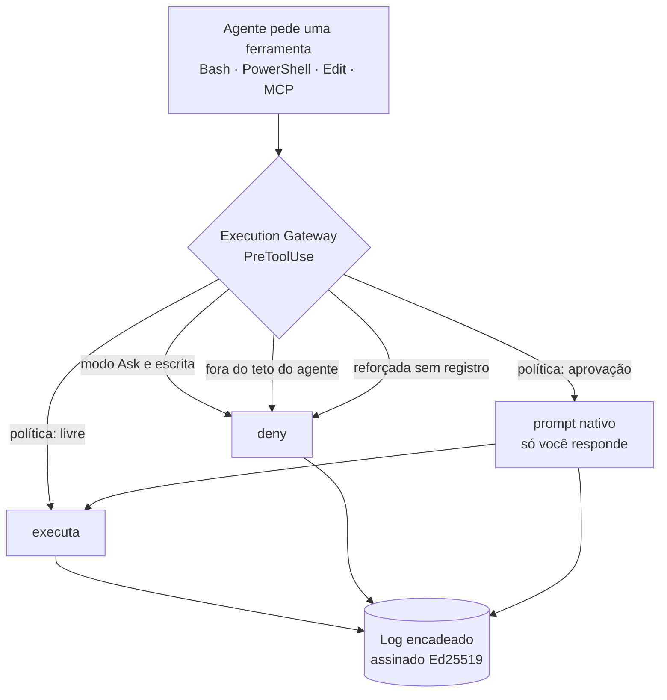
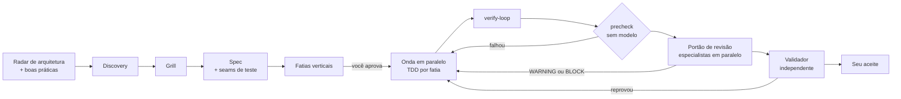

<p align="center"></p>

<p align="center"><a href="README.md">English</a> · <b>Português</b></p>

<h3 align="center">Uma equipe de engenharia de 66 agentes para o Claude Code. Ela lê a sua arquitetura, segue as suas boas práticas, se revisa antes de perguntar a você e prova cada passo.</h3>

O AISEF é um plugin do Claude Code que transforma um pedido em linguagem natural numa feature especificada. A feature é quebrada em fatias verticais, implementada com testes primeiro por agentes em paralelo, revisada por especialistas, validada por outro agente e aceita por você. Toda chamada de ferramenta passa por uma política aplicada em código, e cada passo vai para um log assinado e à prova de adulteração.

| **66** | **11** | **33** | **156** | **1.249** | **~0,2 s** |
|---|---|---|---|---|---|
| agentes especialistas, ligados conforme a sua stack | estilos de arquitetura detectados, com recomendações | regras de boas práticas instaladas no seu projeto | regras de consistência no `aisef-check` | verificações automáticas, CI em Linux e Windows | custo do gateway por chamada no Windows ([medido](tools/bench_hooks.py)) |

<p align="center"></p>
<p align="center"><sub>O painel ao vivo com dados de demonstração: quem está rodando, quem espera e por quê, qual subagente cada agente disparou e as raias no tempo.</sub></p>

## As ferramentas

Tudo isto vem num plugin só, roda localmente com a biblioteca padrão do Python e funciona no Windows, macOS e Linux.

| | Ferramenta | O que entrega | Como usar |
|---|---|---|---|
| 👥 | **Equipe de agentes** | 66 especialistas: executores, revisores, corretores e consultores. Cada um tem um teto de permissão assinado. | delegação automática, `aisef:<agente>` |
| 🧭 | **Radar de arquitetura** | Acha a sua stack e o seu estilo (Clean, hexagonal, DDD, CQRS, monólito modular, microsserviços, MVC, fatias verticais…). Confere a regra de dependência e as fronteiras entre módulos pelos imports e recomenda melhorias. | `aisef_project.py detect` |
| 📚 | **Biblioteca de boas práticas** | 33 regras: as comuns (Clean Code, SOLID, testes, segurança, Git), uma por estilo de arquitetura com uma seção "quando não usar" e uma por linguagem. | `aisef_project.py practices --apply` |
| 🔍 | **Portão de revisão** | Os revisores de cada tarefa são escolhidos em código: geral, linguagem, banco, segurança, arquitetura e testes. Todos precisam aprovar antes do validador. Tarefa de risco alto tem revisão dupla e independente. | automático em cada onda |
| ✅ | **verify-loop** | Build → tipos → lint → testes → segredos no diff → resumo do diff, com veredito PASS ou FAIL e evidência gravada na tarefa. | `aisef_project.py verify-loop` |
| 🛡️ | **Execution Gateway** | Toda chamada de ferramenta recebe permitir, perguntar ou negar, aplicado em código. Cada operação Git tem a própria aprovação. Nada de `--no-verify`. Banco e deploy são negados. Agente não afrouxa config de lint. | sempre ligado (hook) |
| 🧾 | **Log de auditoria assinado** | Toda operação, e toda tentativa bloqueada, vai para um log em cadeia de hash assinado com Ed25519. O head fica fora do repositório. | `aisef-check` |
| 🗳️ | **Approval Center** | Cada decisão mostra impacto, diff, rollback e risco. Só você decide, pelo prompt nativo. | `aisef-approve` |
| 📊 | **Painel ao vivo** | Mapa de execução, quem disparou quem, decisões esperando por você, rastreabilidade, raias em paralelo. | `aisef-panel` |
| 💸 | **Roteador de modelo** | Haiku → Sonnet → Opus, escolhido por risco e complexidade. Cada tentativa que falha sobe um nível. | automático |
| 🧠 | **Aprendizado revisado** | Lições tiradas de erros já registrados. Só valem depois que você aprova e perdem confiança quando deixam de ajudar. | `aisef_learn.py` |
| 🎨 | **Autoridade de design** | Uma tipografia, uma paleta e um conjunto de componentes aprovados por projeto, conferidos no código. | `aisef-design` |
| ❓ | **Modo Ask** | Responde perguntas sem mudar nada, pesquisando na internet com fontes citadas. | `/aisef:ask` |
| 🧪 | **Benchmark de resultado** | Testes escondidos, AISEF contra o Claude Code puro, com custo e tempo. | `tools/bench_outcomes.py` |

## Conheça a equipe

Os agentes só entram quando se aplicam. Os de linguagem e de framework são ligados quando o radar detecta a stack deles; um projeto Python nunca paga pelo revisor de Swift.

| Tipo | O que fazem | Agentes |
|---|---|---|
| **Construtores** (7) | Implementam dentro do contrato da tarefa, com teste primeiro | `implementer` (fatias verticais inteiras com TDD), `backend`, `frontend`, `database`, `devops`, `doc-updater`, `e2e-runner` |
| **Revisores** (10) | Relatam com prova; nunca mexem no código | `code-reviewer`, `architecture-reviewer`, `database-reviewer`, `security`, `qa`, `pr-test-analyzer`, `silent-failure-hunter`, `type-design-analyzer`, `comment-analyzer`, `agent-evaluator` |
| **Revisores por linguagem** (19) | Idiomas, segurança e armadilhas da sua stack | Python, Django, FastAPI, TypeScript/JavaScript, React, Vue, Go, Rust, Java (Spring/Quarkus), Kotlin, Swift, C#, F#, C++, PHP/Laravel, Ruby/Rails, Flutter, Godot, mais o `a11y-architect` (WCAG 2.2) |
| **Corretores** (16) | Menor diff que funciona; nunca afrouxam regra para passar | `code-simplifier`, `refactor-cleaner`, `performance-optimizer` e 13 corretores de build (TS/JS, Python, Django, Go, Rust, Java, Kotlin, Swift, Dart/Flutter, C++, PyTorch, HarmonyOS, React) |
| **Consultores** (10) | Investigam e propõem; você decide | `planner`, `architect`, `code-architect`, `code-explorer`, `spec-miner` (specs a partir de código legado), `domain`, `docs-lookup`, `commit-reviewer`, `conversation-analyzer`, `harness-optimizer` |
| **Revisores de domínio** (3) | Ligados quando o domínio aparece | `rag-pipeline-reviewer`, `mle-reviewer`, `healthcare-reviewer` |
| **Validador** (1) | Independente; nunca valida o próprio trabalho; Git só de leitura | `validator` |

Todo revisor segue a mesma disciplina:
- só relata o que tem mais de 80% de certeza;
- achado CRITICAL ou HIGH exige a linha, o cenário de falha e o motivo de as proteções existentes não pegarem;
- zero achados é um resultado válido.

Todo corretor segue uma regra: nada de `any`, `# noqa` ou teste pulado para fazer o build passar.

## O radar de arquitetura

```
$ python aisef_project.py detect --project .
Stacks: TypeScript, React, C# / .NET (gerenciador: npm)
Arquitetura (heuristica, confirmar com o usuario):
  - DDD estrategico: confianca 0.89 (pasta backend/src/Loja.SharedKernel; arquivo docs/glossary.md)
  - Monolito modular: confianca 0.80 (3 modulos em backend/src/Modules/; modulo com camadas: Pedidos)
  - Clean Architecture / Onion: confianca 0.67 (pasta .../Loja.Pedidos.Domain; pasta .../Loja.Pedidos.Application)
  - Fatias verticais: confianca 0.67 (pasta frontend/src/features; pasta frontend/src/shared)
Fronteiras entre modulos: 3 modulo(s), 204 arquivo(s) analisados, 2 dependencia(s) entre modulos:
  sugestoes -> contas (application); sugestoes -> contas (domain, VIOLACAO)
Recomendacoes (decisao do usuario):
  - REC-DEPENDENCY-RULE: Corrigir a regra de dependencia. Sugestoes.Infrastructure/EfCatalogo.cs:2 importa Loja.Contas.Domain
Praticas aplicaveis: common, lang/typescript, lang/web, lang/csharp, architecture/modular-monolith, architecture/clean-architecture, ...
```

O radar foi medido em 10 repositórios públicos de referência (templates de Clean Architecture, eShop, modular-monolith-with-ddd, domain-driven-hexagon e outros). Acertou 9 deles, sem nenhuma violação de dependência falsa.

Ele nunca muda nada sozinho. Você adota um estilo pelo Approval Center e, daí em diante, o `architecture-reviewer` cobra esse estilo em cada entrega. Cada prática diz quando **não** usar, para o AISEF não empurrar DDD ou CQRS num CRUD simples.

## Medido, não prometido

O `tools/bench_outcomes.py` roda a mesma tarefa de três jeitos. Os testes ficam escondidos do agente e só rodam depois que ele termina. Resultado do `feat-slugify`, Sonnet, 3 repetições:

| Braço | Testes escondidos | Custo (mediana) | Tempo (mediana) |
|---|---|---|---|
| Claude Code puro | 3/3 execuções com 7/7 | US$ 0,13 | 26 s |
| AISEF com o portão de revisão | 3/3 execuções com 7/7 | US$ 1,49 | 335 s |
| AISEF sem revisores | 3/3 execuções com 7/7 | US$ 1,32 | 333 s |

O portão de revisão acrescenta cerca de 13% por fatia, dentro da variação entre execuções. Numa tarefa tão pequena, o processo completo custa cerca de 11× o Claude Code puro. O que você paga é a spec, a evidência de TDD, a validação independente, a revisão e o registro assinado. O ganho de qualidade em features reais e maiores é o que vem sendo medido agora.

## Novidades

- **0.12.1, correções vindas do uso.** Saíram de rodar a 0.12 num projeto real:
  - decisão de arquitetura pode valer para o projeto todo, então dá para adotar um estilo antes da primeira feature;
  - o radar confere as fronteiras entre módulos e não chama mais de microsserviço um serviço que é só esqueleto;
  - o gateway não bloqueia mais comandos só de leitura na pasta de auditoria (`grep`, `git check-ignore`, `--dry-run`).
- **0.12.0, a equipe, o radar e as práticas.** 56 agentes novos, organizados por tipo e ligados pela stack. Detecção de arquitetura com recomendações. 33 regras de boas práticas. Revisores escolhidos em código, com portão antes da validação. `verify-loop`. Configs de lint que os agentes não afrouxam. Ideias portadas do [everything-claude-code](https://github.com/affaan-m/everything-claude-code) (MIT, ver [avisos](THIRD_PARTY_NOTICES.md)).
- **0.11.0, medir.** `metrics` (aprovações, reprovações, lead time, tokens e custo por tarefa) e o benchmark de resultado.
- **0.10.0, painel v3.** O mapa de execução, quem disparou quem, raias em paralelo e o grafo de dependências com o caminho crítico.

Histórico completo no [CHANGELOG](CHANGELOG.md).

## A mesma feature, de dois jeitos

Pedido: *"recuperação de senha por e-mail, o link vale 30 minutos e só pode ser usado uma vez"*.

| Com um prompt solto | Com o AISEF |
|---|---|
| O agente começa a escrever código na hora. | O AISEF diz a fase: "Estamos em Especificar. Próximo: Grill → Spec → Fatias." |
| Tabela, endpoint e tela de uma vez; nenhum teste antes do código. | **Grill:** três perguntas, uma por vez, cada uma com recomendação (validade do link? resposta para e-mail inexistente? link reutilizável?). Nada é inventado. |
| Decide sozinho que "o link vale 24 h" e que "a resposta muda se o e-mail não existe". Nenhum dos dois foi pedido, e o segundo vaza quem tem conta. | **Spec** com os seams de teste confirmados por você (`POST /auth/reset`, `POST /auth/reset/confirm`). |
| Roda um comando no banco local "para conferir a tabela". Nada impede, nada registra. | Três **fatias verticais**; você aprova o plano. Uma chamada despacha a onda: duas fatias em paralelo para o `implementer`. |
| "Pronto, todos os testes passam": os testes foram escritos depois do código. | O agente tenta `psql` e recebe **deny** (banco a partir de uma sessão é tratado como produção). Fica no log. |
| `git push` vai junto, porque o agente achou que você queria. | A `tdd_evidence` mostra o teste **falhando antes de passar**, e o check confere a ordem. Os revisores especialistas aprovam, depois outro modelo valida. Seu aceite, e o `git push` passa pelo prompt nativo, que só você responde. |

Do lado esquerdo, o trabalho é rápido e opaco. Do direito, cada decisão foi sua, cada requisito tem teste e evidência, e daqui a seis meses o painel e o log mostram exatamente o que aconteceu.

## Como funciona

Skills dizem ao modelo o que fazer. O **gateway** decide o que ele **pode** fazer.



O trabalho segue o método do Matt Pocock (grill → spec → tickets → TDD), com rastreabilidade de ponta a ponta:



| Camada | O que faz |
|---|---|
| **Processo (SDD + TDD)** | Radar de arquitetura, Discovery, Grill, Spec, fatias verticais, execução paralela com TDD, portão de revisão, validação independente e o seu aceite. Cada requisito aponta para a fatia, o critério, o teste e a evidência (RTM). |
| **Aplicação técnica** | Um gateway `PreToolUse` aplica a política a Bash, PowerShell, ferramentas de arquivo, WebFetch e MCP. Cada operação Git pede a própria aprovação, segredos pedem aprovação, banco e deploy são negados, e cada subagente fica limitado pelo seu Agent Contract. |
| **Evidência** | Toda operação e toda tentativa bloqueada vão para um log encadeado por hash e assinado com Ed25519. O head assinado fica fora do repositório. |
| **Custo** | Modelo e effort escolhidos por tarefa, conforme risco e complexidade, do Haiku ao Opus; cada tentativa que falha sobe um nível. |
| **Aprendizado** | Lições tiradas de erros já registrados (reprovações, bloqueios), que só valem com a sua aprovação e perdem confiança quando param de ajudar. |

## O painel

<p align="center"></p>

Oito telas num trilho de ícones. Todas são derivadas dos contratos e do log assinado, e nenhuma é fonte de verdade:

| Tela | O que mostra |
|---|---|
| **Agora** | O que roda e o que espera, o mapa de execução, as decisões que esperam você com o comando para copiar, o próximo passo, as raias em paralelo e a tabela de fatias com os ciclos de TDD |
| **Mapa dos agentes** | O mapa e as raias em largura total, mais a árvore de quem disparou quem |
| **Features e fatias** | A etapa de cada feature, as fatias, o grafo de dependências com o caminho crítico e os relatórios de execução entregues |
| **Rastreabilidade** | Requisito → fatia → critério → evidência, com o filtro "só lacunas" |
| **Governança** | Decisões pendentes, decisões tomadas, escolhas de arquitetura com as opções descartadas, e riscos |
| **Histórico** | O log encadeado por hash, cada evento com o seu bloco e a assinatura |
| **Engenharia** | Diagramas de arquitetura e de dados, endpoints, ameaças e migrações do blueprint |
| **Equipe de agentes** | Quem trabalha em quê, os subagentes em execução, as lições aprovadas e os despachos por modelo |

Com o log comprometido, uma faixa vermelha aparece no topo e todos os comandos de aprovar somem. Rode ao vivo com `build_panel.py --serve` (atualiza a cada 3 s sem perder rolagem, filtros nem a gaveta aberta) ou como página estática.

## Onde o AISEF fica entre as alternativas

Leitura dos READMEs e da documentação oficial em 18/11/2026. "Instrução" quer dizer que o processo depende de o modelo obedecer; "aplicado" quer dizer que há código impedindo.

| | Specs | Aplicação técnica | TDD | Paralelismo | Rastreabilidade | Auditoria | Custo por risco |
|---|---|---|---|---|---|---|---|
| **AISEF** | ● spec + fatias | ● gateway, teto por agente | ● vermelho→verde checado | ● ondas + validação por onda | ● requisito→evidência | ● hash + Ed25519 | ● L0–L6 |
| Spec Kit (150k★) | ● | ◐ hooks de extensão | – | – | ◐ | – | – |
| Superpowers (321k★) | ◐ | ◐ instrução + bootstrap | ● | ● | – | – | ◐ |
| BMAD (55k★) | ● | – instrução | ◐ | ◐ | ◐ IDs com fonte | – | – |
| OpenSpec (75k★) | ● | – instrução | – | – | ◐ | – | – |
| Kiro (AWS) | ● | ● hooks | ◐ | ● ondas | – | – | – |
| Matt Pocock (327k★) | ● | – instrução | ● | ● | ◐ blocking edges | – | – |
| everything-claude-code (306k★) | ◐ | ● hooks em Node | ● | ◐ | – | ◐ varredura | ◐ |
| Claude Code puro | – | ● permissões e hooks | – | ● | – | – | ◐ manual |

● cobre · ◐ em parte · – não descrito

### As sete lacunas que ninguém cobre bem, e a resposta do AISEF

| Lacuna | Como o AISEF cobre | Limite |
|---|---|---|
| Governança aplicada na hora da chamada | Gateway decide allow, ask ou deny em cada chamada, com teto por agente | Lê comandos por padrões: reduz risco, não isola. Use com o `/sandbox` |
| Log que denuncia adulteração | Cada evento tem o hash do anterior e assinatura Ed25519; o head fica fora do repositório | Não protege contra quem tem a chave privada da sua máquina |
| Requisito até a evidência | RTM liga requisito → fatia → critério → teste → evidência, e o check acusa buracos | O caminho rápido de manutenção tem rastreio mais leve |
| Validação com privilégio separado | O validador só lê o Git, nunca valida o próprio trabalho e roda em nível igual ou maior, de preferência em outro modelo | Uma onda grande num validador só pede para ser dividida |
| Modelo escolhido pelo risco | Escada Haiku → Opus por risco, recursos sensíveis, complexidade e tentativas | Variáveis de ambiente do Claude Code podem anular; o roteador avisa |
| Uma central de decisões | Cada decisão é um pedido com impacto, diff, rollback e risco; a reforçada vale para o comando exato, uma vez | Se você aprovar sem ler, nenhuma camada técnica impede |
| Memória revisada antes de virar regra | Lições de erros registrados, aprovadas por você, com confiança calculada em código | Sem a sua revisão nos marcos, nada é aprendido, e isso é de propósito |

### Somar em vez de competir

O AISEF é a **espinha** (governança, rastreabilidade, decisões e aprendizado revisado). O **músculo** vem de skills prontas, mantidas por quem as criou:
- **Matt Pocock:** `grilling`, `domain-modeling`, `tdd` (pré-carregada no agente `implementer`) e `code-review`.
- **Design:** UI/UX Pro Max, Taste e Impeccable, trabalhando dentro de uma autoridade de design aprovada por você.
- **Grafos de código:** codebase-memory-mcp (código) e Graphify (docs e decisões).

## Instalação

Pré-requisitos:
- Claude Code;
- Python 3.10 ou mais novo, com `pip install jsonschema cryptography`;
- no Windows, o Git Bash (o Claude Code já o usa para os hooks).

```
/plugin marketplace add NowItMakesSense/aisef
/plugin install aisef@aisef
```

Se o Python que tem o `cryptography` não for o primeiro do PATH, defina `AISEF_PYTHON` com o caminho dele (isso também deixa os hooks mais rápidos). Para atualizar uma instalação antiga: `/plugin marketplace update aisef` e depois `/plugin update aisef@aisef`.

## Comece em 5 minutos

1. Na pasta do projeto, peça **"iniciar o AISEF neste projeto"**. Num projeto existente, o AISEF investiga antes de propor qualquer coisa.
2. Quando ele pedir, aprove os agentes e as regras nativas de segunda camada. Num projeto existente, o **radar de arquitetura** roda e mostra a sua stack, o seu estilo e as recomendações. Você adota um estilo e instala as **boas práticas** correspondentes, com uma aprovação para cada.
3. Descreva o que quer. O AISEF diz em que fase você está e conduz Grill → Spec → Fatias até o plano que você aprova.
4. Acompanhe ao vivo: `aisef-panel` abre o painel com o mapa de execução, quem disparou quem, as decisões que esperam você e as raias em paralelo.
5. Só uma dúvida? `/aisef:ask <pergunta>` responde sem mudar nada: lê o projeto e, quando a pergunta pede, pesquisa na internet com as fontes citadas, escolhendo o modelo pela pergunta. `/aisef:modo ask` deixa a sessão inteira só de leitura até `/aisef:modo exec`. Veja [como ele se compara ao Ask do Cursor](docs/guide/ask-mode.md).

Para explorar sem gastar tokens, siga o [passo a passo com o projeto de demonstração](docs/guide/walkthrough.md).

## O que vem dentro

| Componente | Papel |
|---|---|
| Skills | `aisef` (orquestrador), `aisef-init`, `aisef-discovery`, `aisef-tooling`, `aisef-design`, `aisef-feature`, `aisef-approve`, `aisef-check`, `aisef-panel`, `ask`, `modo` |
| Agentes | 66 papéis num catálogo único (`core/agents/catalog.v0.1.json`): executores (`implementer`, `backend`, `frontend`...), avaliadores, corretores, consultores e o `validator`; os de stack entram com a detecção. Cada um com teto de permissão |
| Hooks | gateway (`PreToolUse`), auditoria (`PostToolUse`), doctor (`SessionStart`), eventos dos subagentes e quem disparou quem (`PreToolUse` Agent), lembrete do modo Ask |
| Núcleo | JSON Schemas, políticas de permissão e de modelo, verificador de consistência, log assinado, geradores por brief, despacho em lote, pacotes de contexto, aprendizado revisado, painel ao vivo, detecção de stack e arquitetura, boas práticas, roteamento de revisores e verify-loop |

## Documentação

Comece por [docs/README.md](docs/README.md). Lá estão:
- os conceitos e o fluxo de trabalho;
- a referência da política, dos comandos e dos hooks;
- a lista gerada das regras do check;
- as [decisões de arquitetura](docs/adr/README.md);
- o [roadmap](docs/roadmap.md).

## Desenvolvimento

```
python -m venv .venv && .venv/Scripts/pip install -r requirements-dev.txt   # Windows
python run_tests.py
claude plugin validate plugins/aisef
claude plugin eval plugins/aisef --tag trigger --no-publish
```

O repositório usa o Graphify em si mesmo (código, docs, ADRs e skills; só o passo estrutural, nada sai da máquina). Regenere o grafo depois de mudar código ou docs; `graphify-out/` não é versionado:

```
GRAPHIFY_BACKEND=none python -m graphify update .
python -m graphify query "como o gateway decide um git push"
```

## Licença

MIT
