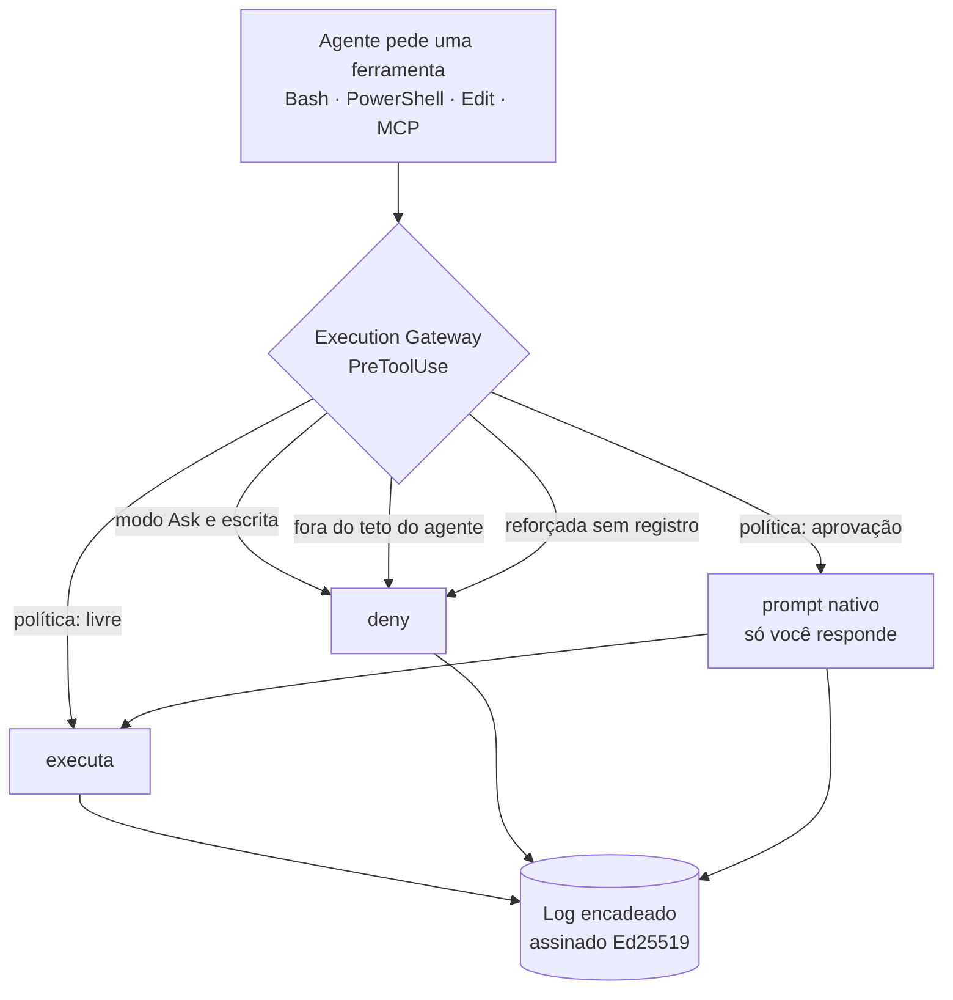
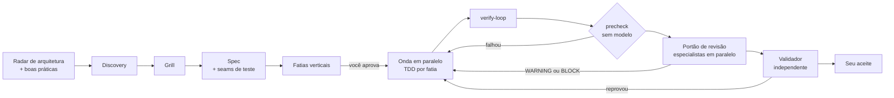

<p align="center"></p>

<p align="center"><a href="README.md">English</a> · <b>Português</b> · <a href="README.zh-CN.md">简体中文</a></p>

<h3 align="center">A trilha de evidência da engenharia com IA. Regras aplicadas em código, cada passo num log assinado, cada requisito ligado à sua prova e um pacote que o seu auditor verifica sozinho.</h3>

O AISEF é um plugin do Claude Code para times que precisam mostrar o que a IA fez, não só entregar mais rápido. Um pedido em linguagem natural vira uma feature especificada: triada em código, quebrada em fatias verticais, construída com testes primeiro por agentes em paralelo, revisada por especialistas, validada por outro agente e aceita por você. Toda chamada de ferramenta passa por uma política aplicada em código, e cada passo vai para um log assinado, à prova de adulteração, que o CI verifica em cada pull request.

| **171** | **2.800+** | **207** | **66** | **~0,2 s** |
|---|---|---|---|---|
| regras de consistência no `aisef-check` | verificações automáticas, CI em Linux e Windows | casos do gateway, 80 deles tentativas de contorno, todas barradas ([limites](#o-que-o-gateway-não-garante)) | agentes especialistas (15 ativos num projeto Python novo) | custo do gateway por chamada no Windows ([medido](tools/bench_hooks.py)) |

<p align="center"></p>
<p align="center"><sub>O painel ao vivo com dados de demonstração: quem está rodando, quem espera e por quê, qual subagente cada agente disparou e as raias no tempo.</sub></p>

## O que só o AISEF cobre

| Necessidade | O que o AISEF entrega |
|---|---|
| **Regras que valem** | Um Execution Gateway decide permitir, perguntar ou negar em cada chamada, em código. Ele lê os comandos por partes (`bash -c`, `eval`, `$(...)`, código inline), mantém a chave de assinatura fora do alcance e limita cada agente ao próprio teto de permissão. |
| **Um log que ninguém edita em silêncio** | Cada evento tem cadeia de hash e assinatura Ed25519; o head fica fora do repositório. Em time, cada pessoa grava no próprio stream, com a própria chave: o merge nunca conflita e cada aprovação leva a assinatura de quem a deu. |
| **Cada requisito ligado à prova** | Requisito → fatia → critério de aceite → teste → evidência, conferido por 171 regras. O `aisef_sysgraph.py` responde "o que este requisito toca?" sem modelo. |
| **Prova em cada pull request** | A GitHub Action `aisef-verify` reprova a PR quando o log foi adulterado, quando o log encolheu desde a branch base, quando o `aisef-check` acusa erro ou quando a PR toca uma tarefa que ninguém validou. |
| **Evidência que o auditor verifica** | O `aisef_evidence.py` empacota uma feature (contratos, relatórios, aprovações, eventos assinados, chaves públicas) com uma tabela de controles para SOC 2 CC8.1, ISO/IEC 27001:2022 A.8.32 e A.5.3, ISO/IEC 42001, EU AI Act art. 12 e NIST AI RMF. Com `--in-toto`, cada tarefa ganha um atestado in-toto assinado (DSSE). O pacote se verifica sozinho, sem o projeto. |
| **Observabilidade que você já usa** | O `aisef_otel.py` exporta cada feature como traces OpenTelemetry (OTLP/JSON) com as convenções GenAI: um span por tentativa de agente, um por chamada de ferramenta. |

O AISEF é para times em ambiente regulado e para quem precisa mostrar como uma mudança feita com IA foi autorizada, testada e aprovada. Se você só quer o agente mais rápido possível, o Claude Code puro sai mais barato; a seção "Medido, não prometido" tem os números.

## As ferramentas

Tudo isto vem num plugin só, roda localmente com a biblioteca padrão do Python e funciona no Windows, macOS e Linux.

| | Ferramenta | O que entrega | Como usar |
|---|---|---|---|
| 🧭 | **Triagem em código** | Escolhe o caminho de cada mudança (rápido, enxuto ou completo) por caminhos sensíveis, tipo de mudança, tamanho e risco. O caminho enxuto é uma fatia com TDD e sem blueprint. Os perfis (solo, team, regulated) definem o padrão. Dá para subir de caminho, nunca descer. | `aisef_triage.py` |
| 👥 | **Equipe de agentes** | 66 especialistas: executores, revisores, corretores e consultores, cada um com um teto de permissão assinado. Um projeto novo começa com o núcleo mais a sua stack; o resto entra por pedido. | delegação automática, `aisef:<agente>` |
| 🧭 | **Radar de arquitetura** | Acha a sua stack e o seu estilo (Clean, hexagonal, DDD, CQRS, monólito modular, microsserviços, MVC, fatias verticais…). Confere a regra de dependência e as fronteiras entre módulos pelos imports e recomenda melhorias. | `aisef_project.py detect` |
| 📚 | **Biblioteca de boas práticas** | 33 regras: as comuns (Clean Code, SOLID, testes, segurança, Git), uma por estilo de arquitetura com uma seção "quando não usar" e uma por linguagem. | `aisef_setup.py --apply` (no init) |
| 🔍 | **Portão de revisão** | Os revisores de cada tarefa são escolhidos em código: geral, linguagem, banco, segurança, arquitetura e testes. Todos precisam aprovar antes do validador. Tarefa de risco alto tem revisão dupla e independente. | automático em cada onda |
| ✅ | **verify-loop** | Build → tipos → lint → testes → segredos no diff → resumo do diff, com veredito PASS ou FAIL e evidência gravada na tarefa. | `aisef_project.py verify-loop` |
| 🛡️ | **Execution Gateway** | Toda chamada de ferramenta recebe permitir, perguntar ou negar, aplicado em código. Cada operação Git tem a própria aprovação. Nada de `--no-verify`. Banco e deploy são negados. Agente não afrouxa config de lint. | sempre ligado (hook) |
| 🧾 | **Log de auditoria assinado** | Ciclo de vida, decisões, comandos de shell e toda chamada negada ou perguntada vão para um log em cadeia de hash assinado com Ed25519; as edições de arquivo vão para uma telemetria com cadeia de hash. Um stream por pessoa, em time. | `aisef-check`, `aisef_streams.py` |
| ✔️ | **Verificação no CI** | A Action `aisef-verify` confere o log, as regras de consistência e as tarefas tocadas por cada pull request, com resumo no job. | `.github/actions/aisef-verify` |
| 📦 | **Pacote de evidência** | Um pacote por feature que se verifica sozinho, com os controles SOC 2, ISO 27001, ISO 42001, EU AI Act e NIST AI RMF ligados às evidências, e atestados in-toto. | `aisef_evidence.py build` |
| 🔭 | **Exportação OpenTelemetry** | Features como traces com atributos GenAI, para a observabilidade que você já roda. | `aisef_otel.py export` |
| 🗳️ | **Approval Center** | Cada decisão mostra impacto, diff, rollback e risco. Só você decide, pelo prompt nativo. | `aisef-approve` |
| 📊 | **Painel ao vivo** | Mapa de execução, quem disparou quem, decisões esperando por você, rastreabilidade, raias em paralelo. | `aisef-panel` |
| 💸 | **Roteador de modelo e orçamento** | Haiku → Sonnet → Opus, escolhido por risco e complexidade. O modo contínuo para por orçamento da feature (tempo, tokens, despachos), pela mesma falha duas vezes e por agente travado. | automático |
| 🌳 | **Worktree por fatia** | Fatias que mexem no mesmo arquivo rodam lado a lado, cada uma no seu worktree; o merge passa pelo escopo da feature e um conflito vira nova tentativa. | `parallel.mode = worktree` |
| 🧠 | **Aprendizado revisado** | Lições tiradas de erros já registrados. Só valem depois que você aprova e perdem confiança quando deixam de ajudar. | `aisef_learn.py` |
| 🎨 | **Autoridade de design** | Uma tipografia, uma paleta e um conjunto de componentes aprovados por projeto, conferidos no código. | `aisef-design` |
| ❓ | **Modo Ask** | Responde perguntas sem mudar nada, pesquisando na internet com fontes citadas. | `/aisef:ask` |

## Conheça a equipe

Os agentes só entram quando se aplicam. Um projeto novo começa com o núcleo (13 subagentes: os construtores, os revisores que rodam em toda tarefa, o validador e três consultores) mais os agentes de linguagem e de framework que o radar detecta. Assim, um projeto Python começa com 15 e nunca paga pelo revisor de Swift. A equipe estendida entra quando você pede ou quando o trabalho pede.

| Tipo | O que fazem | Agentes |
|---|---|---|
| **Construtores** (7) | Implementam dentro do contrato da tarefa, com teste primeiro | `implementer` (fatias verticais inteiras com TDD), `backend`, `frontend`, `database`, `devops`, `doc-updater`, `e2e-runner` |
| **Revisores** (10) | Relatam com prova; nunca mexem no código | `code-reviewer`, `architecture-reviewer`, `database-reviewer`, `security`, `qa`, `pr-test-analyzer`, `silent-failure-hunter`, `type-design-analyzer`, `comment-analyzer`, `agent-evaluator` |
| **Revisores por linguagem** (19) | Idiomas, segurança e armadilhas da sua stack | Python, Django, FastAPI, TypeScript/JavaScript, React, Vue, Go, Rust, Java (Spring/Quarkus), Kotlin, Swift, C#, F#, C++, PHP/Laravel, Ruby/Rails, Flutter, Godot, mais o `a11y-architect` (WCAG 2.2) |
| **Corretores** (16) | Menor diff que funciona; nunca afrouxam regra para passar | `code-simplifier`, `refactor-cleaner`, `performance-optimizer` e 13 corretores de build (TS/JS, Python, Django, Go, Rust, Java, Kotlin, Swift, Dart/Flutter, C++, PyTorch, HarmonyOS, React) |
| **Consultores** (10) | Investigam e propõem; você decide | `planner`, `architect`, `code-architect`, `code-explorer`, `spec-miner` (specs a partir de código legado), `domain`, `docs-lookup`, `commit-reviewer`, `conversation-analyzer`, `harness-optimizer` |
| **Revisores de domínio** (3) | Ligados quando o domínio aparece | `rag-pipeline-reviewer`, `mle-reviewer`, `healthcare-reviewer` |
| **Validador** (1) | Independente; nunca valida o próprio trabalho; Git só de leitura | `validator` |

Todo revisor segue a mesma disciplina:
- só relata o que tem mais de 80% de certeza;
- achado CRITICAL ou HIGH exige a linha, o cenário de falha e o motivo de as proteções existentes não pegarem;
- zero achados é um resultado válido.

Todo corretor segue uma regra: nada de `any`, `# noqa` ou teste pulado para fazer o build passar.

## O radar de arquitetura

```
$ python aisef_project.py detect --project .
Stacks: TypeScript, React, C# / .NET (gerenciador: npm)
Arquitetura (heuristica, confirmar com o usuario):
  - DDD estrategico: confianca 0.89 (pasta backend/src/Loja.SharedKernel; arquivo docs/glossary.md)
  - Monolito modular: confianca 0.80 (3 modulos em backend/src/Modules/; modulo com camadas: Pedidos)
  - Clean Architecture / Onion: confianca 0.67 (pasta .../Loja.Pedidos.Domain; pasta .../Loja.Pedidos.Application)
  - Fatias verticais: confianca 0.67 (pasta frontend/src/features; pasta frontend/src/shared)
Fronteiras entre modulos: 3 modulo(s), 204 arquivo(s) analisados, 2 dependencia(s) entre modulos:
  sugestoes -> contas (application); sugestoes -> contas (domain, VIOLACAO)
Recomendacoes (decisao do usuario):
  - REC-DEPENDENCY-RULE: Corrigir a regra de dependencia. Sugestoes.Infrastructure/EfCatalogo.cs:2 importa Loja.Contas.Domain
Praticas aplicaveis: common, lang/typescript, lang/web, lang/csharp, architecture/modular-monolith, architecture/clean-architecture, ...
```

O radar foi medido em 10 repositórios públicos de referência (templates de Clean Architecture, eShop, modular-monolith-with-ddd, domain-driven-hexagon e outros). Acertou 9 deles, sem nenhuma violação de dependência falsa.

Ele nunca muda nada sozinho. Você adota um estilo pelo Approval Center e, daí em diante, o `architecture-reviewer` cobra esse estilo em cada entrega. Cada prática diz quando **não** usar, para o AISEF não empurrar DDD ou CQRS num CRUD simples.

## Medido, não prometido

O `tools/bench_outcomes.py` roda a mesma tarefa de três jeitos. Os testes ficam escondidos do agente e só rodam depois que ele termina. Resultado do `feat-slugify`, Sonnet, 3 repetições:

| Braço | Testes escondidos | Custo (mediana) | Tempo (mediana) |
|---|---|---|---|
| Claude Code puro | 3/3 execuções com 7/7 | US$ 0,13 | 26 s |
| AISEF com o portão de revisão | 3/3 execuções com 7/7 | US$ 1,49 | 335 s |
| AISEF sem revisores | 3/3 execuções com 7/7 | US$ 1,32 | 333 s |

O portão de revisão acrescenta cerca de 13% por fatia, dentro da variação entre execuções. Numa tarefa tão pequena, o processo completo custa cerca de 11× o Claude Code puro. O que você paga é a spec, a evidência de TDD, a validação independente, a revisão e o registro assinado. O ganho de qualidade em features reais e maiores é o que vem sendo medido agora.

Os recursos da 0.13 em diante têm cobertura no CI, incluindo um teste que roda o ciclo inteiro de uma feature nas 48 combinações de perfil, caminho, paralelismo, telemetria e log por pessoa. Eles ainda não rodaram num projeto real. A [tabela de maturidade](docs/reference/maturity.md) mostra o nível de cada um, se vem ligado e como voltar atrás.

## Novidades

- **0.17.1, features ligadas e um painel que funciona em qualquer tela.** Feature nova precisa declarar de quais depende, e o check aponta as que não declaram. O painel mostra todas as telas no celular, mantém o foco do teclado visível, devolve o foco ao fechar a gaveta, deixa arrastar as pílulas de feature para o lado e explica uma falha de integridade: o que mudou, em qual evento, como foi detectado e quando pode ter acontecido.
- **0.17.0, fechar o que este README promete.** O gateway fecha mais 13 contornos (código inline de interpretador, a home inteira, pacote baixado e executado na hora), pergunta antes de dependência nova e endurece a saída de dados depois que a sessão leu conteúdo não confiável da web ou de MCP; `team` e `regulated` ganham sandbox estrito. O vermelho e o verde do TDD são conferidos contra o log assinado, o validador trabalha às cegas às alegações do executor, os marcos podem ganhar carimbo de tempo RFC 3161 e a chave de assinatura pode ficar no cofre do sistema (os dois opt-in). O pacote de evidência ganha atestados in-toto assinados e os controles ISO/IEC 42001, EU AI Act art. 12 e NIST AI RMF. Os revisores podem ser medidos com bugs plantados e o benchmark de resultado ganhou o braço enxuto; as rodadas pagas ainda vão acontecer.
- **0.16.0, painel confiável e outra sessão no mesmo projeto.** O painel mostra a feature aceita como aceita, põe cada agente na fatia em que trabalhou, com linha do tempo por feature e visão geral em cartões, e só acende o alarme do gateway quando pesa. Duas sessões do Claude Code no mesmo projeto passam a se enxergar, reservam áreas separadas e são avisadas antes de editar ou fazer commit sobre o trabalho da outra.

Histórico completo no [CHANGELOG](CHANGELOG.md).

## A mesma feature, de dois jeitos

Pedido: *"recuperação de senha por e-mail, o link vale 30 minutos e só pode ser usado uma vez"*.

| Com um prompt solto | Com o AISEF |
|---|---|
| O agente começa a escrever código na hora. | O AISEF diz a fase: "Estamos em Especificar. Próximo: Grill → Spec → Fatias." |
| Tabela, endpoint e tela de uma vez; nenhum teste antes do código. | **Grill:** três perguntas, uma por vez, cada uma com recomendação (validade do link? resposta para e-mail inexistente? link reutilizável?). Nada é inventado. |
| Decide sozinho que "o link vale 24 h" e que "a resposta muda se o e-mail não existe". Nenhum dos dois foi pedido, e o segundo vaza quem tem conta. | **Spec** com os seams de teste confirmados por você (`POST /auth/reset`, `POST /auth/reset/confirm`). |
| Roda um comando no banco local "para conferir a tabela". Nada impede, nada registra. | Três **fatias verticais**; você aprova o plano. Uma chamada despacha a onda: duas fatias em paralelo para o `implementer`. |
| "Pronto, todos os testes passam": os testes foram escritos depois do código. | O agente tenta `psql` e recebe **deny** (banco a partir de uma sessão é tratado como produção). Fica no log. |
| `git push` vai junto, porque o agente achou que você queria. | A `tdd_evidence` mostra o teste **falhando antes de passar**, e o check confere a ordem. Os revisores especialistas aprovam, depois outro modelo valida. Seu aceite, e o `git push` passa pelo prompt nativo, que só você responde. |

Do lado esquerdo, o trabalho é rápido e opaco. Do direito, cada decisão foi sua, cada requisito tem teste e evidência, e daqui a seis meses o painel e o log mostram exatamente o que aconteceu.

## Como funciona

Skills dizem ao modelo o que fazer. O **gateway** decide o que ele **pode** fazer.

### O que o gateway não garante

O gateway é um hook que roda com o seu próprio usuário do sistema. Ele lê cada chamada de ferramenta e pega o que consegue ler: não vê o que um script escrito agora fará quando rodar depois, e comando que ele não consegue ler vira pergunta, não liberação. A fronteira de verdade é o sistema operacional: ligue o sandbox nativo do Claude Code (Linux, macOS, WSL2) ou rode os agentes num devcontainer. Os perfis `team` e `regulated` gravam o sandbox estrito no settings do projeto (sem a saída `dangerouslyDisableSandbox` e sem leitura de `~/.aisef`), e o doctor avisa enquanto ele não estiver valendo. No Windows nativo o sandbox não existe: use WSL2 ou um devcontainer.



O trabalho segue o método do Matt Pocock (grill → spec → tickets → TDD), com rastreabilidade de ponta a ponta:



## O painel

<p align="center"></p>

Oito telas num trilho de ícones. Todas são derivadas dos contratos e do log assinado, e nenhuma é fonte de verdade:

| Tela | O que mostra |
|---|---|
| **Agora** | O que roda agora e o que espera, a decisão que espera você com o comando para copiar e a saúde do processo: custo de atenção, como cada fatia foi provada, aprovação de primeira e ritmo, custo na sua moeda (por dia, modelo e feature) e atalhos para lacunas de prova, riscos e decisões |
| **Mapa dos agentes** | O grafo de features (qual depende ou deriva de qual), as ondas e os agentes de cada feature, e os agentes no tempo ou na árvore de quem disparou quem |
| **Features e fatias** | Cada feature numa linha do tempo, do primeiro agente ao aceite, com as fatias que voltaram do validador ou pularam o vermelho do TDD; abra a feature para ver fatias, tentativas, ciclo TDD e relatórios |
| **Rastreabilidade** | Uma matriz de prova (um quadrado por requisito) que leva à cadeia de cada requisito: fatia → critério → evidência, com busca de impacto e o filtro "só lacunas" |
| **Governança** | Decisões pendentes, a linha do tempo de cada decisão com a espera (e as registradas antes do pedido), escolhas de arquitetura com as opções descartadas e os riscos abertos por severidade e feature |
| **Histórico** | O que garante o registro (cadeia de hash, assinaturas Ed25519, âncora externa), quando o trabalho acontece por dia e hora, e o log assinado página a página |
| **Engenharia** | Todos os blueprints lado a lado (componentes, dados pessoais, ameaças, migrações) e o escolhido em detalhe: diagramas de arquitetura e de dados, endpoints, ameaças e migrações |
| **Equipe de agentes** | Quem constrói, revisa e valida, com o custo de cada agente, os agentes fora da equipe e se cada lição aprovada de fato resolve o que promete |

Com o log comprometido, uma faixa vermelha aparece no topo e todos os comandos de aprovar somem. Rode ao vivo com `build_panel.py --serve` (atualiza a cada 3 s sem perder rolagem, filtros nem a gaveta aberta) ou como página estática.

## Onde o AISEF fica entre as alternativas

Leitura dos READMEs e da documentação oficial em 18/11/2026. "Instrução" quer dizer que o processo depende de o modelo obedecer; "aplicado" quer dizer que há código impedindo.

| | Specs | Aplicação técnica | TDD | Paralelismo | Rastreabilidade | Auditoria | Custo por risco |
|---|---|---|---|---|---|---|---|
| **AISEF** | ● spec + fatias | ● gateway, teto por agente | ● vermelho→verde checado | ● ondas + validação por onda | ● requisito→evidência | ● hash + Ed25519 | ● L0–L6 |
| Spec Kit (150k★) | ● | ◐ hooks de extensão | – | – | ◐ | – | – |
| Superpowers (321k★) | ◐ | ◐ instrução + bootstrap | ● | ● | – | – | ◐ |
| BMAD (55k★) | ● | – instrução | ◐ | ◐ | ◐ IDs com fonte | – | – |
| OpenSpec (75k★) | ● | – instrução | – | – | ◐ | – | – |
| Kiro (AWS) | ● | ● hooks | ◐ | ● ondas | – | – | – |
| Matt Pocock (327k★) | ● | – instrução | ● | ● | ◐ blocking edges | – | – |
| everything-claude-code (306k★) | ◐ | ● hooks em Node | ● | ◐ | – | ◐ varredura | ◐ |
| Claude Code puro | – | ● permissões e hooks | – | ● | – | – | ◐ manual |

● cobre · ◐ em parte · – não descrito

### Limites, ditos de saída

- O log assinado não protege contra quem tem a chave privada da sua máquina.
- O caminho rápido de manutenção tem rastreio mais leve que os caminhos enxuto e completo.
- Uma onda grande num validador só pede para ser dividida.
- Variáveis de ambiente do Claude Code podem anular o roteador de modelos; ele avisa quando isso acontece.
- Se você aprovar sem ler, nenhuma camada técnica impede.

### Somar em vez de competir

O AISEF é a **espinha** (governança, rastreabilidade, decisões e aprendizado revisado). O **músculo** vem de skills prontas, mantidas por quem as criou:
- **Matt Pocock:** `grilling`, `domain-modeling`, `tdd` (pré-carregada no agente `implementer`) e `code-review`.
- **Design:** UI/UX Pro Max, Taste e Impeccable, trabalhando dentro de uma autoridade de design aprovada por você.
- **Grafos de código:** codebase-memory-mcp (código) e Graphify (docs e decisões).

## Instalação

Pré-requisitos:
- Claude Code;
- Python 3.10 ou mais novo, com `pip install jsonschema cryptography`;
- no Windows, o Git Bash (o Claude Code já o usa para os hooks).

```
/plugin marketplace add NowItMakesSense/aisef
/plugin install aisef@aisef
```

Se o Python que tem o `cryptography` não for o primeiro do PATH, defina `AISEF_PYTHON` com o caminho dele (isso também deixa os hooks mais rápidos). Para atualizar uma instalação antiga: `/plugin marketplace update aisef` e depois `/plugin update aisef@aisef`.

## Comece em 5 minutos

1. Na pasta do projeto, peça **"iniciar o AISEF neste projeto"**. Num projeto existente, o AISEF investiga antes de propor qualquer coisa.
2. Quando ele pedir, aprove os agentes e as regras nativas de segunda camada. Num projeto existente, o **radar de arquitetura** roda e mostra a sua stack, o seu estilo e as recomendações. Você adota um estilo e instala as **boas práticas** correspondentes, com uma aprovação para cada.
3. Descreva o que quer. O AISEF diz em que fase você está e conduz Grill → Spec → Fatias até o plano que você aprova.
4. Acompanhe ao vivo: `aisef-panel` abre o painel com o mapa de execução, quem disparou quem, as decisões que esperam você e as raias em paralelo.
5. Só uma dúvida? `/aisef:ask <pergunta>` responde sem mudar nada: lê o projeto e, quando a pergunta pede, pesquisa na internet com as fontes citadas, escolhendo o modelo pela pergunta. `/aisef:modo ask` deixa a sessão inteira só de leitura até `/aisef:modo exec`. Veja [como ele se compara ao Ask do Cursor](docs/guide/ask-mode.md).

Para explorar sem gastar tokens, siga o [passo a passo com o projeto de demonstração](docs/guide/walkthrough.md).

## Documentação

Comece por [docs/README.md](docs/README.md). Lá estão:
- os conceitos e o fluxo de trabalho;
- a referência da política, dos comandos e dos hooks;
- a lista gerada das regras do check;
- as [decisões de arquitetura](docs/adr/README.md);
- o [roadmap](docs/roadmap.md).

## Desenvolvimento

```
python -m venv .venv && .venv/Scripts/pip install -r requirements-dev.txt   # Windows
python run_tests.py
claude plugin validate plugins/aisef
claude plugin eval plugins/aisef --tag trigger --no-publish
```


## Licença

MIT
