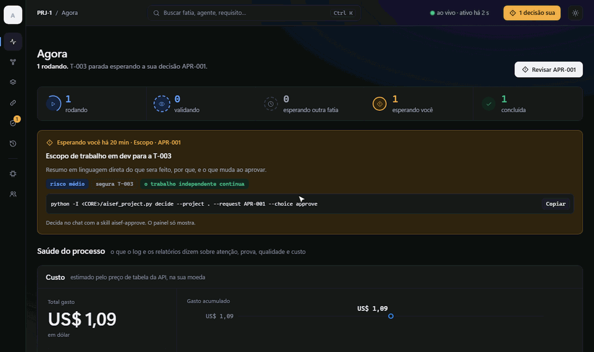
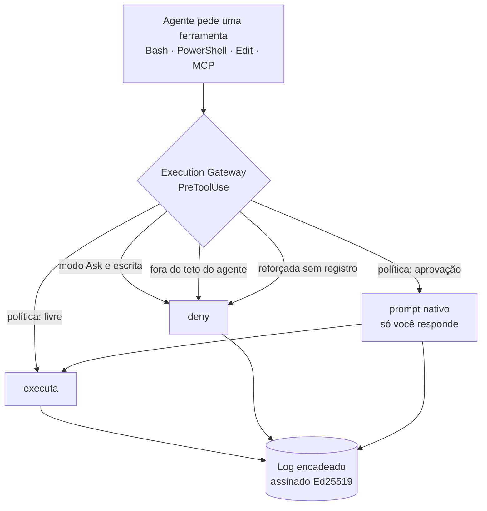
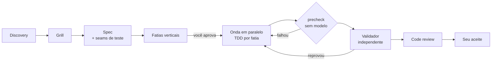
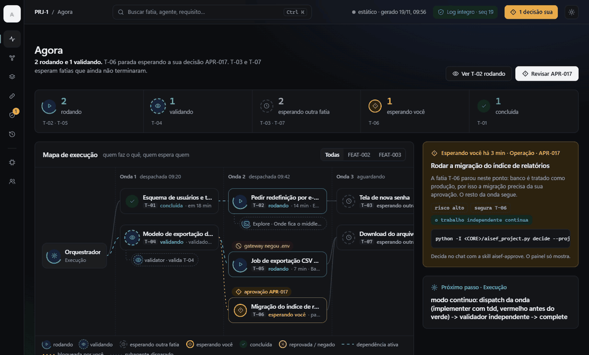

<p align="center"></p>

<p align="center"><a href="README.md">English</a> · <b>Português</b></p>

O AISEF é um plugin do Claude Code que transforma um pedido em linguagem natural numa feature especificada, quebrada em fatias verticais, implementada com TDD por agentes em paralelo, validada por outro agente e aceita por você. Cada chamada de ferramenta passa por uma política aplicada em código, e cada passo fica num log assinado que denuncia adulteração.

| 148 | 919 | 19 | ~0,2 s |
|---|---|---|---|
| regras de consistência no `aisef-check` | checagens automatizadas, CI em Linux e Windows | decisões de arquitetura registradas ([ADRs](docs/adr/README.md)) | por chamada de ferramenta no Windows ([medido](tools/bench_hooks.py)) |

<p align="center"></p>
<p align="center"><sub>O painel ao vivo com dados de demonstração: quem está rodando, quem está esperando e por quê, que subagente cada agente disparou, e as raias no tempo.</sub></p>

## Novidades

- **0.12.0, a equipe, as boas práticas e a arquitetura (ideias do everything-claude-code).**
  - **66 agentes num catálogo único**, por tipo: executores, avaliadores (código, arquitetura, banco, segurança, testes, falhas silenciosas, tipos, comentários e 16 revisores por linguagem), corretores (simplificador, limpador de código morto, desempenho e 13 corretores de build) e consultores (planejador, arquiteto, minerador de specs, explorador, documentação). Os de linguagem só entram quando a stack é detectada. O agente `frontend` não mudou.
  - **Detecção de arquitetura.** `aisef_project.py detect` acha a stack e o estilo (Clean, hexagonal, DDD, CQRS, MVC, monólito modular, microsserviços...), confere a regra de dependência pelos imports e recomenda melhorias. Adotar um estilo é decisão sua e vira ADR.
  - **Boas práticas** (comuns, por arquitetura com "quando não usar", por linguagem) instaladas em `.claude/rules/aisef/`.
  - **Revisores escolhidos em código**, todos precisam aprovar antes do validador, com revisão dupla em risco alto. E mais `verify-loop`, nada de `--no-verify` e configs de lint que os agentes não podem afrouxar.
- **0.10.0, painel v3.** O **mapa de execução** virou a visão principal: uma coluna por onda, cada fatia com estado, tempo e última ação, e os subagentes presos ao agente que os disparou. Um hook novo registra **quem disparou quem**; quando não há como ter certeza, a ligação aparece como "inferida".
  - Clicar numa fatia abre a gaveta dela. Clicar num agente ou subagente abre a gaveta dele: o que pediram a ele, quem o disparou, modelo, tempo e as últimas ações.
  - As **raias em paralelo** marcam reprovações, negações do gateway e pedidos de decisão no momento exato.
  - O grafo de dependências é desenhado pelo próprio painel e destaca o **caminho crítico**.
  - Busca global (`Ctrl K`), atalhos de teclado, filtros que sobrevivem a recarregar a página, claro e escuro com contraste AA conferido, e um autoteste no Chrome sem interface.
- **0.9.3, o Ask pesquisa na internet.** O `/aisef:ask` lê fontes primárias, cita as URLs e escolhe o modelo pela pergunta: Haiku para achar algo no projeto, Sonnet para pesquisa (o padrão) e Opus só a pedido.

Histórico completo no [CHANGELOG](CHANGELOG.md).

## A mesma feature, de dois jeitos

Pedido: *"recuperação de senha por e-mail, o link vale 30 minutos e só pode ser usado uma vez"*.

| Com um prompt solto | Com o AISEF |
|---|---|
| O agente começa a escrever código na hora. | O AISEF diz a fase: "Estamos em Especificar. Próximo: Grill → Spec → Fatias." |
| Tabela, endpoint e tela de uma vez; nenhum teste antes do código. | **Grill:** três perguntas, uma por vez, cada uma com recomendação (validade do link? resposta para e-mail inexistente? link reutilizável?). Nada é inventado. |
| Decide sozinho que "o link vale 24 h" e que "a resposta muda se o e-mail não existe". Nenhum dos dois foi pedido, e o segundo vaza quem tem conta. | **Spec** com os seams de teste confirmados por você (`POST /auth/reset`, `POST /auth/reset/confirm`). |
| Roda um comando no banco local "para conferir a tabela". Nada impede, nada registra. | Três **fatias verticais**; você aprova o plano. Uma chamada despacha a onda: duas fatias em paralelo para o `implementer`. |
| "Pronto, todos os testes passam": os testes foram escritos depois do código. | O agente tenta `psql` e recebe **deny** (banco a partir de uma sessão é tratado como produção). Fica no log. |
| `git push` vai junto, porque o agente achou que você queria. | A `tdd_evidence` mostra o teste **falhando antes de passar**, e o check confere a ordem. Outro modelo valida. Code review, seu aceite, e o `git push` passa pelo prompt nativo, que só você responde. |

Do lado esquerdo, o trabalho é rápido e opaco. Do direito, cada decisão foi sua, cada requisito tem teste e evidência, e daqui a seis meses o painel e o log mostram exatamente o que aconteceu.

## Como funciona

Skills dizem ao modelo o que fazer. O **gateway** decide o que ele **pode** fazer.



O trabalho segue o método do Matt Pocock (grill → spec → tickets → TDD), com rastreabilidade de ponta a ponta:



| Camada | O que faz |
|---|---|
| **Processo (SDD + TDD)** | Discovery, Grill, Spec, fatias verticais, execução paralela com TDD, validação independente, code review e o seu aceite. Cada requisito aponta para a fatia, o critério, o teste e a evidência (RTM). |
| **Aplicação técnica** | Um gateway `PreToolUse` aplica a política a Bash, PowerShell, ferramentas de arquivo, WebFetch e MCP. Cada operação Git pede a própria aprovação, segredos pedem aprovação, banco e deploy são negados, e cada subagente fica limitado pelo seu Agent Contract. |
| **Evidência** | Toda operação e toda tentativa bloqueada vão para um log encadeado por hash e assinado com Ed25519. O head assinado fica fora do repositório. |
| **Custo** | Modelo e effort escolhidos por tarefa, conforme risco e complexidade, do Haiku ao Opus; cada tentativa que falha sobe um nível. |
| **Aprendizado** | Lições tiradas de erros já registrados (reprovações, bloqueios), que só valem com a sua aprovação e perdem confiança quando param de ajudar. |

## O painel

<p align="center"></p>

Oito telas num trilho de ícones. Todas são derivadas dos contratos e do log assinado, e nenhuma é fonte de verdade:

| Tela | O que mostra |
|---|---|
| **Agora** | O que roda e o que espera, o mapa de execução, as decisões que esperam você com o comando para copiar, o próximo passo, as raias em paralelo e a tabela de fatias com os ciclos de TDD |
| **Mapa dos agentes** | O mapa e as raias em largura total, mais a árvore de quem disparou quem |
| **Features e fatias** | A etapa de cada feature, as fatias, o grafo de dependências com o caminho crítico e os relatórios de execução entregues |
| **Rastreabilidade** | Requisito → fatia → critério → evidência, com o filtro "só lacunas" |
| **Governança** | Decisões pendentes, decisões tomadas, escolhas de arquitetura com as opções descartadas, e riscos |
| **Histórico** | O log encadeado por hash, cada evento com o seu bloco e a assinatura |
| **Engenharia** | Diagramas de arquitetura e de dados, endpoints, ameaças e migrações do blueprint |
| **Equipe de agentes** | Quem trabalha em quê, os subagentes em execução, as lições aprovadas e os despachos por modelo |

Com o log comprometido, uma faixa vermelha aparece no topo e todos os comandos de aprovar somem. Rode ao vivo com `build_panel.py --serve` (atualiza a cada 3 s sem perder rolagem, filtros nem a gaveta aberta) ou como página estática.

## Onde o AISEF fica entre as alternativas

Leitura dos READMEs e da documentação oficial em 18/11/2026. "Instrução" quer dizer que o processo depende de o modelo obedecer; "aplicado" quer dizer que há código impedindo.

| | Specs | Aplicação técnica | TDD | Paralelismo | Rastreabilidade | Auditoria | Custo por risco |
|---|---|---|---|---|---|---|---|
| **AISEF** | ● spec + fatias | ● gateway, teto por agente | ● vermelho→verde checado | ● ondas + validação por onda | ● requisito→evidência | ● hash + Ed25519 | ● L0–L6 |
| Spec Kit (150k★) | ● | ◐ hooks de extensão | – | – | ◐ | – | – |
| Superpowers (321k★) | ◐ | ◐ instrução + bootstrap | ● | ● | – | – | ◐ |
| BMAD (55k★) | ● | – instrução | ◐ | ◐ | ◐ IDs com fonte | – | – |
| OpenSpec (75k★) | ● | – instrução | – | – | ◐ | – | – |
| Kiro (AWS) | ● | ● hooks | ◐ | ● ondas | – | – | – |
| Matt Pocock (327k★) | ● | – instrução | ● | ● | ◐ blocking edges | – | – |
| everything-claude-code (306k★) | ◐ | ● hooks em Node | ● | ◐ | – | ◐ varredura | ◐ |
| Claude Code puro | – | ● permissões e hooks | – | ● | – | – | ◐ manual |

● cobre · ◐ em parte · – não descrito

### As sete lacunas que ninguém cobre bem, e a resposta do AISEF

| Lacuna | Como o AISEF cobre | Limite |
|---|---|---|
| Governança aplicada na hora da chamada | Gateway decide allow, ask ou deny em cada chamada, com teto por agente | Lê comandos por padrões: reduz risco, não isola. Use com o `/sandbox` |
| Log que denuncia adulteração | Cada evento tem o hash do anterior e assinatura Ed25519; o head fica fora do repositório | Não protege contra quem tem a chave privada da sua máquina |
| Requisito até a evidência | RTM liga requisito → fatia → critério → teste → evidência, e o check acusa buracos | O caminho rápido de manutenção tem rastreio mais leve |
| Validação com privilégio separado | O validador só lê o Git, nunca valida o próprio trabalho e roda em nível igual ou maior, de preferência em outro modelo | Uma onda grande num validador só pede para ser dividida |
| Modelo escolhido pelo risco | Escada Haiku → Opus por risco, recursos sensíveis, complexidade e tentativas | Variáveis de ambiente do Claude Code podem anular; o roteador avisa |
| Uma central de decisões | Cada decisão é um pedido com impacto, diff, rollback e risco; a reforçada vale para o comando exato, uma vez | Se você aprovar sem ler, nenhuma camada técnica impede |
| Memória revisada antes de virar regra | Lições de erros registrados, aprovadas por você, com confiança calculada em código | Sem a sua revisão nos marcos, nada é aprendido, e isso é de propósito |

### Somar em vez de competir

O AISEF é a **espinha** (governança, rastreabilidade, decisões e aprendizado revisado). O **músculo** vem de skills prontas, mantidas por quem as criou:
- **Matt Pocock:** `grilling`, `domain-modeling`, `tdd` (pré-carregada no agente `implementer`) e `code-review`.
- **Design:** UI/UX Pro Max, Taste e Impeccable, trabalhando dentro de uma autoridade de design aprovada por você.
- **Grafos de código:** codebase-memory-mcp (código) e Graphify (docs e decisões).

## Instalação

Pré-requisitos:
- Claude Code;
- Python 3.10 ou mais novo, com `pip install jsonschema cryptography`;
- no Windows, o Git Bash (o Claude Code já o usa para os hooks).

```
/plugin marketplace add NowItMakesSense/aisef
/plugin install aisef@aisef
```

Se o Python que tem o `cryptography` não for o primeiro do PATH, defina `AISEF_PYTHON` com o caminho dele (isso também deixa os hooks mais rápidos). Para atualizar uma instalação antiga: `/plugin marketplace update aisef` e depois `/plugin update aisef@aisef`.

## Comece em 5 minutos

1. Na pasta do projeto, peça **"iniciar o AISEF neste projeto"**. Num projeto existente, o AISEF investiga antes de propor qualquer coisa.
2. Quando ele pedir, aprove os agentes e as regras nativas de segunda camada.
3. Descreva o que quer. O AISEF diz em que fase você está e conduz Grill → Spec → Fatias até o plano que você aprova.
4. Acompanhe ao vivo: `aisef-panel` abre o painel com o mapa de execução, quem disparou quem, as decisões que esperam você e as raias em paralelo.
5. Só uma dúvida? `/aisef:ask <pergunta>` responde sem mudar nada: lê o projeto e, quando a pergunta pede, pesquisa na internet com as fontes citadas, escolhendo o modelo pela pergunta. `/aisef:modo ask` deixa a sessão inteira só de leitura até `/aisef:modo exec`. Veja [como ele se compara ao Ask do Cursor](docs/guide/ask-mode.md).

Para explorar sem gastar tokens, siga o [passo a passo com o projeto de demonstração](docs/guide/walkthrough.md).

## O que vem dentro

| Componente | Papel |
|---|---|
| Skills | `aisef` (orquestrador), `aisef-init`, `aisef-discovery`, `aisef-tooling`, `aisef-design`, `aisef-feature`, `aisef-approve`, `aisef-check`, `aisef-panel`, `ask`, `modo` |
| Agentes | 66 papéis num catálogo único (`core/agents/catalog.v0.1.json`): executores (`implementer`, `backend`, `frontend`...), avaliadores, corretores, consultores e o `validator`; os de stack entram com a detecção. Cada um com teto de permissão |
| Hooks | gateway (`PreToolUse`), auditoria (`PostToolUse`), doctor (`SessionStart`), eventos dos subagentes e quem disparou quem (`PreToolUse` Agent), lembrete do modo Ask |
| Núcleo | JSON Schemas, políticas de permissão e de modelo, verificador de consistência, log assinado, geradores por brief, despacho em lote, pacotes de contexto, aprendizado revisado, painel ao vivo, detecção de stack e arquitetura, boas práticas, roteamento de revisores e verify-loop |

## Documentação

Comece por [docs/README.md](docs/README.md). Lá estão:
- os conceitos e o fluxo de trabalho;
- a referência da política, dos comandos e dos hooks;
- a lista gerada das regras do check;
- as [decisões de arquitetura](docs/adr/README.md);
- o [roadmap](docs/roadmap.md).

## Desenvolvimento

```
python -m venv .venv && .venv/Scripts/pip install -r requirements-dev.txt   # Windows
python run_tests.py
claude plugin validate plugins/aisef
claude plugin eval plugins/aisef --tag trigger --no-publish
```

O repositório usa o Graphify em si mesmo (código, docs, ADRs e skills; só o passo estrutural, nada sai da máquina). Regenere o grafo depois de mudar código ou docs; `graphify-out/` não é versionado:

```
GRAPHIFY_BACKEND=none python -m graphify update .
python -m graphify query "como o gateway decide um git push"
```

## Licença

MIT
