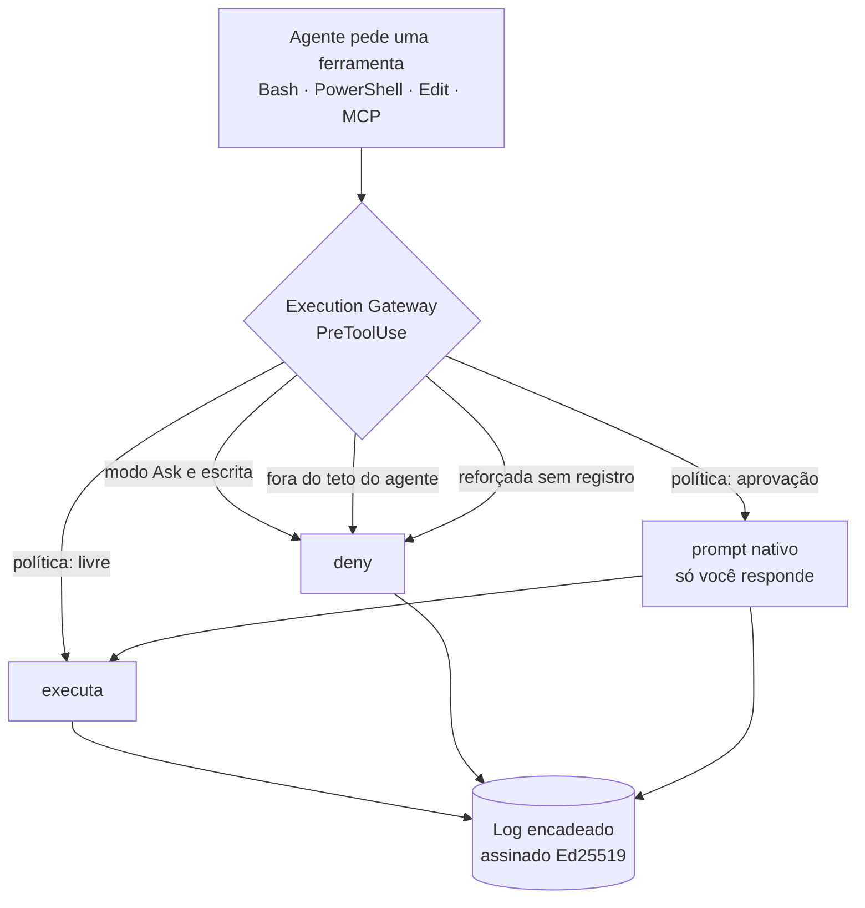
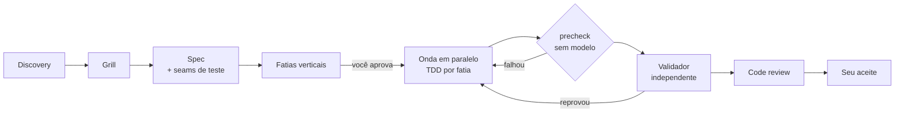

<p align="center"></p>

# AISEF

[English](README.md) · **Português**

**Agentes rápidos são fáceis. Agentes que você pode auditar, não.**

O AISEF é um plugin do Claude Code que transforma um pedido em linguagem natural numa feature especificada, quebrada em fatias verticais, implementada com TDD por agentes em paralelo, validada por outro agente e aceita por você. Cada chamada de ferramenta passa por uma política aplicada em código, e cada passo fica num log assinado que denuncia adulteração.

| 148 | 857 | 18 | ~0,2 s |
|---|---|---|---|
| regras de consistência no `aisef-check` | checagens automatizadas, CI em Linux e Windows | decisões de arquitetura registradas ([ADRs](docs/adr/README.md)) | por chamada de ferramenta no Windows ([medido](tools/bench_hooks.py)) |


## A mesma feature, de dois jeitos

Pedido: *"recuperação de senha por e-mail, o link vale 30 minutos e só pode ser usado uma vez"*.

| Com um prompt solto | Com o AISEF |
|---|---|
| O agente começa a escrever código na hora. | O AISEF diz a fase: "Estamos em Especificar. Próximo: Grill → Spec → Fatias." |
| Tabela, endpoint e tela de uma vez; nenhum teste antes do código. | **Grill:** três perguntas, uma por vez, cada uma com recomendação (validade do link? resposta para e-mail inexistente? link reutilizável?). Nada é inventado. |
| Decide sozinho que "o link vale 24 h" e que "a resposta muda se o e-mail não existe". Nenhum dos dois foi pedido, e o segundo vaza quem tem conta. | **Spec** com os seams de teste confirmados por você (`POST /auth/reset`, `POST /auth/reset/confirm`). |
| Roda um comando no banco local "para conferir a tabela". Nada impede, nada registra. | Três **fatias verticais**; você aprova o plano. Uma chamada despacha a onda: duas fatias em paralelo para o `implementer`. |
| "Pronto, todos os testes passam": os testes foram escritos depois do código. | O agente tenta `psql` e recebe **deny** (banco a partir de uma sessão é tratado como produção). Fica no log. |
| `git push` vai junto, porque o agente achou que você queria. | A `tdd_evidence` mostra o teste **falhando antes de passar**, e o check confere a ordem. Outro modelo valida. Code review, seu aceite, e o `git push` passa pelo prompt nativo, que só você responde. |

Do lado esquerdo, o trabalho é rápido e opaco. Do direito, cada decisão foi sua, cada requisito tem teste e evidência, e daqui a seis meses o painel e o log mostram exatamente o que aconteceu.

## Como funciona

Skills dizem ao modelo o que fazer. O **gateway** decide o que ele **pode** fazer.



O trabalho segue o método do Matt Pocock (grill → spec → tickets → TDD), com rastreabilidade de ponta a ponta:



| Camada | O que faz |
|---|---|
| **Processo (SDD + TDD)** | Discovery, Grill, Spec, fatias verticais, execução paralela com TDD, validação independente, code review e o seu aceite. Cada requisito aponta para a fatia, o critério, o teste e a evidência (RTM). |
| **Aplicação técnica** | Um gateway `PreToolUse` aplica a política a Bash, PowerShell, ferramentas de arquivo, WebFetch e MCP. Cada operação Git pede a própria aprovação, segredos pedem aprovação, banco e deploy são negados, e cada subagente fica limitado pelo seu Agent Contract. |
| **Evidência** | Toda operação e toda tentativa bloqueada vão para um log encadeado por hash e assinado com Ed25519. O head assinado fica fora do repositório. |
| **Custo** | Modelo e effort escolhidos por tarefa, conforme risco e complexidade, do Haiku ao Opus; cada tentativa que falha sobe um nível. |
| **Aprendizado** | Lições tiradas de erros já registrados (reprovações, bloqueios), que só valem com a sua aprovação e perdem confiança quando param de ajudar. |

## Onde o AISEF fica entre as alternativas

Leitura dos READMEs e da documentação oficial em 18/11/2026. "Instrução" quer dizer que o processo depende de o modelo obedecer; "aplicado" quer dizer que há código impedindo.

| | Specs | Aplicação técnica | TDD | Paralelismo | Rastreabilidade | Auditoria | Custo por risco |
|---|---|---|---|---|---|---|---|
| **AISEF** | ● spec + fatias | ● gateway, teto por agente | ● vermelho→verde checado | ● ondas + validação por onda | ● requisito→evidência | ● hash + Ed25519 | ● L0–L6 |
| Spec Kit (150k★) | ● | ◐ hooks de extensão | – | – | ◐ | – | – |
| Superpowers (321k★) | ◐ | ◐ instrução + bootstrap | ● | ● | – | – | ◐ |
| BMAD (55k★) | ● | – instrução | ◐ | ◐ | ◐ IDs com fonte | – | – |
| OpenSpec (75k★) | ● | – instrução | – | – | ◐ | – | – |
| Kiro (AWS) | ● | ● hooks | ◐ | ● ondas | – | – | – |
| Matt Pocock (327k★) | ● | – instrução | ● | ● | ◐ blocking edges | – | – |
| everything-claude-code (306k★) | ◐ | ● hooks em Node | ● | ◐ | – | ◐ varredura | ◐ |
| Claude Code puro | – | ● permissões e hooks | – | ● | – | – | ◐ manual |

● cobre · ◐ em parte · – não descrito

### As sete lacunas que ninguém cobre bem, e a resposta do AISEF

| Lacuna | Como o AISEF cobre | Limite |
|---|---|---|
| Governança aplicada na hora da chamada | Gateway decide allow, ask ou deny em cada chamada, com teto por agente | Lê comandos por padrões: reduz risco, não isola. Use com o `/sandbox` |
| Log que denuncia adulteração | Cada evento tem o hash do anterior e assinatura Ed25519; o head fica fora do repositório | Não protege contra quem tem a chave privada da sua máquina |
| Requisito até a evidência | RTM liga requisito → fatia → critério → teste → evidência, e o check acusa buracos | O caminho rápido de manutenção tem rastreio mais leve |
| Validação com privilégio separado | O validador só lê o Git, nunca valida o próprio trabalho e roda em nível igual ou maior, de preferência em outro modelo | Uma onda grande num validador só pede para ser dividida |
| Modelo escolhido pelo risco | Escada Haiku → Opus por risco, recursos sensíveis, complexidade e tentativas | Variáveis de ambiente do Claude Code podem anular; o roteador avisa |
| Uma central de decisões | Cada decisão é um pedido com impacto, diff, rollback e risco; a reforçada vale para o comando exato, uma vez | Se você aprovar sem ler, nenhuma camada técnica impede |
| Memória revisada antes de virar regra | Lições de erros registrados, aprovadas por você, com confiança calculada em código | Sem a sua revisão nos marcos, nada é aprendido, e isso é de propósito |

### Onde o AISEF perde

- **Só no Claude Code.** Em Cursor, Codex ou Gemini, o `AGENTS.md` é só orientação.
- **Mais cerimônia.** Para um protótipo de uma tarde, o processo pesa mais que o risco. O caminho rápido alivia mudanças pequenas, mas não some.
- **Latência.** Cerca de 0,17 a 0,25 s por hook no Windows, quase todo gasto abrindo o processo Python.
- **Não é fronteira de segurança.** Um comando bem disfarçado pode passar; isolamento de verdade vem do sandbox.
- **Comunidade pequena.** É um projeto individual, com menos olhos em busca de bugs.

**Quando não usar:** prova de conceito descartável, código sem dado sensível nem deploy, ou equipe que precisa do mesmo processo em várias IDEs.

### Somar em vez de competir

O AISEF é a **espinha** (governança, rastreabilidade, decisões e aprendizado revisado). O **músculo** vem de skills prontas, mantidas por quem as criou:
- **Matt Pocock:** `grilling`, `domain-modeling`, `tdd` (pré-carregada no agente `implementer`) e `code-review`.
- **Design:** UI/UX Pro Max, Taste e Impeccable, trabalhando dentro de uma autoridade de design aprovada por você.
- **Grafos de código:** codebase-memory-mcp (código) e Graphify (docs e decisões).

## Instalação

Pré-requisitos:
- Claude Code;
- Python 3.10 ou mais novo, com `pip install jsonschema cryptography`;
- no Windows, o Git Bash (o Claude Code já o usa para os hooks).

```
/plugin marketplace add NowItMakesSense/aisef
/plugin install aisef@aisef
```

Se o Python que tem o `cryptography` não for o primeiro do PATH, defina `AISEF_PYTHON` com o caminho dele (isso também deixa os hooks mais rápidos). Para atualizar uma instalação antiga: `/plugin marketplace update aisef` e depois `/plugin update aisef@aisef`.

## Comece em 5 minutos

1. Na pasta do projeto, peça **"iniciar o AISEF neste projeto"**. Num projeto existente, o AISEF investiga antes de propor qualquer coisa.
2. Quando ele pedir, aprove os agentes e as regras nativas de segunda camada.
3. Descreva o que quer. O AISEF diz em que fase você está e conduz Grill → Spec → Fatias até o plano que você aprova.
4. Acompanhe ao vivo: `aisef-panel` abre o painel com o que cada agente está fazendo agora, o próximo passo, o fluxo de cada feature e as ondas em paralelo.
5. Só uma dúvida? `/aisef:ask <pergunta>` responde lendo o projeto com o Haiku, sem mudar nada; `/aisef:modo ask` deixa a sessão inteira só de leitura até `/aisef:modo exec`. Veja [como ele se compara ao Ask do Cursor](docs/guide/ask-mode.md).

Para explorar sem gastar tokens, siga o [passo a passo com o projeto de demonstração](docs/guide/walkthrough.md).

## O que vem dentro

| Componente | Papel |
|---|---|
| Skills | `aisef` (orquestrador), `aisef-init`, `aisef-discovery`, `aisef-tooling`, `aisef-design`, `aisef-feature`, `aisef-approve`, `aisef-check`, `aisef-panel`, `ask`, `modo` |
| Agentes | `implementer` (fatias verticais com TDD), `backend`, `frontend`, `database`, `qa`, `security`, `devops`, `domain`, `validator`, `ask`, cada um com teto de permissão e gerado de uma fonte única |
| Hooks | gateway (`PreToolUse`), auditoria (`PostToolUse`), doctor (`SessionStart`), eventos dos subagentes, lembrete do modo Ask |
| Núcleo | JSON Schemas, políticas de permissão e de modelo, verificador de consistência, log assinado, geradores por brief, despacho em lote, pacotes de contexto, aprendizado revisado e painel ao vivo |

## Documentação

Comece por [docs/README.md](docs/README.md). Lá estão:
- os conceitos e o fluxo de trabalho;
- a referência da política, dos comandos e dos hooks;
- a lista gerada das regras do check;
- as [decisões de arquitetura](docs/adr/README.md);
- o [roadmap](docs/roadmap.md).

## Desenvolvimento

```
python -m venv .venv && .venv/Scripts/pip install -r requirements-dev.txt   # Windows
python run_tests.py
claude plugin validate plugins/aisef
claude plugin eval plugins/aisef --tag trigger --no-publish
```

## Licença

MIT
