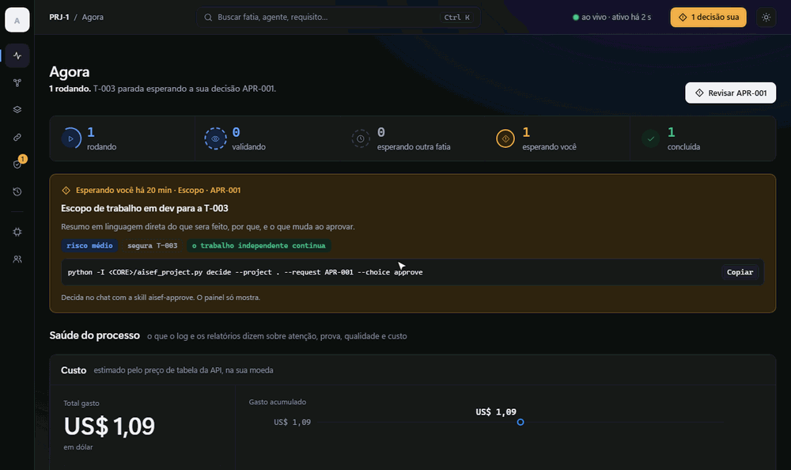
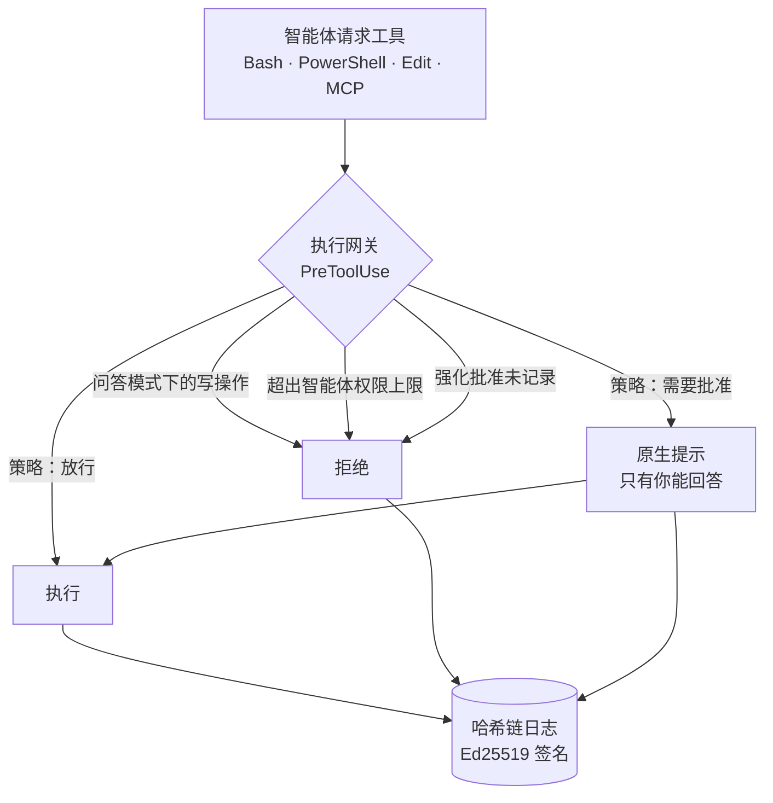
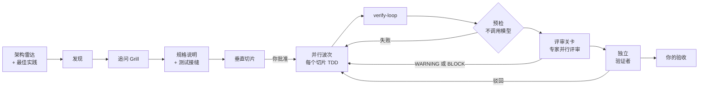
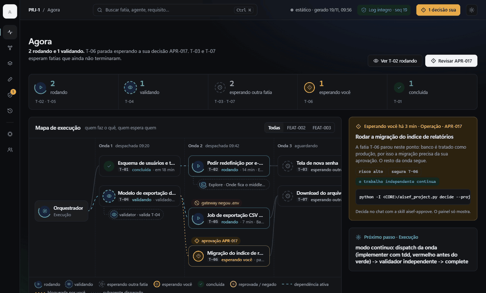

<p align="center"></p>

<p align="center"><a href="README.md">English</a> · <a href="README.pt-BR.md">Português</a> · <b>简体中文</b></p>

<h3 align="center">AI 辅助工程的证据链。规则由代码强制执行，每一步都写入签名日志，每条需求都能追溯到它的证明，并提供一个审计人员可以独立验证的证据包。</h3>

AISEF 是一个 Claude Code 插件，面向那些不仅要更快交付、还必须证明 AI 做了什么的团队。一句自然语言需求会变成一个有规格说明的功能：在代码中完成分诊，拆分为垂直切片，由多个智能体并行地以测试先行的方式实现，经专家评审，由另一个智能体验证，最后由你验收。每一次工具调用都要经过由代码强制执行的策略，每一步都写入一份签名、可发现篡改的日志，CI 可以在每个拉取请求（PR）上验证它。

| **168** | **2,500+** | **168** | **66** | **~0.2 秒** |
|---|---|---|---|---|
| `aisef-check` 中的一致性规则 | 自动化检查，CI 在 Linux 和 Windows 上运行 | 网关测试用例，其中 65 个是绕过尝试，全部被拦截（隔离边界是沙箱） | 专家智能体（新 Python 项目中启用 15 个） | Windows 上每次工具调用的网关开销（[实测](tools/bench_hooks.py)） |

<p align="center"></p>
<p align="center"><sub>演示数据下的实时面板：谁在运行、谁在等待以及原因、每个智能体启动了哪个子智能体，以及随时间变化的泳道。</sub></p>

## 只有 AISEF 能覆盖的内容

| 需求 | AISEF 提供什么 |
|---|---|
| **真正生效的规则** | 执行网关（Execution Gateway）在代码中对每一次工具调用做出允许、询问或拒绝的决定。它逐个词法单元读取命令（`bash -c`、`eval`、`$(...)`、内联代码），让签名密钥处于智能体无法触及的位置，并用各自的权限上限约束每个智能体。 |
| **无人能悄悄修改的日志** | 每个事件都以哈希链相连，并用 Ed25519 签名；链头保存在仓库之外。在团队中，每个人用自己的密钥写入自己的日志流，因此合并永远不会冲突，每一次批准都带有批准者本人的签名。 |
| **每条需求都能追溯到证明** | 需求 → 切片 → 验收标准 → 测试 → 证据，由 168 条规则检查。`aisef_sysgraph.py` 无需模型即可回答“这条需求影响了什么？” |
| **每个拉取请求都有证明** | 如果日志被篡改、日志相比基础分支变短、`aisef-check` 发现错误，或者 PR 涉及未经验证的任务，`aisef-verify` GitHub Action 就会让该 PR 失败。 |
| **审计人员可以验证的证据** | `aisef_evidence.py` 将一个功能（合同、报告、批准记录、签名事件、公钥）打包，并附上 SOC 2 CC8.1、ISO/IEC 27001:2022 A.8.32 和 A.5.3、ISO/IEC 42001、欧盟《人工智能法》第 12 条以及 NIST AI RMF 的控制项对照表。使用 `--in-toto` 时，每个任务都会获得一份签名的 in-toto 证明（DSSE）。证据包无需项目即可自行验证。 |
| **沿用你现有的可观测性工具** | `aisef_otel.py` 按照 GenAI 语义约定，将每个功能导出为 OpenTelemetry 链路追踪（OTLP/JSON）：每次智能体尝试对应一个 span，每次工具调用对应一个 span。 |

AISEF 面向受监管环境中的团队，以及任何需要说明一项由 AI 完成的变更是如何被授权、测试和批准的人。如果你只想要最快的智能体，直接使用 Claude Code 更便宜；下方“实测数据”一节给出了具体数字。

## 工具箱

以下所有功能都包含在同一个插件中，只依赖 Python 标准库在本地运行，支持 Windows、macOS 和 Linux。

| | 工具 | 能为你做什么 | 如何使用 |
|---|---|---|---|
| 🧭 | **代码分诊** | 根据敏感路径、变更类型、规模和风险，为每项变更选择路径（quick 快速、lean 精简或 full 完整）。精简路径是一个不需要蓝图的 TDD 切片。配置档（solo、team、regulated）决定默认值。你可以把路径调高，但不能调低。 | `aisef_triage.py` |
| 👥 | **智能体团队** | 66 名专家：执行者、评审者、修复者和顾问，每一位都有经过签名的权限上限。新项目从核心团队加上你的技术栈相关成员开始，其余成员按需加入。 | 自动委派，`aisef:<agent>` |
| 🧭 | **架构雷达** | 识别你的技术栈和架构风格（Clean、六边形、DDD、CQRS、模块化单体、微服务、MVC、垂直切片……）。它根据你的 import 检查依赖规则和模块边界，然后给出改进建议。 | `aisef_project.py detect` |
| 📚 | **最佳实践库** | 33 条规则：通用规则（Clean Code、SOLID、测试、安全、Git）、每种架构风格一条（附带“何时不该使用”一节），以及每种语言一条。 | `aisef_setup.py --apply`（初始化时） |
| 🔍 | **评审关卡** | 在代码中为每个任务挑选评审者：通用、语言、数据库、安全、架构和测试。所有评审者都批准后，验证者才会运行。高风险任务会得到两次独立评审。 | 每一波中自动执行 |
| ✅ | **verify-loop** | 构建 → 类型检查 → lint → 测试 → diff 中的密钥 → diff 摘要，最后给出 PASS 或 FAIL，并为任务保存证据。 | `aisef_project.py verify-loop` |
| 🛡️ | **执行网关** | 每一次工具调用都会得到允许、询问或拒绝，由代码强制执行。每个 Git 操作都需要单独批准。禁止 `--no-verify`。数据库和部署操作一律拒绝。智能体无法放宽 lint 配置。 | 始终开启（钩子） |
| 🧾 | **签名审计日志** | 生命周期、决定、shell 命令，以及每一次被拦截或被询问的调用，都会写入以哈希链相连、用 Ed25519 签名的日志；文件编辑写入以哈希链相连的遥测记录。团队中每人一个日志流。 | `aisef-check`、`aisef_streams.py` |
| ✔️ | **CI 验证** | `aisef-verify` Action 检查日志、一致性规则以及每个拉取请求涉及的任务，并生成作业摘要。 | `.github/actions/aisef-verify` |
| 📦 | **证据包** | 每个功能一个可自行验证的证据包，SOC 2、ISO 27001、ISO 42001、欧盟《人工智能法》和 NIST AI RMF 控制项与证据一一对应，并附 in-toto 证明。 | `aisef_evidence.py build` |
| 🔭 | **OpenTelemetry 导出** | 将功能导出为带 GenAI 属性的链路追踪，接入你已经在用的可观测性系统。 | `aisef_otel.py export` |
| 🗳️ | **审批中心** | 每个决定都展示其影响、diff、回滚方式和风险。只有你能通过原生提示做出决定。 | `aisef-approve` |
| 📊 | **实时面板** | 执行地图、谁启动了谁、等待你处理的决定、可追溯性、并行泳道。 | `aisef-panel` |
| 💸 | **模型路由与预算** | Haiku → Sonnet → Opus，按风险和复杂度选择。持续循环会在超出功能预算（时间、token、派发次数）、同一失败连续出现两次或智能体停滞时停止。 | 自动 |
| 🌳 | **每个切片一个 worktree** | 修改同一文件的切片可以各自在独立的 worktree 中并行运行；合并通过功能的授权范围完成，冲突会变成一次新的尝试。 | `parallel.mode = worktree` |
| 🧠 | **经评审的学习** | 从已记录的错误中提炼的经验教训。只有经过你批准才会生效，不再有帮助时置信度会下降。 | `aisef_learn.py` |
| 🎨 | **设计权威** | 每个项目一套经过批准的字体、配色和组件集，并在代码中检查。 | `aisef-design` |
| ❓ | **问答模式** | 回答问题而不修改任何内容，并可上网查资料、给出引用来源。 | `/aisef:ask` |
| 🧪 | **结果基准测试** | 使用隐藏测试，对比 AISEF 与直接使用 Claude Code 的效果、成本和时间。 | `tools/bench_outcomes.py` |

## 认识团队

智能体只在适用时才会加载。新项目从核心团队开始（13 个子智能体：构建者、每个任务都会运行的评审者、验证者和三位顾问），再加上雷达检测到的语言和框架智能体。因此，一个 Python 项目从 15 个智能体起步，永远不必为 Swift 评审者付费。扩展团队会在你提出要求或工作需要时加入。

| 类别 | 职责 | 智能体 |
|---|---|---|
| **构建者**（7） | 在任务合同范围内实现，测试先行 | `implementer`（用 TDD 完成整个垂直切片）、`backend`、`frontend`、`database`、`devops`、`doc-updater`、`e2e-runner` |
| **评审者**（10） | 用证据报告问题；从不改动代码 | `code-reviewer`、`architecture-reviewer`、`database-reviewer`、`security`、`qa`、`pr-test-analyzer`、`silent-failure-hunter`、`type-design-analyzer`、`comment-analyzer`、`agent-evaluator` |
| **语言评审者**（19） | 你所用技术栈的惯用法、安全性和常见陷阱 | Python、Django、FastAPI、TypeScript/JavaScript、React、Vue、Go、Rust、Java（Spring/Quarkus）、Kotlin、Swift、C#、F#、C++、PHP/Laravel、Ruby/Rails、Flutter、Godot，以及 `a11y-architect`（WCAG 2.2） |
| **修复者**（16） | 用最小的可行 diff 解决问题；绝不为了通过而放宽规则 | `code-simplifier`、`refactor-cleaner`、`performance-optimizer`，以及 13 个构建修复器（TS/JS、Python、Django、Go、Rust、Java、Kotlin、Swift、Dart/Flutter、C++、PyTorch、HarmonyOS、React） |
| **顾问**（10） | 调查并提出方案；由你决定 | `planner`、`architect`、`code-architect`、`code-explorer`、`spec-miner`（从遗留代码中提取规格）、`domain`、`docs-lookup`、`commit-reviewer`、`conversation-analyzer`、`harness-optimizer` |
| **领域评审者**（3） | 出现相应领域时启用 | `rag-pipeline-reviewer`、`mle-reviewer`、`healthcare-reviewer` |
| **验证者**（1） | 独立；从不验证自己的工作；对 Git 只读 | `validator` |

每位评审者都遵循同样的纪律：
- 只报告把握超过 80% 的问题；
- CRITICAL 和 HIGH 级别的问题必须给出代码行、失败场景，以及现有防护为何没能发现它；
- 没有发现问题也是有效结果。

每位修复者都遵守同一条规则：不用 `any`，不加 `# noqa`，不跳过测试来让构建通过。

## 架构雷达

```
$ python aisef_project.py detect --project .
Stacks: TypeScript, React, C# / .NET (manager: npm)
Architecture (heuristic, confirm with the user):
  - DDD strategic: confidence 0.89 (folder backend/src/Shop.SharedKernel; file docs/glossary.md)
  - Modular monolith: confidence 0.80 (3 modules in backend/src/Modules/; module with layers: Orders)
  - Clean Architecture / Onion: confidence 0.67 (folder .../Shop.Orders.Domain; folder .../Shop.Orders.Application)
  - Vertical slices: confidence 0.67 (folder frontend/src/features; folder frontend/src/shared)
Module boundaries: 3 module(s), 204 file(s) scanned, 2 cross-module dependencies:
  suggestions -> accounts (application); suggestions -> accounts (domain, VIOLATION)
Recommendations (your decision):
  - REC-DEPENDENCY-RULE: Fix the dependency rule. Suggestions.Infrastructure/EfCatalog.cs:2 imports Shop.Accounts.Domain
Applicable practices: common, lang/typescript, lang/web, lang/csharp, architecture/modular-monolith, architecture/clean-architecture, ...
```

雷达在 10 个公开的参考仓库（Clean Architecture 模板、eShop、modular-monolith-with-ddd、domain-driven-hexagon 等）上做过测量，判断正确 9 个，且没有误报依赖违规。

它从不自行修改任何内容。你通过审批中心采用某种风格，此后 `architecture-reviewer` 会按该风格检查每一次交付。每条实践都说明了何时**不该**使用，所以 AISEF 不会把 DDD 或 CQRS 强加给一个简单的 CRUD 应用。

## 实测数据，而非宣传

`tools/bench_outcomes.py` 用三种方式运行同一个任务。测试对智能体隐藏，只在它完成后运行。以下是 `feat-slugify` 的结果，使用 Sonnet，重复 3 次：

| 方式 | 隐藏测试 | 成本中位数 | 耗时中位数 |
|---|---|---|---|
| 直接使用 Claude Code | 3/3 次运行均为 7/7 | 0.13 美元 | 26 秒 |
| AISEF，带评审关卡 | 3/3 次运行均为 7/7 | 1.49 美元 | 335 秒 |
| AISEF，不带评审者 | 3/3 次运行均为 7/7 | 1.32 美元 | 333 秒 |

评审关卡让每个切片的成本增加约 13%，处于多次运行之间的正常波动范围内。对于这么小的任务，完整流程的成本约为直接使用 Claude Code 的 11 倍。你付费换来的是规格说明、TDD 证据、独立验证、评审以及签名记录。在更大的真实功能上带来的质量提升，是下一步要测量的内容。

0.13 及之后版本的功能都有 CI 覆盖，其中包括一个测试：让一个完整的功能周期跑遍配置档、路径、并行方式、遥测和个人日志的全部 48 种组合。这些功能尚未在真实项目中运行过。[成熟度表](docs/reference/maturity.md)（葡萄牙语）列出了每项功能的成熟度、是否默认开启以及如何关闭。

## 更新内容

- **0.16.0，可信的面板，以及同一项目中的另一个会话。** 面板会把已验收的功能显示为已验收，把每个代理放到它实际处理的切片上，提供按功能的时间线和卡片式总览，并且只在真正重要时才亮起网关警报。同一项目中的两个 Claude Code 会话现在能互相看到、各自保留不同区域，并在编辑或提交到对方的工作之前收到提醒。
- **0.15.5，首次推送前先确认远程仓库。** 当项目还不是 Git 仓库或没有远程仓库时，`next` 和 doctor 会给出提示；初始化会先询问项目是否已在 GitHub 上存在，再决定是否新建。添加或修改远程仓库、在 GitHub 上创建仓库，现在都由你决定。
- **0.15.4，面板。** 右侧栏只有一张卡片时，它保持地图高度的一半，而不再拉伸到整个高度。
- **0.15.3，面板修复。** 实时指示器显示面板已打开多长时间；已用时间在两次更新之间也会继续走动；在“现在”页面，执行地图有固定高度，由待处理的决定和关注成本卡片平均分配。
- **0.15.2，哪些已被证明、哪些还没有。** 一张成熟度表区分了经过真实使用的功能和只有 CI 覆盖的功能，并列出每项的默认值和关闭方式。一个新测试让完整的功能周期跑遍全部 48 种模式组合。README 中的数字现在会与代码核对。
- **0.15.1，面板中的关注成本与影响范围。** “现在”页面显示你被打断了多少次（每完成一个任务对应的批准次数和网关询问次数、首次验证通过率、每个任务的 token 数），可追溯性页面新增“影响范围”筛选：输入一条需求、一个任务或一个文件，只看它涉及的需求。
- **0.15.0，面向团队和审计人员。** 每个拉取请求上的 `aisef-verify` GitHub Action，每个功能一个可自行验证、附带 SOC 2 和 ISO 27001 控制项的证据包，按 GenAI 约定导出 OpenTelemetry，每人一份审计日志（合并永不冲突，批准由批准者本人签名），以及一份与变更日志核对过的路线图。
- **0.14.0，系统即图，流程即数据，切片各有 worktree。**
  - 核心和钩子模块都不再超过 500 行；`aisef_project` 保持相同的 API，检查改为运行一组规则注册表；
  - `aisef_sysgraph.py` 无需模型即可回答影响范围问题：一条需求涉及哪些任务、标准、测试、文件和证据，以及某个任务为什么存在；
  - 流程（任务状态、事件、阶段、关卡、配置档）保存在 `workflow.v0.1.json` 中，由循环、引导、分诊和检查共同读取；
  - 文件编辑和被允许的 MCP 调用写入以哈希链相连的遥测记录，签名日志只保留能证明工作内容的事件；
  - 使用 `parallel.mode = worktree` 时，共享同一文件的切片在各自的 worktree 中并行运行，通过功能的授权范围合并，合并冲突会变成一次新的尝试。worktree 内的钩子写入主 `.aisef`；
  - `metrics` 报告关注成本：每完成一个任务，你需要停下来多少次。
- **0.13.0，更少摩擦，更严格的网关，一个知道何时停下的循环。**
  - 由代码分诊选择路径（quick、lean 或 full）；新的精简路径是一个不需要蓝图的 TDD 切片，仪式化程度配置档（solo、team、regulated）决定默认值；
  - Python 项目从 15 个智能体起步，而不是 33 个；初始化只需一次批准，即可应用智能体、原生规则、最佳实践和文档；
  - 网关逐个词法单元读取命令（`bash -c`、`eval`、`$(...)`、内联代码），并有一个包含 138 条命令、其中 48 条为绕过尝试的语料库作保护。它还堵住了真实存在的漏洞：带 `git -c` 的强制推送此前只会询问，而且签名密钥和链头锚点此前可以被访问；
  - 按风险处理 Git：`feat/*` 上的提交无需批准，功能分支的推送由该功能的授权范围覆盖。MCP 工具可以被信任最长 7 天；
  - 持续循环会在超出预算、反复出现相同失败或智能体停滞时停止。钩子会记录任务的开始和结束，`check --fix` 会给出修复建议，`rebase-req` 会跟进发生变化的需求；
  - 缺少 Graphify 时使用原生 import 图，doctor 能找到正确的 Python，新增 `migrate` 和原生沙箱。
- **0.12.1，实地检验后的修复。** 这些修复来自在真实项目中运行 0.12：
  - 架构决定可以作用于整个项目，因此在第一个功能出现之前就能采用某种风格；
  - 雷达会检查模块边界，并且不再把骨架服务当作微服务；
  - 网关不再拦截访问审计目录的只读命令（`grep`、`git check-ignore`、`--dry-run`）。
- **0.12.0，团队、雷达和最佳实践。** 56 个新智能体，按类别组织并按技术栈启用。带建议的架构检测。33 条最佳实践规则。在代码中选择评审者，并在验证前设置关卡。`verify-loop`。智能体无法放宽的 lint 配置。部分思路移植自 [everything-claude-code](https://github.com/affaan-m/everything-claude-code)（MIT 许可，见[声明](THIRD_PARTY_NOTICES.md)）。
- **0.11.0，度量。** `metrics`（每个任务的批准、驳回、交付周期、token 和成本）以及结果基准测试。
- **0.10.0，面板 v3。** 执行地图、谁启动了谁、并行泳道，以及带关键路径的依赖图。

完整历史见 [CHANGELOG](CHANGELOG.md)（葡萄牙语）。

## 同一个功能，两种做法

需求：*“通过邮件重置密码；链接 30 分钟内有效，且只能使用一次”*。

| 直接用提示词 | 使用 AISEF |
|---|---|
| 智能体立刻开始写代码。 | AISEF 说明当前阶段：“我们处于规格说明阶段。下一步：Grill → Spec → Slices。” |
| 数据表、接口和页面一次性全部写完；写代码之前没有任何测试。 | **Grill（追问）：** 一次问一个问题，共三个，每个都附带建议（链接有效期多长？邮箱不存在时如何响应？链接能否重复使用？）。不会凭空捏造任何内容。 |
| 它自作主张地决定“链接有效期 24 小时”以及“邮箱不存在时返回不同的响应”。这两点都不是需求，而第二点会泄露谁拥有账号。 | 包含你确认过的测试接缝（`POST /auth/reset`、`POST /auth/reset/confirm`）的 **Spec（规格说明）**。 |
| 它为了“检查一下数据表”对本地数据库执行命令。没有任何东西阻止它，也没有任何记录。 | 三个**垂直切片**；你批准计划。一次调用派发整一波：两个切片并行交给 `implementer`。 |
| “完成了，所有测试都通过”：而这些测试是在代码之后才写的。 | 智能体尝试运行 `psql`，被**拒绝**（会话中访问的数据库一律视为生产环境）。这一过程被记录下来。 |
| `git push` 也一并执行了，因为智能体认为你会想要这样。 | `tdd_evidence` 证明测试**先失败后通过**，检查会核对这一顺序。专家评审者批准，然后由另一个模型验证。经你验收后，`git push` 才会通过只有你能回答的原生提示。 |

左边的工作快速但不透明。右边的每个决定都出自你，每条需求都有测试和证据，六个月后，面板和日志依然能准确展示当时发生了什么。

## 工作原理

技能（skill）告诉模型该做什么。**网关**决定模型**可以**做什么。



工作遵循 Matt Pocock 的方法（grill → spec → tickets → TDD），并具备端到端的可追溯性：



| 层次 | 作用 |
|---|---|
| **流程（SDD + TDD）** | 架构雷达、发现、追问、规格说明、垂直切片、并行的测试先行执行、评审关卡、独立验证以及你的验收。每条需求都指向它的切片、标准、测试和证据（RTM，需求追溯矩阵）。 |
| **强制执行** | `PreToolUse` 网关将策略应用于 Bash、PowerShell、文件工具、WebFetch 和 MCP。每个 Git 操作都需要单独批准，涉及密钥时会询问，数据库和部署操作一律拒绝，每个子智能体都受其智能体合同（Agent Contract）的约束。 |
| **证据** | 每一次操作和每一次被拦截的尝试都会写入以哈希链相连、用 Ed25519 签名的日志。签名链头保存在仓库之外。 |
| **成本** | 按风险和复杂度为每个任务路由模型和推理强度，从 Haiku 到 Opus；每次尝试失败都会提升一级。 |
| **学习** | 从已记录的错误（驳回、拦截）中提炼的经验教训，只有经你批准才会生效，不再有帮助时置信度会下降。 |

## 面板

<p align="center"></p>

图标导航栏上有八个页面。每个页面都由合同和签名日志推导而来，没有一个是事实的来源：

| 页面 | 你能看到什么 |
|---|---|
| **现在** | 哪些在运行、哪些在等待，执行地图，等待你处理的决定及可复制的命令，下一步，并行泳道，以及带 TDD 周期的切片表 |
| **智能体地图** | 全宽显示的地图和泳道，以及谁启动了谁的树状图 |
| **功能与切片** | 每个功能所处的阶段、它的切片、带关键路径的原生依赖图，以及已交付的执行报告 |
| **可追溯性** | 需求 → 切片 → 标准 → 证据，并提供“只看缺口”筛选 |
| **治理** | 待处理的决定、过往的决定、附带被放弃方案的架构选择，以及风险 |
| **历史** | 以哈希链相连的日志，每个事件都带有其区块和签名 |
| **工程** | 来自蓝图的架构图和数据图、接口、威胁和迁移 |
| **智能体团队** | 谁在做什么、正在运行的子智能体、已批准的经验教训，以及按模型统计的派发次数 |

日志损坏时，顶部会出现红色横幅，并隐藏所有批准命令。可以用 `build_panel.py --serve` 实时运行（每 3 秒刷新一次，不会丢失滚动位置、筛选条件或已打开的抽屉），也可以作为静态页面使用。

## AISEF 在同类方案中的位置

基于各项目截至 2026-11-18 的 README 和官方文档。“指令”表示流程依赖模型自觉遵守；“强制”表示由代码阻止违规。

| | 规格说明 | 强制执行 | TDD | 并行 | 可追溯性 | 审计 | 按风险控制成本 |
|---|---|---|---|---|---|---|---|
| **AISEF** | ● 规格说明 + 切片 | ● 网关，每个智能体的权限上限 | ● 检查红→绿顺序 | ● 波次 + 每波验证 | ● 需求→证据 | ● 哈希 + Ed25519 | ● L0–L6 |
| Spec Kit（15 万★） | ● | ◐ 扩展钩子 | – | – | ◐ | – | – |
| Superpowers（32.1 万★） | ◐ | ◐ 指令 + 引导 | ● | ● | – | – | ◐ |
| BMAD（5.5 万★） | ● | – 指令 | ◐ | ◐ | ◐ 带来源的 ID | – | – |
| OpenSpec（7.5 万★） | ● | – 指令 | – | – | ◐ | – | – |
| Kiro（AWS） | ● | ● 钩子 | ◐ | ● 波次 | – | – | – |
| Matt Pocock（32.7 万★） | ● | – 指令 | ● | ● | ◐ 阻塞依赖 | – | – |
| everything-claude-code（30.6 万★） | ◐ | ● Node 钩子 | ● | ◐ | – | ◐ 扫描 | ◐ |
| 直接使用 Claude Code | – | ● 权限与钩子 | – | ● | – | – | ◐ 手动 |

● 覆盖 · ◐ 部分覆盖 · – 未提及

### 无人能很好覆盖的七个空白，以及 AISEF 的回答

| 空白 | AISEF 如何覆盖 | 局限 |
|---|---|---|
| 工具调用时的治理 | 网关对每一次调用决定允许、询问或拒绝，并有每个智能体的权限上限 | 它通过词法单元和模式读取命令：能降低风险，但不能实现隔离。请配合原生沙箱使用，初始化时会在支持的平台上将其开启 |
| 可发现篡改的日志 | 每个事件都带有上一个事件的哈希和 Ed25519 签名；链头保存在仓库之外 | 无法防范掌握你本机私钥的人 |
| 从需求到证据 | RTM 连接需求 → 切片 → 标准 → 测试 → 证据，检查会标出缺口 | 快速维护路径的可追溯性较弱 |
| 权限分离的验证 | 验证者对 Git 只读，从不验证自己的工作，并且以相同或更高的级别运行，最好使用另一个模型 | 由一个验证者处理的大波次应当拆分 |
| 按风险选择模型 | 由风险、敏感资源、复杂度和尝试次数驱动的 Haiku → Opus 阶梯 | Claude Code 的环境变量可以覆盖它；路由器会发出警告 |
| 所有决定集中一处 | 每个决定都是一个附带影响、diff、回滚和风险的请求；强化批准只覆盖那条确切的命令，且仅限一次 | 如果你不看就批准，任何技术手段都拦不住 |
| 经评审后才成为规则的记忆 | 从已记录错误中提炼的经验教训，由你批准，置信度在代码中计算 | 如果你不在里程碑处评审，就不会学到任何东西，这是有意的设计 |

### 互相补充而非竞争

AISEF 是**骨架**（治理、可追溯性、决定和经评审的学习）。**肌肉**来自由各自作者维护的现成技能：
- **Matt Pocock：** `grilling`、`domain-modeling`、`tdd`（预加载在 `implementer` 智能体中）和 `code-review`。
- **设计：** UI/UX Pro Max、Taste 和 Impeccable，在你批准的设计权威范围内工作。
- **代码图谱：** codebase-memory-mcp（代码）和 Graphify（文档与决定）。

## 安装

要求：
- Claude Code；
- Python 3.10+，并执行 `pip install jsonschema cryptography`；
- 在 Windows 上需要 Git Bash（Claude Code 已经用它来运行钩子）。

```
/plugin marketplace add NowItMakesSense/aisef
/plugin install aisef@aisef
```

如果装有 `cryptography` 的 Python 不是 PATH 中的第一个，请将 `AISEF_PYTHON` 设置为它（这也会让钩子运行得更快）。要更新旧的安装：先执行 `/plugin marketplace update aisef`，再执行 `/plugin update aisef@aisef`。

## 5 分钟上手

1. 在项目文件夹中说 **“start AISEF in this project”**（在此项目中启动 AISEF）。对于已有代码库，AISEF 会先调查再提出任何建议。
2. 在被询问时批准智能体和原生的第二层规则。对于已有代码库，**架构雷达**会运行，并展示你的技术栈、风格及其建议。你各用一次批准来采用某种风格、安装对应的**最佳实践**。
3. 描述你想要的内容。AISEF 会告诉你所处的阶段，并带你走完 Grill → Spec → Slices，直到你批准计划。
4. 实时观看：`aisef-panel` 会打开面板，显示执行地图、谁启动了谁、等待你处理的决定以及并行泳道。
5. 只是想问个问题？`/aisef:ask <问题>` 会在不修改任何内容的情况下回答：它会阅读项目，并在问题需要时上网查资料、给出引用来源，同时根据问题选择模型。`/aisef:modo ask` 会让整个会话保持只读，直到执行 `/aisef:modo exec`。参见[它与 Cursor 的 Ask 模式的比较](docs/guide/ask-mode.md)（葡萄牙语）。

如果想在不消耗 token 的情况下探索，请按照[演示项目演练](docs/guide/walkthrough.md)（葡萄牙语）操作。

## 包含的内容

| 组件 | 作用 |
|---|---|
| 技能 | `aisef`（编排器）、`aisef-init`、`aisef-discovery`、`aisef-tooling`、`aisef-design`、`aisef-feature`、`aisef-approve`、`aisef-check`、`aisef-panel`、`ask`、`modo` |
| 智能体 | 来自同一份目录（`core/agents/catalog.v0.1.json`）的 66 个角色：执行者（`implementer`、`backend`、`frontend`……）、评估者、修复者、顾问和 `validator`；与技术栈相关的角色在检测到对应技术时启用。每个角色都有权限上限 |
| 钩子 | 网关（`PreToolUse`）、审计（`PostToolUse`）、doctor（`SessionStart`）、子智能体事件以及谁启动了谁（`PreToolUse` Agent）、问答模式提醒 |
| 核心 | JSON Schema、权限与模型策略、一致性检查器、签名日志、需求简报生成器、批量派发、上下文包、经评审的学习、实时面板、技术栈与架构检测、最佳实践、评审者路由以及 verify-loop |

## 文档

从 [docs/README.md](docs/README.md)（葡萄牙语）开始阅读：
- 概念与工作流程；
- 策略、命令和钩子参考；
- 自动生成的检查规则列表；
- [架构决策记录](docs/adr/README.md)；
- [路线图](docs/roadmap.md)。

## 开发

```
python -m venv .venv && .venv/Scripts/pip install -r requirements-dev.txt   # Windows
python run_tests.py
claude plugin validate plugins/aisef
claude plugin eval plugins/aisef --tag trigger --no-publish
```

本仓库对自身使用 Graphify（代码、文档、ADR 和技能；只做结构分析，数据不会离开本机）。修改代码或文档后请重建图谱；`graphify-out/` 不纳入版本控制：

```
GRAPHIFY_BACKEND=none python -m graphify update .
python -m graphify query "how does the gateway decide on git push"
```

## 许可证

MIT
