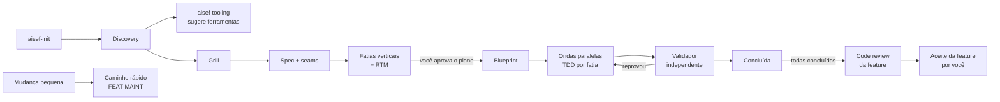

# Fluxo de trabalho

## 1. Começar
Diga "iniciar o AISEF neste projeto". A `aisef-init` detecta se o projeto é novo ou existente, pergunta só o identificador, o nome e o ambiente e cria `.aisef/` com o log assinado. Depois:
- mostra o teto de cada agente e pede sua aprovação para ativá-los;
- propõe as regras nativas de segunda camada em `.claude/settings.json`;
- propõe a seção AISEF no `AGENTS.md`;
- oferece a `find-skills` e o grafo de código.

Nada é gravado sem o seu OK.

## 2. Descobrir
A `aisef-discovery` investiga antes de perguntar: docs, código, schema (sem conectar ao banco), testes, histórico e, se preciso, internet. Cada informação é classificada como `confirmado`, `encontrado` (com fonte), `inferido` (vira pergunta) ou `desconhecido`. O resultado fica em `.aisef/discovery.md`. Em seguida, a `aisef-tooling` sugere skills, plugins e MCPs ligados ao que foi descoberto, e só instala o que você escolher.

## Design (projeto com interface)
Antes da primeira feature de UI, a `aisef-design` define **uma autoridade de design** em `.aisef/design/`: tipografia, paleta, espaçamento, movimento, componentes e regras. Ela usa como fontes a UI/UX Pro Max (dados), a Taste (direção de arte, só em sites) e o Impeccable (execução e detector). Você aprova como decisão arquitetural. Depois disso:
- toda fatia de UI recebe os tokens no pacote de contexto e o critério "nada fora dos tokens" (`design_check.py scan`);
- o `frontend` entrega capturas em 375, 768 e 1440 px.

## 3. Especificar (Grill → Spec → Fatias)
Peça a feature, ou diga "quero fazer uma spec disso". A `aisef-feature` conduz três fases e sempre diz em qual você está:
1. **Grill:** perguntas uma de cada vez até fechar cada ramo da ideia (skill `grilling` do plugin `mattpocock-skills`, quando instalado).
2. **Spec:** solução, histórias de usuário, decisões e os **seams de teste**, as interfaces públicas onde os testes vão atuar, confirmados com você.
3. **Fatias verticais:** cada fatia atravessa as camadas necessárias, é demonstrável sozinha e tem teste automatizado; as dependências entre fatias são as blocking edges.

O modelo escreve um brief curto e `aisef_new.py feature` gera, já validados contra os schemas, o Feature Contract com a spec, uma tarefa por fatia (TDD obrigatório), a RTM e o pedido `plan_approval`. Você aprova o plano na `aisef-approve`. Depois vem o Blueprint (`aisef_new.py blueprint`). O método está em [`spec-and-slices.md`](../../plugins/aisef/skills/aisef-feature/references/spec-and-slices.md).

## 4. Executar (modo contínuo)
Com o plano aprovado, o orquestrador segue sozinho. A cada ciclo, `aisef_project.py next` calcula as ações, e cada uma tem uma resposta:

| Ação | Resposta do orquestrador |
|---|---|
| `dispatch` | Dispara a onda atual em paralelo; cada fatia vai para o `implementer`, que faz TDD e registra a evidência de vermelho antes do verde |
| `validate` | Chama um validador independente |
| `complete` | Conclui a tarefa |
| `feature_acceptance` | Pede o seu aceite da feature |
| `await_decision` | Leva a decisão até você |

Ele para só quando precisa de você:
- `critical_risk`;
- `attempts_exhausted`;
- `user_decision_pending`;
- `nothing_ready`.

Funciona com o `/loop` do Claude Code no modo autoritmado.

## 5. Aceitar
A feature só fecha com o seu aceite, depois de requisitos rastreados, critérios verificados, testes de integração e regressão e um relatório final planejado × executado. **O aceite não autoriza Git.** Commit, push, PR e merge pedem aprovação própria.

## Mudanças pequenas
Typo, texto, renomeação local, patch de dependência sem quebra, ajuste de lint: `aisef_new.py quick` cria uma tarefa na feature permanente `FEAT-MAINT`. Na primeira vez, você aprova o plano dela; depois, essas mudanças seguem sem blueprint nem validador. Na dúvida, não é rápido.

## Reabrir uma feature aceita
É sempre um novo ciclo (`defect`, `requirement_change` ou `evolution`), com Impact Analysis e novo aceite. O ciclo anterior fica congelado ([ADR 0001](../adr/0001-reabertura-de-feature-e-um-novo-ciclo.md)).

## Branch por feature (opcional)
Com `"git": {"branch_per_feature": true, ...}` no `config.json`, o `next` sugere criar `feat/<id>` antes da primeira onda e, depois do merge do PR, apagar a branch remota e a local. Cada exclusão é uma aprovação reforçada.
