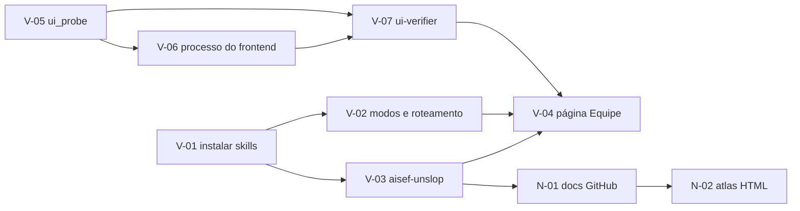

# Plano 0.18: frontend com skills por intenção, checagem de "cara de IA" e documentação do projeto

> **Status:** em execução desde 2026-11-27 (o usuário pediu para fazer tudo). V-05 e V-06 prontas; próxima: V-07.
> **Origem:** pedido do usuário em 2026-11-27. Ele quer:
> - skills certas para cada tipo de trabalho de frontend;
> - uma skill que diga se o projeto está com cara de IA;
> - documentação para o GitHub e documentação HTML do projeto inteiro;
> - a página de agentes do painel refeita, como teste do novo fluxo.
>
> **Como retomar:** leia só a seção 1 (Estado). Pegue a primeira tarefa `[ ]` e leia o bloco dela na seção 3.

## 1. Estado

Legenda: `[x]` feito, `[~]` em andamento, `[ ]` a fazer, `[u]` depende do usuário (instalação, escolha).

| Ordem | ID | Tarefa | Estado |
|---|---|---|---|
| 1 | V-05 | `ui_probe`: sonda de responsividade e usabilidade num navegador real, com capturas | `[x]` |
| 2 | V-06 | Frontend: processo obrigatório de responsividade, conteúdo alcançável e interação | `[x]` |
| 3 | V-07 | Agente `ui-verifier`: confere toda entrega de UI com provas, e sem ele a fatia não fecha | `[ ]` |
| 4 | V-01 | Instalar e fixar as skills externas (GSAP, img2threejs, unslop) | `[u]` |
| 5 | V-02 | Frontend: modos de design por fatia e roteamento de skills | `[ ]` |
| 6 | V-03 | Skill `aisef-unslop`: o projeto está com cara de IA? | `[ ]` |
| 7 | N-01 | Documentação para o GitHub (evolui o `doc-updater`) | `[ ]` |
| 8 | N-02 | Atlas do projeto: documentação HTML de todo o contexto | `[ ]` |
| 9 | V-04 | Painel: refazer a página "Equipe de agentes" com o fluxo novo | `[ ]` |

**Prioridade (pedido de 2026-11-27):** V-05, V-06 e V-07 vêm primeiro. É o problema que aparece hoje: componentes que não se adaptam à largura da tela, conteúdo escondido ou inacessível, e interação esperada que não existe (arrastar, por exemplo) sem que ninguém teste.

**Versão:** entra em `## 0.18.0 (em andamento)` no CHANGELOG. Bump no fechamento.

**PRs:** uma branch por tarefa (`feat/v0.18-<id>`), PR para `main` e merge depois do CI verde. V-05 e V-06 saíram juntas (mesmos arquivos), na branch `feat/v0.18-v05`.

**Notas da V-05:** a sonda foi calibrada no painel do AISEF com os dados do HireMe (de 63 achados para 3 reais, já corrigidos). As barras curtas da linha do tempo ficam como exceção da WCAG 2.5.8; na V-04 elas entram no `ui-probe.ignore.json` do painel, com o motivo. A suíte da sonda leva cerca de 4 minutos (Chrome real).

**Fechamento de cada tarefa:**
- teste no `run_tests.py`;
- CHANGELOG;
- linha em `docs/reference/maturity.md`;
- ADR quando a política muda (V-02 e V-03 mudam);
- `python tools/gen_agents.py` quando mexer em agente;
- contagem de regras nos 3 READMEs quando entrar regra nova.

## 2. Decisões (recomendação; confirme ou troque)

### D1. Um agente frontend com modos, não um agente por skill

Recomendo **não** criar seis agentes. Fica um `frontend`, com o prompt de hoje quase intacto, e cada fatia de UI declara o **modo** do trabalho. O pacote de contexto entrega só a skill daquele modo.

Por que este caminho:
- **Custo:** cada subagente começa do zero e relê contrato, tokens e código. Seis agentes repetiriam essa leitura até seis vezes por tela.
- **Contexto:** as skills de design são pesadas. A Taste manda ler várias referências e tem um Stop hook de até 600 s; a UI/UX Pro Max traz bases de dados inteiras. Pré-carregar todas (campo `skills:` do subagente) gastaria contexto em toda tarefa. Carregar só a skill do modo, pela ferramenta Skill, gasta só o necessário.
- **Consistência:** uma única autoridade de design (`.aisef/design/tokens.json`) continua mandando em todos os modos. Agentes separados tenderiam a divergir em tipografia e paleta, que é exatamente o problema que o `aisef-design` resolveu.
- **Pouca mudança:** você pediu para não mudar muito o agente. Muda só a tabela de skills do prompt; o resto do pacote de contexto já existe.

O `implementer` também entra: as fatias verticais atravessam a UI, e ele recebe o mesmo roteamento quando a fatia tem `touches: ["ui"]`.

| Modo (`design_mode`) | Quando | Skill principal | Apoio |
|---|---|---|---|
| `component` | criar ou mudar componente (botão, card, tabela, formulário) | **Taste** (`design-taste-frontend`, que na v2 tem regras para telas de app) | Impeccable `audit` |
| `page` | montar página ou tela inteira (layout, hierarquia, fluxo) | **UI/UX Pro Max** (padrões de UX por stack e setor) | Taste para a direção de arte, Impeccable `layout` |
| `recreate` | recriar o design de um site ou imagem, ou reescrever componente ou página a pedido | **Emil Kowalski** (`emil-design-eng`) | `design_check.py shots` para comparar com a referência |
| `motion` | animação | **GSAP** (`greensock/gsap-skills`, oficial) | `animate`, `animation-performance` |
| `3d` | transformar imagem em modelo 3D | **img2threejs** | GSAP para animar o modelo |

Regras que valem em todos os modos:
- A skill propõe e os tokens decidem. Valor fora dos tokens vira proposta de mudança de design, decisão sua (como hoje).
- Uma tarefa pode ter mais de um modo; por exemplo, `["page", "motion"]` carrega as duas skills.
- Sem modo declarado, vale o comportamento de hoje (tabela antiga do prompt).
- Skill ausente: o pacote avisa e o agente segue as regras do prompt, sem travar. A instalação é sugerida pela `aisef-tooling`, nunca feita sozinha.

### D2. Mudança na regra da Taste

Hoje o prompt e o schema dizem "Taste só em `marketing_site` ou `mixed`". Você quer a Taste nos componentes de qualquer projeto. A v2 dela já tem uma trilha para telas de app (dashboards, configurações), então a regra passa a ser:
- Taste sempre no modo `component`;
- a trilha de landing page dela só em `marketing_site` ou `mixed`.

O Stop hook de 600 s continua sendo um risco de lentidão: medir na V-04.

### D3. Recriar o design de outro site

O modo `recreate` copia **estrutura, ritmo e linguagem visual**, nunca logo, marca, texto ou imagem de terceiros. A referência (URL ou imagem) fica registrada na fatia e a captura da referência entra na evidência. Recriar o produto de outra empresa como se fosse ele não é aceito.

### D4. "Cara de IA" é checada em três frentes, não só no texto

O `unslop` (`theclaymethod/unslop`) cuida só de **texto**. Para o projeto inteiro, a skill `aisef-unslop` junta três detectores que já existem ou entram na V-01:

| Frente | O que acusa | Detector |
|---|---|---|
| Texto | README, docs, CHANGELOG, textos da UI e mensagens de commit com frases feitas, travessões em excesso, "não é X, é Y", listas de três, superlativos | `unslop` (scanners em Python com biblioteca padrão) |
| Interface | gradiente violeta, cards iguais em grade, sombras e raios genéricos, ícone em cima de todo título, hero centralizado padrão | `npx impeccable detect`, inspetor da Taste, `design_check.py scan` |
| Código | comentário que narra o óbvio, `try/except` defensivo sem motivo, abstração com um uso só, nome genérico (`data`, `handleClick2`) | agentes `comment-analyzer` e `code-simplifier`, em modo só leitura |

A skill entrega uma nota por frente, os achados com `arquivo:linha` e a correção sugerida.
- Por padrão só lê; corrigir é um segundo passo, com seu OK.
- Ela **não** vira regra que bloqueia o check (gosto não é erro). Entra como aviso opcional no aceite da feature (`SLOP-REPORT-MISSING`, só quando o projeto ativar).

### D5. Duas documentações, uma com redação e outra gerada

- **GitHub (N-01):**
  - evolui o `doc-updater`, que já faz README e guias, em vez de criar um agente novo;
  - ganha um modo `github`: README com instalação que roda, CONTRIBUTING, `docs/` navegável e Mermaid que o GitHub renderiza;
  - passa pela `aisef-unslop` antes da entrega.
- **Atlas HTML (N-02):** quase tudo já está nos contratos (features, requisitos, fatias, RTM, blueprints, decisões, riscos). O mais barato e mais confiável é um **gerador determinístico** (`build_atlas.py`, irmão do `build_panel.py`): uma página HTML única, offline, com busca. O LLM entra só onde o contrato não tem texto: o resumo "o que esta feature faz para o usuário", escrito pelo `doc-updater` a partir do código e salvo em `.aisef/atlas/notes/FEAT-x.md` para o gerador incluir.
  - Diferença do painel: o painel mostra **o andamento** (quem está fazendo o quê, custo, integridade); o atlas mostra **o produto** (o que existe, por que e onde está no código). Não é para virar um segundo painel.

### D6. Qual página do painel

O painel tem duas telas de agentes. "Mapa dos agentes" (`#mapa`) mostra ondas e linha do tempo. "Equipe de agentes" (`#agentes`) tem as colunas de cartões e as lições. **Assumo que é a Equipe de agentes.** Se for o Mapa, a V-04 muda de alvo, e o método é o mesmo.

### D7. Quem faz a interface não é quem prova que ela funciona

Hoje a evidência visual do `frontend` são três capturas (375, 768 e 1440 px), o `design_check scan` (só cores e fontes) e "checagem de acessibilidade" declarada por ele mesmo. O `a11y-architect` revisa lendo código. **Ninguém abre a tela num navegador, muda a largura, rola, arrasta e usa o teclado.** Foi assim que passaram, no painel, as pílulas de feature inacessíveis, os botões cobertos pela barra fixa e o texto cortado sem como ler inteiro.

A mudança tem três camadas:
1. **Ferramenta determinística** (`ui_probe`, V-05): mede no navegador real o que dá para medir sem opinião, como estouro de largura, conteúdo fora de alcance, foco coberto, alvo pequeno e controle que não faz nada. Ela gera capturas anotadas e um relatório.
2. **Processo do executor** (V-06): o `frontend` e o `implementer` declaram, antes de codar, como cada componente se comporta em cada largura e que interações ele tem. Escrevem testes para elas e só entregam com a sonda limpa.
3. **Verificador independente** (V-07): um agente novo, `ui-verifier`, que nunca é quem fez. Ele roda a sonda de novo, testa as interações declaradas e as que deveriam existir, e anexa as provas. Sem o relatório dele aprovado, a fatia de UI não passa para `validated`.

### D8. Motor da sonda: Chrome pelo protocolo de depuração, sem dependência nova

O plugin só usa biblioteca padrão mais `cryptography` e `jsonschema`. Opções:

| Opção | Prós | Contras |
|---|---|---|
| **(a) Chrome/Edge pelo DevTools Protocol, com cliente WebSocket mínimo em biblioteca padrão** | Sem dependência; o `find_chrome` já existe; dá eventos reais de ponteiro e toque (`Input.dispatchMouseEvent`, `dispatchTouchEvent`), emulação de tela e captura recortada | Escrever o cliente WebSocket (cerca de 120 linhas) |
| (b) Playwright do projeto (`npx playwright`) | API pronta | Nem todo projeto tem; instalar baixa navegador; passa pelo S-05 |
| (c) Claude in Chrome (MCP) | Interativo | Depende da extensão e da sessão do usuário; não roda no CI nem em subagente |

**Recomendo a (a)** como padrão. Quando o projeto já tiver Playwright, a (b) roda os testes de interação que o próprio `frontend` escreveu (V-06). A (c) fica só para depuração manual.

## 3. Tarefas

### V-05: `ui_probe`, a sonda de responsividade e usabilidade

Ponto de partida: o `audit.js` da auditoria U-01 do painel, que já detectou texto cortado, foco coberto, rolagem sem barra e clique sem efeito. Ele é generalizado para qualquer página, não só o painel.

**Arquivos:**
- `core/ui_probe.py` (CLI, até 500 linhas): abre o Chrome headless com `--remote-debugging-port`, injeta a sonda e passa por cada largura e estado.
  - Uso: `python -I CORE/ui_probe.py run --url <url> [--routes rotas.json] --out .aisef/reports/ui/<T-ID>`.
- `core/cdp_client.py` (cliente WebSocket mínimo e chamadas CDP; só biblioteca padrão).
- `core/ui_probe.js` (a sonda que roda na página).
- `core/ui-probe-report.schema.v0.1.json`.
- Junção com `design_check.py shots`: as capturas passam a sair da sonda, e o `shots` antigo continua como atalho.

**O que ela mede, por largura** (320, 375, 768, 1024 e 1440 px; com toque emulado nas duas menores):

| Regra | O que acusa | Referência |
|---|---|---|
| `UI-REFLOW` | a página rola na horizontal, ou um elemento passa da borda da tela | WCAG 1.4.10 |
| `UI-CLIPPED` | texto cortado (reticências, `overflow: hidden`, altura fixa) sem jeito de ler inteiro: nada de `title`, dica no foco, expandir ou nome acessível | 1.3.1, 1.4.10 |
| `UI-UNREACHABLE` | conteúdo dentro de um contêiner que corta ou rola sem nenhum jeito de chegar a ele: barra escondida e sem arrastar, roda, teclado ou botão. A sonda **tenta** cada jeito e registra qual funcionou | 2.1.1 |
| `UI-COVERED` | elemento focado ou clicável coberto por barra fixa, cabeçalho grudado ou modal | 2.4.11 |
| `UI-TARGET` | alvo de toque menor que 24×24 px sem espaço livre em volta | 2.5.8 |
| `UI-KEYBOARD` | controle que não recebe foco; ordem de foco que pula; foco invisível; Enter ou Espaço sem efeito em `role=button`; armadilha de foco | 2.1.1, 2.4.3, 2.4.7 |
| `UI-DEAD` | elemento com cara de clicável (cursor de mão, `role=button`, `onclick`) que não muda nada ao ser acionado | — |
| `UI-HOVER-ONLY` | informação ou ação que só aparece no hover, sem equivalente no toque e no foco | 1.4.13 |
| `UI-FOCUS-RETURN` | gaveta ou modal que, ao fechar, não devolve o foco a quem a abriu | 2.4.3 |
| `UI-ZOOM` | com o texto em 200%, algo se sobrepõe ou some | 1.4.4 |
| `UI-MOTION` | animação que ignora `prefers-reduced-motion` | 2.3.3 |
| `UI-INTERACTION` | interação declarada na fatia (V-06) que não funciona; por exemplo, `drag` na lista de pílulas não move o conteúdo | — |

**Provas:**
- Uma captura da página inteira por largura.
- Para cada achado, uma **captura recortada com o elemento contornado** (a sonda desenha um contorno antes de capturar) e o seletor.
- Para cada interação, capturas de antes e depois, ou sequência em GIF quando houver movimento.
- Os arquivos ficam em `.aisef/reports/ui/<T-ID>/`, com o SHA-256 de cada um no relatório. Assim a prova não pode ser trocada depois sem o `aisef-check` acusar.

**Ruído:**
- Achados iguais são agrupados (por exemplo, "x12 chips cortados").
- Cada achado sai com o nível de certeza da sonda. Uma exceção conhecida, como texto cortado de propósito com `title`, vai em `ui-probe.ignore.json` com o motivo, e o motivo aparece no relatório.
- Sem Chrome na máquina, a sonda sai com erro claro, nunca com "tudo ok".

**Testes:** `test_ui_probe.py`, com páginas de exemplo em `core/fixtures/ui/`, uma por regra: o defeito presente gera o achado e a versão corrigida não gera. Também cobre:
- interação `drag` declarada que funciona e que não funciona;
- captura recortada criada e com hash certo;
- agrupamento de achados;
- `ignore` com motivo;
- sem Chrome, a sonda sai com erro.

No CI, o Chrome do runner (`ubuntu-latest` já tem) roda os testes. Os mesmos fixtures rodam no Windows, que é a máquina do usuário.

**Prova de fogo:** rodar no painel do AISEF. A sonda tem de achar de novo os defeitos que a U-01 corrigiu, ao reverter a correção num fixture, e passar limpa no painel atual. Rodar também no frontend do HireMe e registrar a linha de base no PR.

### V-06: processo do frontend (responsividade, conteúdo alcançável, interação)

O prompt do `frontend` muda pouco: entra um bloco novo, e o resto fica. O `implementer` recebe o mesmo bloco quando a fatia toca UI.

**1. Antes de codar, declarar o comportamento.** No brief da fatia (`aisef-feature`, fase Fatias), cada componente ou tela de UI ganha `ui_behavior`:
- `widths`: o que muda em cada faixa. Por exemplo, "até 480 px: lista em uma coluna; tabela vira cartões; filtros num menu".
- `overflow`: o que fazer quando o conteúdo não cabe: quebrar linha, rolar com barra visível, arrastar, "ver mais" ou truncar com o texto inteiro acessível.
- `interactions`: os gestos esperados, por exemplo `[{"target": ".fb-list", "gesture": "drag", "expect": "rola na horizontal"}]`. Os gestos possíveis são `drag`, `swipe`, `wheel`, `keyboard`, `hover`, `long_press` e `resize`.
- `states`: vazio, carregando, erro, muito conteúdo (100 itens, nome de 80 caracteres) e pouco conteúdo.

Quando o brief não declara, o orquestrador pergunta na fase Fatias. A sonda também sugere: contêiner que rola sem barra vira "declare a interação ou mostre a barra".

**2. Durante: regras fixas no prompt.**
- Sem largura fixa em contêiner de conteúdo; `min-width: 0` em filho de flex e grid.
- Nada de `overflow: hidden` em texto sem o caminho para ler inteiro.
- Rolagem horizontal sempre com indício visível (sombra na borda, barra ou setas) e com arrastar, roda e teclado.
- Toda ação de hover tem equivalente no toque e no foco.
- Alvo de 24 px; barra fixa com `scroll-padding`.
- Testar com conteúdo do pior caso. A skill `break-ui`, já instalada, gera esses dados.

**3. Antes de entregar: provar o que ele mesmo fez.**
- Testes de interação escritos por ele, no Playwright do projeto quando houver, ou como roteiro da sonda em `ui-probe.routes.json`: um por item de `interactions`, cada um com o comportamento esperado.
- `ui_probe run` sem achado acima de `low` nas 5 larguras.
- O relatório da sonda vai junto no Execution Report (`evidence.ui_probe`).
- O estado final continua no máximo `executed`. A prova dele não substitui a do verificador (D7).

**Arquivos:**
- `core/agents/prompts/frontend.md` e `implementer.md`;
- `core/task-contract.schema.v0.1.json` (`ui_behavior`);
- `core/aisef_new.py` (aceita o campo no brief e, nas fatias de UI, acrescenta o critério "UI verificada pela sonda e pelo `ui-verifier`");
- `skills/aisef-feature/SKILL.md` (pergunta o comportamento na fase Fatias);
- `core/aisef_context.py` (o pacote traz `ui_behavior` e o comando da sonda);
- depois, `python tools/gen_agents.py`.

**Regras no check:**
- `UI-BEHAVIOR-MISSING` (aviso): fatia de UI sem `ui_behavior`;
- `UI-PROBE-MISSING` (erro ao passar para `executed`): relatório de fatia de UI sem `evidence.ui_probe`.

**Testes:** `test_ui_behavior.py` cobre:
- o schema aceita e recusa;
- o pacote traz o bloco;
- a fatia de UI ganha o critério;
- as duas regras disparam e deixam de disparar nos casos certos;
- o prompt gerado contém o bloco.

### V-07: agente `ui-verifier`

**Papel:** avaliador independente de toda entrega de UI. Ele não corrige: relata com prova, e a correção volta ao executor. Pode ser o mesmo modelo do executor, mas nunca a mesma instância nem o mesmo relatório (regra "quem executa não valida").

**Catálogo** (`core/agents/catalog.v0.1.json`):
- `kind: evaluator`; `activation: always`, para rodar em qualquer projeto com UI;
- ferramentas `Read`, `Grep`, `Glob`, `Bash` (sem `Edit` nem `Write` no código; escreve só o relatório);
- modelo e esforço pela Model Policy: esforço alto, porque é o portão.

**O que ele faz, em ordem:**
1. Lê o Task Contract, o `ui_behavior` e o relatório do executor. **Não confia** no relatório da sonda que o executor anexou: roda a sonda de novo, na build atual, com as mesmas rotas.
2. Testa cada interação declarada.
3. **Procura o que não foi declarado:**
   - contêiner que corta conteúdo;
   - lista longa sem paginação ou rolagem;
   - componente que parece arrastável ou expansível e não é;
   - tabela larga no celular;
   - formulário com teclado virtual cobrindo o campo, no toque emulado;
   - conteúdo do pior caso, gerado com a `break-ui`.
4. Para os achados que a sonda não mede (hierarquia confusa, ação principal escondida, fluxo que exige adivinhar), dá um parecer de usabilidade em passos: "para fazer X, o usuário precisa de N passos; o terceiro não tem pista visível". Cada item vem com a captura do passo. Opinião sem captura não entra.
5. Monta a **prancha de provas**: um HTML único em `.aisef/reports/ui/<T-ID>/index.html` com as capturas por largura lado a lado, cada achado com a captura recortada, as interações com antes e depois, e o veredito. O link vai no relatório e o painel mostra a prancha na gaveta da fatia.

**Veredito:**
- `APPROVE`: sem achado `high` nem `critical`.
- `WARNING`: com `medium` aceitável e registrado.
- `BLOCK`: conteúdo inacessível, interação declarada quebrada ou página que estoura a largura.

**Portão:**
- `core/aisef_review.py` `reviewers_for`: toda tarefa com `touches: ["ui"]` ou arquivo de UI ganha `ui-verifier`, sempre, além do `a11y-architect` de hoje.
- `check_rules_4.py`:
  - `UI-VERIFY-MISSING` (erro): fatia de UI em `validated` sem relatório do `ui-verifier` com `APPROVE` ou `WARNING`;
  - `UI-VERIFY-SELF` (erro): o relatório foi feito pelo mesmo agente que executou;
  - `UI-EVIDENCE-TAMPERED` (erro): o hash de uma captura não bate com o relatório.
- O `validator` continua conferindo os critérios de aceite. Ele lê o veredito do `ui-verifier` como evidência, mas não o refaz.

**Arquivos:**
- `core/agents/prompts/ui-verifier.md`;
- entrada no catálogo;
- `core/aisef_project.py` `AGENT_PROFILES` (teto de ferramentas);
- `core/aisef_review.py`;
- `check_rules_4.py` e `check_project.py` (`RULE_GROUPS`);
- `core/ui-verification-report.schema.v0.1.json`;
- prancha: `core/ui_board.py` e o modelo HTML;
- painel: o link da prancha na gaveta da fatia;
- `python tools/gen_agents.py`;
- contagem de regras nos 3 READMEs;
- ADR `docs/adr/00xx-verificacao-de-ui-independente.md`.

**Testes:** `test_ui_verifier.py` cobre:
- fatia de UI recebe o `ui-verifier` nos revisores;
- `validated` sem relatório dá `UI-VERIFY-MISSING`;
- relatório do mesmo agente dá `UI-VERIFY-SELF`;
- captura trocada dá `UI-EVIDENCE-TAMPERED`;
- `BLOCK` impede `validated`;
- a prancha gera HTML com todas as capturas e roda offline;
- o agente gerado tem as ferramentas certas e não tem `Edit`.

**Pronto quando:**
1. no HireMe, uma fatia de UI real passa pelo fluxo inteiro: `frontend` com sonda limpa, `ui-verifier` com prancha e `validated` só depois do `APPROVE`;
2. uma versão com um defeito plantado (as pílulas sem arrastar) é barrada com `BLOCK` e a captura do problema.

### V-01: instalar e fixar as skills externas `[u]`

Já instaladas nesta máquina:
- Taste (`design-taste-frontend`);
- UI/UX Pro Max (plugin `ui-ux-pro-max-skill`);
- Impeccable;
- `emil-design-eng`;
- `animate`, `animation-performance`, `improve-animations`.

Faltam três:

| Skill | Fonte | Observação |
|---|---|---|
| GSAP | `greensock/gsap-skills` (oficial da GreenSock): `/plugin marketplace add greensock/gsap-skills` | GSAP é gratuito, com todos os plugins |
| img2threejs | `img2threejs/img2threejs` ou `hoainho/img2threejs`: a origem oficial ainda precisa ser confirmada | Há várias cópias, e a versão do npm (0.1.1) não bate com a do SKILL.md (2.0.0). Ler o código antes, fixar por commit |
| unslop | `theclaymethod/unslop` | Só biblioteca padrão. Outro projeto usa o mesmo nome (`popey/claude-code-skills`): fixar o dono |

Passos:
1. Pela `aisef-tooling`, com a sua escolha, ler o SKILL.md e os scripts de cada uma e fixar o commit.
2. Registrar em `.aisef/tooling.md` e no catálogo novo `core/design-skills.v0.1.json` (V-02).
3. A skill Emil vem de `~/.claude/skills/emil-design-eng`. Confirmar a origem para registrar a fonte.

**Pronto quando:** as 3 skills estão instaladas, com commit fixado, e o `doctor` lista as 5 do roteamento como presentes ou ausentes.

### V-02: modos de design e roteamento de skills

**Arquivos:**
- `core/design-skills.v0.1.json` (novo, fonte única): modo → skill principal, apoio, nome do pacote para instalar, restrições (por exemplo, `recreate` exige `reference`) e evidência exigida.
- `core/task-contract.schema.v0.1.json`: campo opcional `design.modes` (enum dos 5) e `design.reference` (URL ou caminho de imagem, obrigatório em `recreate`).
- `core/aisef_new.py`: as fatias com `touches: ["ui"]` aceitam `design_modes` no brief; sem ele, fica sem modo (compatível).
- `core/aisef_context.py` `_design_for`: devolve `skills` com o modo, a skill, se está instalada e as instruções de uso (de 3 a 5 linhas, tiradas do catálogo). Não devolve o conteúdo da skill: o agente carrega a skill pela ferramenta Skill.
- `core/agents/prompts/frontend.md` e `implementer.md`: a tabela fixa de skills dá lugar a "use as skills de `design.skills` do pacote". Taste, Impeccable e a regra dos tokens continuam como estão. Depois, `python tools/gen_agents.py`.
- `core/design-tokens.schema.v0.1.json`: texto do `kind` atualizado (D2); `sources` ganha `gsap`, `img2threejs`, `emil-design-eng`.
- `skills/aisef-design/SKILL.md` (tabela de fontes) e `skills/aisef-feature/SKILL.md` (na fase Fatias, perguntar o modo de cada fatia de UI).
- Regras novas no check (`check_rules_4.py`), ambas aviso:
  - `DESIGN-MODE-REF-MISSING`: `recreate` sem `reference`;
  - `DESIGN-SKILL-ABSENT`: o modo pede uma skill que não está instalada, com a correção apontando para a `aisef-tooling`.
- Evidência por modo, no Execution Report:
  - `recreate`: captura da referência e da tela, lado a lado (`design_check.py shots --compare <ref>`);
  - `motion`: `prefers-reduced-motion` respeitado e sem animação de propriedade que não seja `transform` ou `opacity` (checagem no `design_check scan`);
  - `3d`: a cena renderiza e tem alternativa estática.

**ADR:** `docs/adr/00xx-modos-de-design.md` (D1 e D2).

**Testes:** `test_design_modes.py` cobre:
- o pacote traz só a skill do modo;
- dois modos trazem duas skills;
- sem modo, o pacote fica igual ao de hoje;
- skill ausente dá aviso, não erro;
- `recreate` sem referência dá aviso;
- o schema aceita e recusa os casos certos;
- o `gen_agents --check` continua verde.

**Pronto quando:** uma fatia de UI com `design_modes: ["page"]` gera um pacote com a UI/UX Pro Max, e o `frontend` a carrega no teste de ponta a ponta (V-04).

### V-03: skill `aisef-unslop`

**Arquivos:**
- `skills/aisef-unslop/SKILL.md`:
  - entrada: projeto, ou só uma frente (`--text`, `--ui`, `--code`) ou só uma pasta;
  - roda os três detectores da D4;
  - junta tudo em `.aisef/reports/slop/SLOP-<data>.json` e num resumo legível.
- `core/slop_report.py` (novo, só biblioteca padrão):
  - normaliza a saída dos detectores num formato único `{front, file, line, pattern, severity, fix}`;
  - dá nota de 0 a 10 por frente;
  - compara com o relatório anterior ("melhorou ou piorou desde a última vez").
  - Os detectores externos podem faltar: a frente aparece como "não medida", nunca como 10.
- `core/slop-report.schema.v0.1.json`.
- Padrões próprios do AISEF para o texto em português, porque o `unslop` é escrito para inglês. A lista sai do que este repositório já evita nos docs: travessão em excesso, "não é X, é Y", "vale ressaltar", "robusto", "jornada", trincas de adjetivos. Fica em `core/slop-patterns.pt.v0.1.json`.
- Painel: a aba Histórico ganha a linha "última checagem de cara de IA" com a nota e a tendência (dado opcional; sem relatório, não aparece).
- Check: `SLOP-REPORT-MISSING`, aviso, só com `config.json` → `slop_check: "on_acceptance"`.

**Testes:** `test_slop_report.py` cobre:
- texto com padrões conhecidos dá os achados certos com a linha;
- texto limpo não dá achado;
- detector ausente aparece como "não medida";
- a comparação com o relatório anterior funciona;
- o schema é respeitado;
- a skill nunca edita na primeira passada.

Teste de fogo: rodar no próprio README do AISEF e no HireMe, e registrar as notas no PR.

### N-01: documentação para o GitHub

**Arquivos:**
- `core/agents/prompts/doc-updater.md`: um bloco "Modo github". Ele cobre:
  - README com o que é, instalação que roda (o agente executa os comandos), uso, configuração e licença;
  - CONTRIBUTING e a estrutura de `docs/` com índice;
  - Mermaid no lugar de imagem, quando der;
  - links relativos que funcionam no GitHub;
  - nada de badge que não seja verificável.
  - Antes de entregar, `aisef-unslop --text` nos arquivos tocados.
- `core/agents/catalog.v0.1.json`: a descrição do `doc-updater` cita o modo github. `python tools/gen_agents.py`.
- `skills/aisef/SKILL.md`: o orquestrador sabe pedir "documentar no GitHub" ao `doc-updater` como tarefa de manutenção ou de fechamento de feature.
- `tools/check_md_links.py` (novo ou dentro do `design_check`): confere links relativos e âncoras de Markdown. É a evidência determinística do modo.

**Testes:** `test_docs_links.py` cobre:
- link quebrado é acusado;
- âncora inexistente é acusada;
- link externo não é seguido (sem rede);
- o prompt gerado contém o bloco.

### N-02: atlas do projeto (HTML)

**Arquivos:**
- `core/build_atlas.py` (novo, mesmo padrão do `build_panel.py`, até 500 linhas) junta:
  - **Visão:** o que é o projeto (discovery), stack, arquitetura adotada, ADRs aprovados.
  - **Por feature:** o que faz para o usuário (nota do `doc-updater`, ou o objetivo do Feature Contract quando não houver nota); requisitos; histórias; fatias com estado; arquivos do código que cada fatia tocou (pelos relatórios); blueprint (componentes, dados, ameaças); riscos.
  - **Glossário e regras de domínio** (`domain`), quando existirem.
  - **Mapa do código:** diretório → feature que o criou ou alterou.
  - **Busca** em tudo, no próprio HTML, sem rede.
- `core/atlas.html` (modelo de página única, offline). Mesma família visual do painel, mas como documento de leitura: texto largo, índice lateral, impressão boa.
- `skills/aisef-atlas/SKILL.md`, com dois passos:
  1. notas que faltam: o `doc-updater` escreve `.aisef/atlas/notes/FEAT-x.md` só para as features sem nota ou com código alterado depois da nota (pela data e pelo hash dos arquivos da fatia);
  2. `build_atlas.py --project . --out docs/atlas/index.html`.
  - Por padrão a saída vai para `docs/atlas/`, para versionar. Opção `--out .aisef/atlas/` para não versionar.
- Dados sensíveis: a mesma redação do painel (`secrets_redacted`), e nada do log bruto.

**Testes:** `test_atlas.py` cobre:
- o projeto de exemplo gera HTML válido com todas as features;
- feature sem nota usa o objetivo do contrato;
- nota antiga é marcada para refazer;
- a busca acha requisito e arquivo;
- nada de segredo na saída;
- funciona sem rede.

### V-04: refazer a página "Equipe de agentes"

É o teste de ponta a ponta do fluxo novo. A tela é feita **como uma fatia do AISEF**: brief com `design_modes: ["page", "component", "motion"]`, o `frontend` recebe o pacote com as skills, o revisor de UI e o `aisef-unslop --ui` entram antes do aceite.

**O que a tela atual não responde** (lido em `core/index.html`, `teamMap` e `lessonCards`):
- Mostra quanto cada agente trabalhou e custou, mas não **se trabalhou bem**. Não há taxa de reprovação no validador, nem nota do `agent-evaluator`, nem retrabalho.
- Não mostra **com que ele trabalha**: modelo e esforço do papel, teto de ferramentas e permissões, e skills usadas (que passam a importar com a V-02).
- As quatro colunas de cartões iguais viram uma grade genérica. Com muitos agentes, a coluna mais longa domina e não há como comparar.
- Os agentes sem trabalho ficam num `details` escondido, e não se vê **por que** estão parados (não ativados para esta stack? sem tarefa?).
- As lições ficam na mesma tela, mas sem ligação com o agente que as aplicou.

**Proposta de conteúdo** (a forma visual sai das skills, dentro dos tokens do painel):
1. **Faixa de resumo:** quantos agentes trabalharam, custo total, parte do custo em retrabalho, agente que mais reprovou e o que mais custou.
2. **Tabela comparável da equipe**, no lugar das colunas de cartões. Uma linha por agente, agrupada por fase (constrói, revisa, valida, fora da equipe), com:
   - fatias;
   - aprovadas de primeira;
   - reprovações recebidas ou dadas;
   - custo e parte do total;
   - modelo e esforço;
   - última atividade.
   - Ordena por qualquer coluna. No celular vira lista com as 3 métricas principais.
3. **Gaveta do agente** (o padrão de gaveta que já existe):
   - o papel e a responsabilidade do catálogo;
   - ferramentas e permissões;
   - skills usadas, pelo log da ferramenta Skill;
   - fatias em que trabalhou, com o resultado;
   - lições que se aplicam a ele;
   - quanto custou por fatia.
4. **Qualidade por fase:** onde o trabalho volta. Por exemplo, "o validador reprovou 3 de 12 fatias do backend, sempre por falta de evidência".
5. **Lições** ligadas ao agente e à regra, com "funciona" ou "não resolve" como hoje.
6. **Parados com motivo:** "não ativado: stack sem Go", "ativo, sem tarefa ainda".

**Dados novos no `build_panel.py`** (opcionais no `panel-data.schema`, para o painel antigo continuar abrindo):
- `agents[].quality`: `first_pass`, `rejections_received`, `rejections_given`, `rework_usd`;
- `agents[].profile`: `model`, `effort`, `tools`, `activation`;
- `agents[].skills_used`;
- `agents[].idle_reason`.

**Movimento:** só `transform` e `opacity`, com respeito a `prefers-reduced-motion`. O modo `motion` testa a GSAP, mas o painel é um arquivo único sem dependência. Duas saídas:
- (a) a skill GSAP orienta e a implementação usa CSS e WAAPI;
- (b) embutir a GSAP (cerca de 70 KB).

Recomendo a (a), para não quebrar a regra de painel sem dependência. A GSAP fica provada num exemplo à parte.

**Evidência e testes:**
- `test_panel.py` e `test_panel_responsive.py` ganham a tela nova: tabela ordenável pelo teclado, gaveta com retorno do foco, 320 px sem rolagem lateral, alvos de 24 px, dados opcionais ausentes.
- Capturas em 375, 768 e 1440 px.
- Auditoria interativa no Chrome, com o mesmo harness da U-01.
- `aisef-unslop --ui` com nota registrada no PR.
- Medir quanto tempo e custo as skills somaram à fatia (o Stop hook da Taste, D2).

Antes de codar, mostro **duas direções visuais** em captura, para você escolher. A escolha vira o critério de aceite.

## 4. Ordem e dependências

V-05 → V-06 → V-07 vêm primeiro: a sonda é a base dos outros dois. A V-04 passa também pelo `ui-verifier` e é a primeira tela entregue com a prancha de provas. A V-04 vem depois da V-02 e da V-03 de propósito: ela é a prova de que o roteamento e a checagem funcionam juntos. N-01 e N-02 podem andar em paralelo com a V-04.

## 5. Riscos

| Risco | Mitigação |
|---|---|
| Skill de terceiro muda e quebra o fluxo | Commit fixado na V-01; o `doctor` acusa skill ausente; o agente segue sem ela |
| Código não revisado na img2threejs (cópias e versões divergentes) | Ler antes de instalar; fixar o dono e o commit; ela roda só em fatia com modo `3d` |
| Taste lenta (Stop hook de 600 s) em todo componente | Medir na V-04; se pesar, usar só o inspetor dela no modo `component` |
| Padrões do `unslop` pensados para inglês | Lista própria em português (V-03) |
| Atlas virar um segundo painel | Escopo fixo no produto (D5); andamento fica no painel |
| Recriar um site virar cópia | Regra D3 e referência registrada na fatia |
| Sonda com falso positivo trava fatia boa | Nível de certeza por achado; só `high` e `critical` bloqueiam; `ignore` com motivo visível no relatório |
| Sonda lenta (5 larguras × estados × interações) | Rodar só as rotas da fatia; rodar as larguras em paralelo; medir o tempo na prova de fogo |
| Chrome ausente na máquina ou no CI | Erro explícito, nunca "ok"; o `doctor` acusa; o runner do CI já tem o Chrome |
| `ui-verifier` encarece cada fatia de UI | A sonda faz o grosso sem LLM; o agente lê o relatório e só investiga o que ela não mede |
