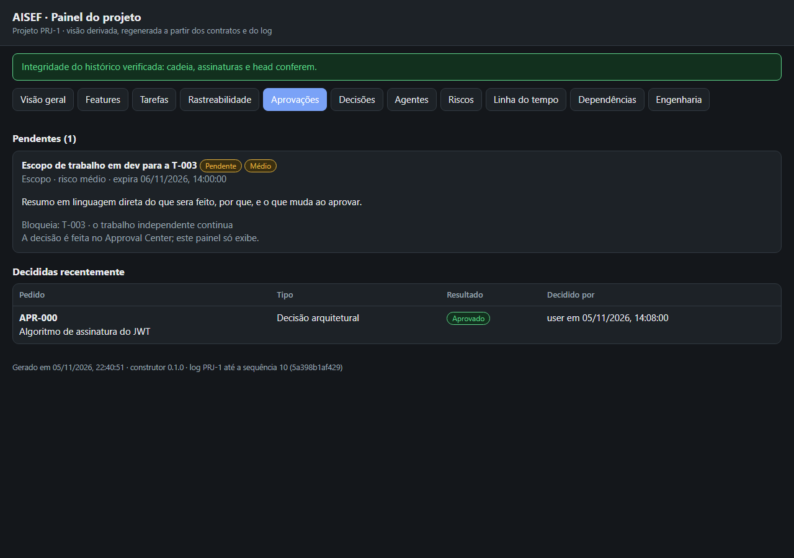
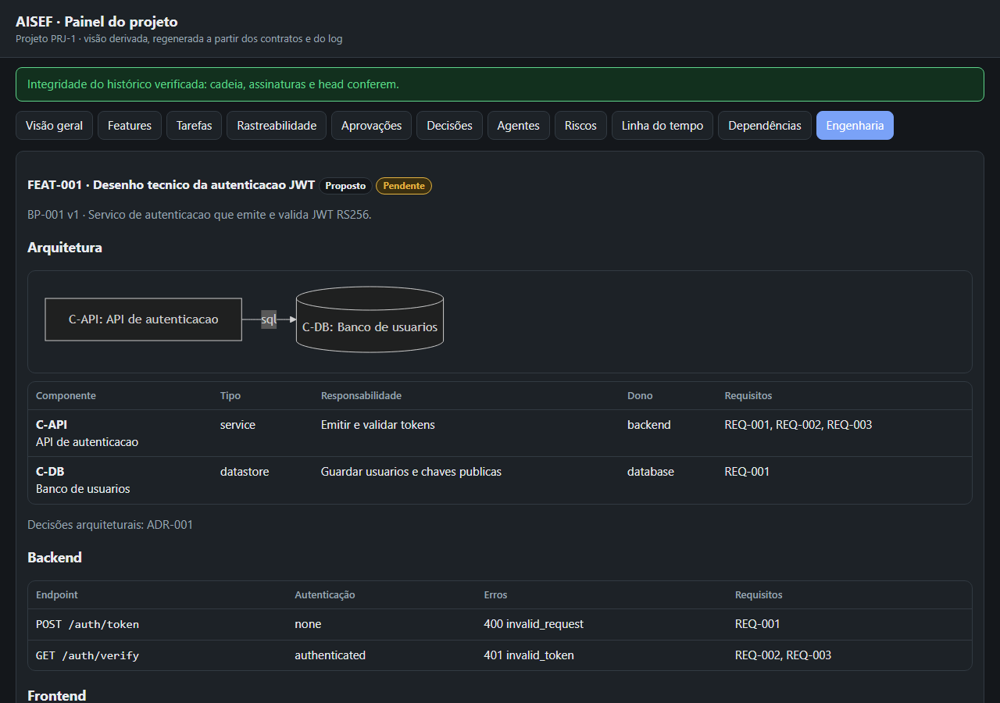

# Passo a passo

São duas partes. A primeira explora o projeto de demonstração, sem gastar tokens. A segunda mostra o fluxo real dentro do Claude Code.

## 1. Explorar o projeto de demonstração (5 minutos, sem modelo)

Com o repositório clonado e o venv criado (veja o README):

```
python -I plugins/aisef/core/make_demo_project.py /tmp/demo
python -I plugins/aisef/core/check_project.py --project /tmp/demo --policy plugins/aisef/core/permission-policy.v0.1.json --defaults plugins/aisef/core/orchestration-defaults.v0.1.json
python -I plugins/aisef/core/build_panel.py --project /tmp/demo --out /tmp/demo/panel --with-page
```

Depois abra `/tmp/demo/panel/index.html` no navegador. O demo traz uma feature (autenticação JWT) com:

- 3 tarefas;
- uma decisão arquitetural escolhida pelo usuário;
- um pedido de escopo pendente;
- um blueprint;
- um log assinado.

| Aprovações | Engenharia |
|---|---|
|  |  |

Para ver um exemplo de brief, que é o que o modelo escreve em vez de JSON completo:

```
python -I plugins/aisef/core/aisef_new.py example feature
python -I plugins/aisef/core/aisef_new.py example blueprint
```

## 2. O fluxo real no Claude Code

1. **Iniciar.** Na pasta do projeto, peça "iniciar o AISEF neste projeto". A `aisef-init`:
   - pergunta o identificador, o nome e o ambiente;
   - cria `.aisef/` e o log assinado;
   - mostra o teto de cada agente e pede sua aprovação para ativá-los;
   - propõe as regras nativas em `.claude/settings.json` e a seção do `AGENTS.md`.

   Tudo o que altera configuração abre o prompt nativo de permissão.
2. **Descobrir.** Num projeto existente, a `aisef-discovery` lê o código, as migrations e os docs antes de perguntar qualquer coisa. O resultado fica em `.aisef/discovery.md`.
3. **Especificar.** Peça a feature. O modelo escreve o brief e roda `aisef_new.py feature`. Você recebe o pedido de aprovação do plano.
4. **Aprovar.** A `aisef-approve` mostra impacto, riscos e rollback, e pergunta. Você aprova no prompt nativo. O contrato passa a `approved_for_execution` e as tarefas, a `ready`.
5. **Executar.** O orquestrador delega aos agentes dentro do escopo aprovado:
   - commit, push e merge pedem aprovação, cada um separadamente;
   - o validador, que não é quem executou, confere os critérios com evidências;
   - a `aisef-check` roda antes de cada mudança de estado.
6. **Aceitar.** A feature só fecha com o seu aceite. O aceite não autoriza Git.
7. **Mudanças pequenas.** Para um typo ou um ajuste trivial, o modelo usa `aisef_new.py quick`. Na primeira vez, você aprova o plano da `FEAT-MAINT` (manutenção contínua); depois disso, essas mudanças seguem sem cerimônia.

## Onde as coisas ficam

| Caminho | O que é |
|---|---|
| `.aisef/contracts/`, `blueprints/`, `reports/` | Contratos, desenho técnico e relatórios. Vale versionar. |
| `.aisef/approvals/`, `authorizations/` | Pedidos e decisões. Só você decide. |
| `.aisef/audit/` | O log, encadeado e assinado. Os segmentos antigos ficam em `archive/`. |
| `~/.aisef/keys/`, `heads/`, `anchors/` | Chave privada, head e âncoras, fora do repositório. |
